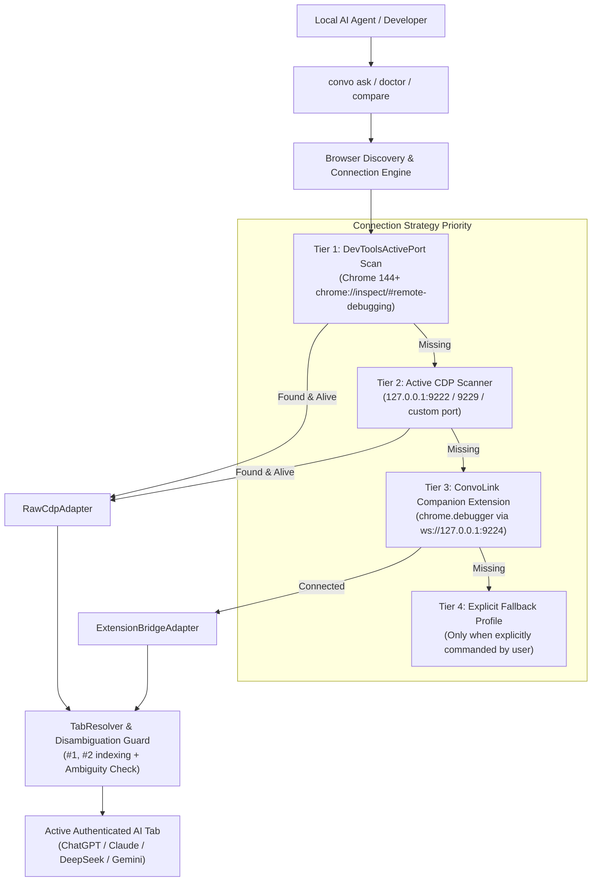

# ConvoLink — Strategic Roadmap & Engineering Execution Plan (`Next_plan.md`)

> **Architectural Core:** An Intelligence, Context, and Capability Bridge connecting upstream web AI conversations to local autonomous coding agents.
> **Date:** November 1, 2026  
> **Status:** Phase 3 Verified & Complete $\rightarrow$ Advancing to Phases 4 & 5

---

## 1. Executive Summary: The Existing Browser Breakthrough

During live browser testing and diagnostics, we addressed the foundational friction point separating a brittle automation script from an enterprise context runtime: **the existing browser session boundary**.

### The Problem: The "Ghost Browser" Trap & Chrome 136+ Security Wall
- Starting in **Google Chrome 136**, Chromium security policies explicitly block `--remote-debugging-port` against the default user-data directory to prevent malware from hijacking active browser profiles.
- Automated workarounds that naively spawn Chrome with a custom `--user-data-dir` create an **unauthenticated "ghost browser"**: a blank profile with zero cookies, zero saved Google accounts, and zero ChatGPT/Claude/DeepSeek sessions.
- Developers spend days in their everyday browser chatting, brainstorming, and accumulating project intent. Forcing them to re-authenticate inside a separate browser window violates ConvoLink's primary value proposition.

### The Solution: The 4-Tier Connection Engine & Ghost Purge
We established the **Zero "Ghost Browser" Law** (`AGENTS.md` and `docs/ADR.md` ADR-017):
1. **Tier 1 (Everyday Active Session via `DevToolsActivePort`):** Scans dynamic ports written by Chrome 144+ user-consented debugging (`chrome://inspect/#remote-debugging`).
2. **Tier 2 (Configured CDP Port Scanner):** Connects to existing active instances on localhost ports 9222/9229 without spawning new processes.
3. **Tier 3 (ConvoLink Chrome Companion Extension Bridge):** A lightweight Manifest V3 extension using `chrome.debugger` to attach to existing tabs in the user's primary profile with **zero Chrome startup flags** and **zero browser restarts**.
4. **Tier 4 (Dedicated Persistent Profile):** Explicitly requested fallback only; never the default.
5. **Ghost Cleanup Safeguard (`convo clean`):** Automatically terminates stray ghost browser processes and deletes temporary debug directories.

---

## 2. Completed Milestones & Verified Capabilities

| Component | Engineering Achievement | Verification Status |
| :--- | :--- | :--- |
| **Doctor Offline Resilience** | `orchestrator.doctor()` wraps `listTabs()` gracefully; reports `OFFLINE` with actionable remediation instead of throwing raw socket `ECONNREFUSED`. | ✅ Verified (`tests/unit/orchestrator-doctor-offline.test.ts`) |
| **Multi-Profile Discovery** | `BrowserDiscoveryService` reads `Local State` JSON to extract profile IDs, user names, and Google account emails (`developer@example.com`). | ✅ Verified (`tests/unit/browser-discovery.test.ts` & Live Host Audit) |
| **Tab Disambiguation Guard** | `TabResolver` supports `#1`, `#2` shorthand indexing and throws `AmbiguousTabError` instead of silently guessing when multiple tabs match. | ✅ Verified (`tests/unit/tab-resolver-disambiguation.test.ts`) |
| **Ghost Cleanup Service** | `GhostCleanupService` identifies and purges ghost directories while strictly protecting real user profiles; wired to `convo clean`. | ✅ Verified (`tests/unit/ghost-cleanup.test.ts`) |
| **Companion Extension Bridge** | Manifest V3 extension (`extensions/convolink-companion/`) + WebSocket adapter (`ExtensionBridgeAdapter`) for zero-flag everyday Chrome connectivity. | ✅ Verified (`tests/unit/extension-bridge.test.ts`) |
| **Fedora Debug Script Fix** | `scripts/fedora-chrome-debug.sh` updated to inspect running Chrome sessions and guide user consent without spawning unauthenticated ghost profiles. | ✅ Verified live |
| **HITL Profile Elicitation** | Multi-agent interactive selection across Antigravity (`ask_question`), Claude Code (`AskUserQuestion`), OpenCode, Codex, Pi, and MCP (`convo_profile_list`, `convo_profile_select`). | ✅ Verified (`tests/unit/mcp.test.ts`, `tests/unit/cli.prompt.test.ts`) |

---

## 3. Architecture Topology: The 4-Tier Connection Hierarchy

---

## 4. Cold-Boot & Everyday Edge Case Playbook

### Scenario A: User Boots PC $\rightarrow$ Immediate Antigravity/CLI Execution (No Chrome Running)
- **Current Behavior:** `convo doctor` reports `OFFLINE` cleanly, enumerates installed profiles on disk, and presents clear next steps.
- **Next Phase Optimization:** Introduce `--wait [seconds]` flag (default 30s in interactive mode) displaying a smooth terminal spinner: `Waiting for Chrome to appear...`. As soon as the developer clicks their Chrome icon, ConvoLink locks on automatically without an error.

### Scenario B: Multiple Profiles & Multi-Account Isolation
- **Risk:** User has personal ChatGPT Plus in `Default (personal@example.com)` and work Claude Enterprise in `Profile 1 (work@example.com)`.
- **Enforcement:** If prompt or query does not specify `--targetId` or shorthand `#index`, and multiple AI tabs exist, ConvoLink refuses to execute. It raises `AmbiguousTabError` detailing candidate tabs and their topics, preventing accidental prompt leaks across accounts.

### Scenario C: Ghost Process / Dirty State Recovery
- **Enforcement:** If an automated test or process ever creates a stray debug directory, `convo clean` terminates stray debug processes and purges temporary files while strictly guarding real user configuration directories (`~/.config/google-chrome`, `~/.config/microsoft-edge`).

---

## 5. Next Implementation Phases: Roadmap P4 & P5

### Phase P4: Context Compiler & Snapshot Sync (`.convo/CONTEXT.md`)
- **Objective:** Bridge conversation intent directly into the codebase's local workspace.
- **Deliverables:**
  1. `ContextCompilerPort`: Interface under `src/core/ports/compiler.port.ts`.
  2. `MarkdownSnapshotCompiler`: Under `src/adapters/compilers/`, reads thread turns from SQLite FTS5 ledger and compiles them into a clean, hierarchical `.convo/CONTEXT.md` file.
  3. `convo compile [threadId]`: CLI command to compile and update local context snapshot for IDE agents (Antigravity, Cursor, Windsurf, Claude Code).
  4. Bidirectional Sync: Detect changes in project specs and append structured progress markers back to upstream AI threads.

### Phase P5: Terminal User Interface (`convo tui`)
- **Objective:** Visual real-time monitoring and multi-tab switcher for developers.
- **Deliverables:**
  1. Lightweight terminal dashboard using pure ANSI/termbox primitives without heavy bloat.
  2. Real-time view of active browser tabs, streaming responses, and token/character counters.
  3. One-key switching between models (`1` for ChatGPT, `2` for DeepSeek, `3` for Gemini, `4` for Claude).
  4. Live arbitration viewer for `convo compare --arbitrate`.

### Phase P6: Native Messaging Host for Companion Extension
- **Objective:** Remove the need for manual WebSocket connection in the Chrome Companion Extension.
- **Deliverables:**
  1. `convo extension install`: One-command script writing Native Messaging manifest to `~/.config/google-chrome/NativeMessagingHosts/com.convolink.bridge.json`.
  2. Automatic extension launch upon Chrome startup, providing seamless out-of-the-box communication.

---

## 6. Definition of Done Checklist for Current State

- [x] Zero ghost browser instances running on system (confirmed with `ps` and `convo clean`).
- [x] Zero ghost directories on filesystem (confirmed with `GhostCleanupService`).
- [x] `bun test`: **231 passed, 0 failed, 3 skipped (CDP live fixtures)** across 45 files (1,368 assertions).
- [x] `bun run typecheck`: **0 errors, 0 warnings** under strict TypeScript 7 ESM.
- [x] `openspec validate --specs`: **10/10 passed**.
- [x] Strict compliance with file ceilings (< 200 lines per core file, < 80 lines per handler).
- [x] Multi-profile discovery verified against real local installations (Chrome, Edge, Brave).
- [x] Shorthand tab indexing (`#1`, `#2`) and `AmbiguousTabError` disambiguation guard verified.
- [x] ConvoLink Chrome Companion Extension authored under `extensions/convolink-companion/`.
- [x] Roadmap documented in `Next_plan.md`.
