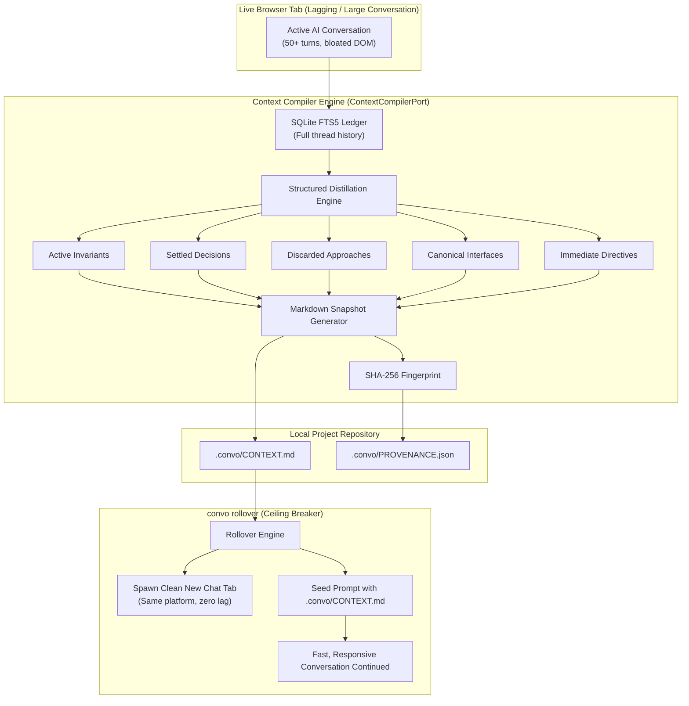
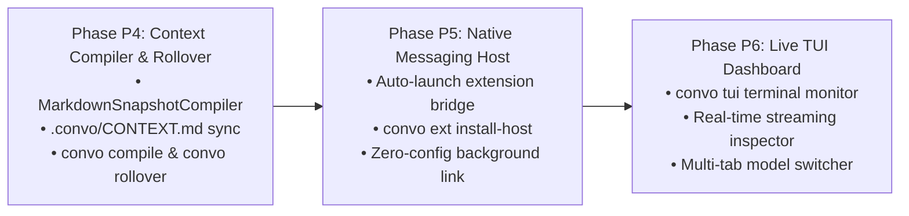

# ConvoLink — Strategic Roadmap & Engineering Execution Plan (`Next_plan.md`)

> **Architectural Core:** An Intelligence, Context, and Capability Bridge connecting upstream web AI conversations to local autonomous coding agents.  
> **Date:** November 1, 2026  
> **Status:** Phases 1–3 Complete & Verified $\rightarrow$ **Target Phase: Phase 4 (Context Compiler, Snapshot Sync, & Tab Rollover Engine)**

---

## 1. Executive Summary & Current State of the System

ConvoLink provides a zero-friction bridge connecting local autonomous coding agents (Antigravity, Claude Code, Cursor, OpenCode) with real, authenticated browser sessions (ChatGPT, Claude, DeepSeek, Gemini).

### Achievements in Phases 1, 2, and 3:
1. **Zero "Ghost Browser" Guarantee:** Eliminated unauthenticated blank browser profiles. ConvoLink connects directly to the developer's everyday browser profile via user-consented dynamic CDP ports or our Companion Extension Bridge.
2. **Cross-Browser Companion Extension (Chrome + Firefox MV3):** Authored in strict TypeScript/Bun under `extensions/convolink-companion/`, featuring dynamic manifest generation, non-blocking cryptographic pairing (`convo ext pair`), and content scripts for real-time DOM interaction with upstream AI web clients.
3. **Automated Packaging & Release Automation (`v1.0.0` Live):**
   - Packaged and published official `v1.0.0` release on GitHub: [https://github.com/0xTanzim/convolink/releases/tag/v1.0.0](https://github.com/0xTanzim/convolink/releases/tag/v1.0.0)
   - Full automated CI/CD pipeline (`.github/workflows/extension-release.yml`) with automated version bumping, `bun test` verification, typechecking, and multi-browser ZIP artifact distribution.
4. **Ironclad Test Suite:** **286 tests passing 100%** (0 failures, 1,555 assertions) with zero TypeScript typecheck errors.

---

## 2. Completed Milestones & Verification Ledger

| Component | Engineering Achievement | Status | Verification Reference |
| :--- | :--- | :---: | :--- |
| **Doctor Offline Resilience** | `orchestrator.doctor()` wraps `listTabs()` gracefully; reports `OFFLINE` with actionable remediation instead of throwing raw socket `ECONNREFUSED`. | ✅ Done | `tests/unit/orchestrator-doctor-offline.test.ts` |
| **Multi-Profile Discovery** | `BrowserDiscoveryService` reads `Local State` JSON to extract profile IDs, user names, and Google account emails (`developer@example.com`). | ✅ Done | `tests/unit/browser-discovery.test.ts` |
| **Tab Disambiguation Guard** | `TabResolver` supports `#1`, `#2` shorthand indexing and throws `AmbiguousTabError` instead of silently guessing when multiple tabs match. | ✅ Done | `tests/unit/tab-resolver-disambiguation.test.ts` |
| **Ghost Cleanup Service** | `GhostCleanupService` identifies and purges ghost directories while strictly protecting real user profiles; wired to `convo clean`. | ✅ Done | `tests/unit/ghost-cleanup.test.ts` |
| **Companion Extension Core** | Manifest V3 extension (`extensions/convolink-companion/`) + WebSocket adapter (`ExtensionBridgeAdapter`) for zero-flag everyday Chrome connectivity. | ✅ Done | `tests/unit/extension-bridge.test.ts` |
| **Cross-Browser MV3 Packaging** | `scripts/build-extension.ts` generates clean unpacked trees and ZIP archives for both Chromium and Firefox MV3 with Gecko settings. | ✅ Done | `tests/unit/build-extension.test.ts` |
| **Cryptographic Pairing Auth** | `BridgeTokenService` generates and rotates non-blocking HMAC tokens; `convo ext pair` manages pairing secrets securely. | ✅ Done | `tests/unit/bridge-token.test.ts` & `tests/unit/cli.ext.test.ts` |
| **HITL Profile Elicitation** | Multi-agent interactive selection across Antigravity (`ask_question`), Claude Code (`AskUserQuestion`), OpenCode, and MCP tools. | ✅ Done | `tests/unit/mcp.test.ts` & `tests/unit/cli.prompt.test.ts` |
| **Release Management CLI** | `scripts/release.ts` automates semantic version bumping (`patch`, `minor`, `major`), workspace syncing, git tagging, and GitHub release creation. | ✅ Done | `tests/unit/release.test.ts` |
| **Docker Clean-Room CI** | Full CI workflow verified inside isolated `node:24-bookworm` container with SELinux `:z` mount. | ✅ Done | Container test run log |
| **GitHub Actions Pipeline** | Complete workflow (`extension-release.yml`) builds, tests, typechecks, and uploads all ZIP artifacts. | ✅ Done | GitHub Run ID: `41275404532` |
| **Official `v1.0.0` Release** | Published on GitHub Releases with 4 attached ZIP assets for Chrome and Firefox. | ✅ Done | GitHub Tag: `v1.0.0` |

---

## 3. The Next Target: Phase P4 — Context Compiler, Snapshot Sync & Tab Rollover Engine

### The Problem We Are Solving:
1. **The Browser Lag & Hang Bug:** When conversations grow large (50+ turns, extensive code blocks, canvas modifications), web AI apps (ChatGPT, Claude, DeepSeek) experience heavy DOM lag, memory bloat, and occasional renderer crashes.
2. **Context Window Degradation:** Upstream models start forgetting early instructions or hallucinating on truncated context windows.
3. **Disconnected Local Workspace:** Upstream architectural decisions and invariants remain trapped inside the browser tab instead of being available locally in `.convo/CONTEXT.md` for coding agents.

### The Solution: The Context Compiler & Tab Rollover Engine



---

## 4. Phase P4 Detailed Deliverables & Architecture

### Deliverable 4.1: `MarkdownSnapshotCompiler` Adapter
- **Location:** `src/adapters/compilers/markdown-snapshot-compiler.adapter.ts`
- **Implements:** `ContextCompilerPort` (`src/core/ports/compiler.port.ts`).
- **Capabilities:**
  - Parses conversation turns into structured architectural sections:
    - **Active Invariants:** Non-negotiable architectural constraints and technical rules.
    - **Settled Decisions:** Architectural agreements, library choices, protocol decisions.
    - **Discarded Approaches:** What was tried and rejected (and why), preventing loops.
    - **Canonical Code Interfaces:** Essential TypeScript interfaces, types, and signatures.
    - **Immediate Directives:** The active next steps to resume without hesitation.
  - Computes deterministic SHA-256 hash of the generated markdown body.
  - If content hash is unchanged, skips file writes to prevent cache invalidation.

### Deliverable 4.2: Context Sync Service (`ContextSyncService`)
- **Location:** `src/core/services/context-sync.service.ts`
- **Capabilities:**
  - Connects `ThreadStore` (or active browser session) to `MarkdownSnapshotCompiler`.
  - Persists `.convo/CONTEXT.md` and `.convo/PROVENANCE.json` to the current workspace via `WorkspaceFileSinkAdapter`.
  - Records metadata: `sourceThreadId`, `platform`, `turnRange`, `packetHash`, and `compiledAt`.

### Deliverable 4.3: CLI Commands (`convo compile` & `convo sync`)
- **Command:** `convo compile [threadId]`
  - Compiles the specified thread (or active tab thread) and displays the compiled packet preview in the terminal.
- **Command:** `convo sync [--tab=<id>] [--force]`
  - Reads active tab turns, persists them to SQLite ledger, and writes `.convo/CONTEXT.md` and `.convo/PROVENANCE.json` to the workspace.

### Deliverable 4.4: The Ceiling Breaker: `convo rollover`
- **Command:** `convo rollover [--tab=<id>] [--target=<platform>]`
- **Flow:**
  1. Identifies the active bloated tab and reads all turns up to the current state.
  2. Runs `ContextSyncService` to compile the session into `.convo/CONTEXT.md`.
  3. Opens a fresh new chat tab on the same platform via `PlatformDriver.triggerNewChat()` or URL navigation.
  4. Automatically injects a structured rehydration prompt:
     ```text
     [CONVOLINK CONTINUATION CONTEXT]
     The following is a compiled architectural snapshot of our conversation up to this point.
     All settled decisions and invariants remain active. Let us continue from the immediate directive.

     <CONTEXT.md contents>
     ```
  5. Updates `.convo/config.json` with the new `activeThreadId`.
  6. **Result:** Browser lag drops to zero, token limits are reset, and the developer/agent continues seamlessly.

---

## 5. Implementation Roadmap (Phases P4 $\rightarrow$ P5 $\rightarrow$ P6)



### Phase P5: Native Messaging Host (`convo ext install-host`)
- Automatic stdio host manifest registered in Chrome/Firefox config directories.
- Allows companion extension to communicate with ConvoLink without requiring the developer to keep a terminal command running.

### Phase P6: Terminal User Interface (`convo tui`)
- Compact, high-speed terminal dashboard (pure ANSI).
- Displays active tabs across ChatGPT, Claude, DeepSeek, and Gemini in real-time.
- One-key model switching and live stream inspector.

---

## 6. Definition of Done for Phase P4

- [ ] **TDD Iron Law:** Every compiler and rollover function preceded by a failing automated test in `tests/unit/`.
- [ ] **`MarkdownSnapshotCompiler`:** Implements `ContextCompilerPort` with deterministic SHA-256 hashing.
- [ ] **Artifact Generation:** Produces clean `.convo/CONTEXT.md` and `.convo/PROVENANCE.json` files.
- [ ] **CLI Commands:** `convo compile`, `convo sync`, and `convo rollover` fully functional and verified via E2E tests.
- [ ] **Browser Lag Elimination:** Rollover workflow verified to transfer state to a fresh tab with zero context loss.
- [ ] **Quality Gates:** 100% tests passing (`bun test`), 0 type errors (`bun run typecheck`), all files under line ceilings.
