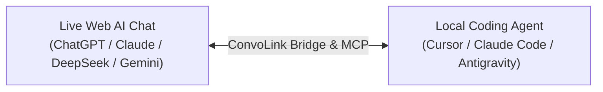

<h1 align="center">ConvoLink</h1>

<p align="center">
  <strong>Your AI architect and coding agent, finally connected.</strong>
  <br />
  Your browser holds the research and decisions. Your coding agent has the tools to act on them.
  ConvoLink connects both sides, so context and generated work can move with you.
</p>

<p align="center">
  <a href="#quickstart"><strong>Get started →</strong></a> ·
  <a href="#use-cases">Explore use cases</a> ·
  <a href="#three-pillars">See the three pillars</a> ·
  <a href="#browser-support">Browser setup</a> ·
  <a href="#integrations">Connect an agent</a> ·
  <a href="#tool-reference">CLI &amp; MCP tools</a> ·
  <a href="https://0xtanzim.github.io/convolink/">Documentation</a>
</p>

<p align="center">
  <a href="https://www.npmjs.com/package/convolink"></a>
  <a href="https://www.npmjs.com/package/convolink"></a>
  <a href="https://github.com/0xTanzim/convolink/actions/workflows/ci.yml"></a>
  <a href="https://github.com/0xTanzim/convolink/releases"></a>
  <a href="LICENSE"></a>
  <a href="https://bun.sh"></a>
  <a href="https://www.typescriptlang.org"></a>
</p>

---

## Why ConvoLink? The context-relay problem

When building software with AI today, developers work in two disconnected worlds:

```text
┌──────────────────────────────────────────────┐       ┌──────────────────────────────────────────────┐
│       The Architectural Brain (Web AI)       │       │           The Coding Hands (IDE)             │
├──────────────────────────────────────────────┤       ├──────────────────────────────────────────────┤
│ ChatGPT Plus, Claude Pro, DeepSeek, Gemini   │       │ Cursor, Claude Code, Antigravity, Shell      │
│ • Holds days of accumulated research & ADRs  │       │ • Great at editing files & running tests     │
│ • State machines, schemas, security rules    │       │ • But starts with TOTAL AMNESIA              │
│ • Rejected trade-offs and domain invariants  │       │ • Blind to your web AI research & masterplan │
└──────────────────────────────────────────────┘       └──────────────────────────────────────────────┘
                       ▲                                                       ▲
                       │                                                       │
                       └────────────────── [ THE DEVELOPER ] ──────────────────┘
                                         (Manual Context Courier)
                          Copies agent doubts & logs to browser →
                          Waits for web AI to formulate specs & invariants →
                          Copies architectural direction back to IDE...
```

### Why Disconnected Agents Fail

1. **Architectural Amnesia:** When you open Cursor or Claude Code, the agent has zero connection to your upstream web research. When it hits an architectural boundary, you must manually copy its questions to the browser, wait for the web AI to specify the data model or flow, and copy the specifications back to your IDE.
2. **Architectural Drift:** If you step away or miss relaying a doubt, the local agent makes assumptions, drifts from your agreed masterplan, and writes conflicting code.
3. **The Intelligence Bottleneck:** Local agents running smaller or cost-effective models struggle with complex concurrency, distributed systems, or difficult debugging. But metered API tokens for frontier models are expensive.

**Why should your IDE agent be trapped in isolation when you already subscribe to world-class reasoning, live web search, and deep research in your browser?**

---

<a id="three-pillars"></a>

## How ConvoLink connects your tools

ConvoLink bridges your IDE agents directly to your live browser tabs across **Three Core Product Pillars**:



### 1. Context Bridge

Streams architectural specifications, state invariants, data schemas, and design trade-offs directly into local agents on demand, while symmetrically reporting milestone progress and discovered constraints back upstream to the web AI conversation.

### 2. Intelligence Bridge

Allows local coding agents running smaller or cost-effective models to delegate complex algorithmic reasoning, tricky debugging, and architectural judgment to powerful frontier web models.

### 3. Capability Bridge

Allows local agents to borrow upstream web capabilities—**extended thinking (DeepSeek v4.1 Flash, GPT-6 Asta, Claude Opus 5.5)**, **live web search grounding**, **deep research**, and **multi-model cross-validation**—using your existing authenticated web subscriptions with zero per-token API charges.

---

### Upstream capability matrix

| Upstream Web AI Capability | What Your Local Coding Agent Gains |
| :--- | :--- |
| **Living Architectural Context** | Direct access to 1-2 days of accumulated R&D, ADRs, rejected trade-offs, and masterplan specifications without manual copy-pasting. |
| **Extended Thinking / Deep Reasoning** | Thorough, multi-step analysis of difficult concurrency race conditions, algorithmic bottlenecks, and formal invariants (`--think`). |
| **Live Web Search Grounding** | Real-time web intelligence: latest library releases, breaking changes, deprecation notices, and official migration guides. |
| **Multi-Model Consensus & Arbitration** | Cross-validates high-risk architectural decisions across Claude, ChatGPT, DeepSeek, and Gemini in parallel with Stage 2 Arbiter synthesis (`convo compare --arbitrate`). |
| **Automated Code Artifact Extraction** | When the upstream architect outputs production files with `// filepath:`, ConvoLink writes them directly into your repo (`-w`). |

---

<a id="quickstart"></a>

## Quickstart

### 1. Install ConvoLink

You need [Bun 1.4 or newer](https://bun.sh). Choose how you want to install it:

#### Run without a global install

Use `bunx` to run a command on demand. Nothing is added to your global command path:

```bash
bunx -y convolink@latest doctor
```

Use the same form for other commands, for example `bunx -y convolink@latest ask --platform chatgpt "..."`.

#### Install globally with Bun

```bash
bun add -g convolink
```

Global installation adds the `convo` command. Verify the install with `convo --help`, then
connect a browser and run `convo doctor`.

#### One-Line Universal Installers

Use these when you want the `convo` wrapper installed in your user directory:

**Linux and macOS**

```bash
curl -fsSL https://raw.githubusercontent.com/0xTanzim/convolink/main/scripts/install.sh | bash
```

**Windows (PowerShell)**

```powershell
irm https://raw.githubusercontent.com/0xTanzim/convolink/main/scripts/install.ps1 | iex
```

<details>
<summary><strong>Use another package manager</strong></summary>

```bash
pnpm add -g convolink
```

</details>

<details>
<summary><strong>What the universal installer does</strong></summary>

- Adds a lightweight command wrapper at `~/.local/bin/convo` on Linux/macOS or `%LOCALAPPDATA%\convolink\bin\convo.cmd` on Windows.
- Runs the latest published package through `bunx` or `npx`, so the command wrapper does not need manual upgrades.
- Does not require root or administrator privileges, start a persistent service, or modify browser profiles.
- Checks whether its install location is on your `PATH` and explains how to add it for Bash, Zsh, or Fish when needed.

</details>

### 2. Connect your browser

Choose the transport that fits your browser and profile:

> **Choose the path that matches your browser:**
>
> - **Chrome, Brave, Edge, or Chromium with your everyday profile:** use the Companion Extension (Path A).
> - **Firefox or Zen:** use native BiDi; no extension is required. The Companion Extension is also available if you prefer it.
> - **Dedicated Chromium profile, headless browser, or CI:** use CDP (Path B) with a dedicated `--user-data-dir`.

#### Path A: Companion Extension (recommended for Chrome and Chromium)

For Chrome 136 and newer, remote debugging requires a non-default user data directory. The
extension lets ConvoLink use your everyday signed-in Chrome, Brave, Edge, or Chromium profile
without changing its launch flags or restarting it.

Firefox and Zen can also load the extension, but their native BiDi connection is already
supported; use the extension there only if you prefer that transport.

1. Download and extract the latest browser-specific extension ZIP from [GitHub Releases](https://github.com/0xTanzim/convolink/releases/latest):
   - **Chrome / Brave / Edge:** choose the Chrome build.
   - **Firefox / Zen Browser:** choose the Firefox build.
2. Open `chrome://extensions/` (Chrome/Brave/Edge) or `about:debugging#/runtime/this-firefox` (Firefox/Zen Browser), then load the extracted extension:
   - **Chrome / Brave / Edge:** Enable Developer mode, choose **Load unpacked**, and select the extracted Chrome extension folder.
   - **Firefox / Zen Browser:** Choose **Load Temporary Add-on...** and select `manifest.json` inside the extracted Firefox package.
3. Pair the extension with your local runtime:

   ```bash
   convo ext pair          # prints the token and the exact folder Chrome must load
   convo daemon start      # keeps the bridge alive on port 9224
   convo ext status        # client, profile, build id, tab count
   ```

4. Confirm the transport works before scripting anything:

   ```bash
   convo ask -p chatgpt --transport extension-bridge "Reply with the single word: ready"
   ```

The extension exposes a **fixed operation set** (probe, read, fill, click, key, navigate).
Arbitrary JavaScript evaluation is not available through the extension; unsupported probes
return `extension-unsupported`.

<details>
<summary><strong>Build and load the extension from source</strong></summary>

```bash
bun run build:extension
```

Load `extensions/convolink-companion/.output/chrome-mv3` in Chrome, Brave, or Edge. For
Firefox or Zen, load `extensions/convolink-companion/.output/firefox-mv3/manifest.json`.

</details>

<details>
<summary><b>What the extension refuses to do (by design)</b></summary>

| Refused | Reason |
|---|---|
| Close a tab you opened | Reports `not-owned` (exit 4). Automation must not destroy your work. |
| Evaluate arbitrary JavaScript | MV3 CSP; the extension maps known probes to typed operations instead. |
| Screenshot without permission | `captureVisibleTab` needs `<all_urls>` or a user gesture; otherwise `unsupported`. |
| Silently drive the wrong browser | Every command is bound to a specific target id. |

</details>

#### Firefox and Zen: native BiDi (no extension required)

ConvoLink can start Firefox or Zen with WebDriver BiDi enabled while reusing the profile
already saved on your machine. Your existing browser logins stay in that profile.

```bash
convo connect --firefox
# Or:
convo connect --zen
```

If Firefox or Zen is already open without BiDi enabled, close it normally and run the command
again. The Companion Extension is an optional alternative for these browsers.

#### Path B: CDP for a dedicated Chromium profile

Use this path for automation, headless runs, or a separate browser profile. On Chrome 136+
remote debugging requires `--user-data-dir` to point to a non-default directory. This keeps
the debug session separate from your everyday browser profile. Use the same directory on
later launches to retain that profile's logins.

The CDP port is `9222`; the Companion Extension bridge uses `9224`.
Each command below creates or reuses a separate profile directory. Sign in to your AI sites
in that profile once; those logins persist there between launches.

<details>
<summary><b>🐧 Fedora & RHEL / CentOS Linux</b></summary>

```bash
# Launch Chrome with an isolated CDP profile
google-chrome \
  --remote-debugging-port=9222 \
  --user-data-dir="$HOME/.config/convolink/profiles/chrome-cdp" &
```

</details>

<details>
<summary><b>🐧 Ubuntu, Debian, Linux Mint & Pop!_OS</b></summary>

```bash
# Standard APT Google Chrome
google-chrome \
  --remote-debugging-port=9222 \
  --user-data-dir="$HOME/.config/convolink/profiles/chrome-cdp" &

# Chromium (APT or Snap)
chromium-browser \
  --remote-debugging-port=9222 \
  --user-data-dir="$HOME/.config/convolink/profiles/chromium-cdp" &
```

*Note for Snap/Flatpak users: ConvoLink automatically discovers sandboxed binaries at `/snap/bin/` and `/var/lib/flatpak/exports/bin/`.*

</details>

<details>
<summary><b>🏹 Arch Linux & Manjaro</b></summary>

```bash
# Google Chrome (AUR) or Chromium (official repo)
google-chrome-stable \
  --remote-debugging-port=9222 \
  --user-data-dir="$HOME/.config/convolink/profiles/chrome-cdp" &
# or
chromium \
  --remote-debugging-port=9222 \
  --user-data-dir="$HOME/.config/convolink/profiles/chromium-cdp" &
```

</details>

<details>
<summary><b>🏔️ Alpine Linux (musl libc / Docker)</b></summary>

```bash
# Install Chromium
apk add chromium

# Launch with container-safe flags
chromium-browser \
  --remote-debugging-port=9222 \
  --user-data-dir="$HOME/.config/convolink/profiles/chromium-cdp" \
  --headless=new --disable-gpu --disable-dev-shm-usage --no-sandbox &
```

</details>

<details>
<summary><b>🦾 Linux ARM64 (Raspberry Pi, Asahi Linux, Ampere Cloud VMs)</b></summary>

Official Google Chrome `.deb`/`.rpm` is x86_64 only. On ARM64 Linux, ConvoLink automatically prioritizes native Chromium:

```bash
# Install native ARM64 Chromium
sudo apt install chromium-browser # (Debian/Ubuntu)
# or: sudo dnf install chromium     # (Fedora)

chromium-browser \
  --remote-debugging-port=9222 \
  --user-data-dir="$HOME/.config/convolink/profiles/chromium-cdp" &
```

</details>

<details>
<summary><b>🍎 macOS (Apple Silicon M1/M2/M3/M4 & Intel)</b></summary>

```bash
# Launch Google Chrome with remote debugging
"/Applications/Google Chrome.app/Contents/MacOS/Google Chrome" \
  --remote-debugging-port=9222 \
  --user-data-dir="$HOME/Library/Application Support/ConvoLink/Chrome-CDP" &

# Or launch Brave
"/Applications/Brave Browser.app/Contents/MacOS/Brave Browser" \
  --remote-debugging-port=9222 \
  --user-data-dir="$HOME/Library/Application Support/ConvoLink/Brave-CDP" &

# Or launch Microsoft Edge
"/Applications/Microsoft Edge.app/Contents/MacOS/Microsoft Edge" \
  --remote-debugging-port=9222 \
  --user-data-dir="$HOME/Library/Application Support/ConvoLink/Edge-CDP" &
```

</details>

<details>
<summary><b>🪟 Windows Native (PowerShell / Command Prompt)</b></summary>

```powershell
# Launch Google Chrome with an isolated CDP profile
$profilePath = Join-Path $env:LOCALAPPDATA "ConvoLink\Chrome-CDP"
Start-Process "chrome.exe" -ArgumentList `
  "--remote-debugging-port=9222", `
  "--user-data-dir=`"$profilePath`""

# Or use ConvoLink debug probe
powershell -File .\scripts\convo-debug.ps1
```

</details>

<details>
<summary><b>🌉 Windows Subsystem for Linux (WSL2) Cross-Boundary Bridging</b></summary>

ConvoLink running inside WSL2 connects directly to your Windows host Chrome session!

1. **On Windows Host:** Launch Chrome with remote debugging:

   ```powershell
   $profilePath = Join-Path $env:LOCALAPPDATA "ConvoLink\Chrome-CDP"
   Start-Process "chrome.exe" -ArgumentList `
     "--remote-debugging-port=9222", `
     "--user-data-dir=`"$profilePath`""
   ```

2. **On Windows Host (One-Time Setup):** Allow port 9222 across the WSL2 vEthernet adapter in Administrator PowerShell:

   ```powershell
   # 1-Click setup via ConvoLink helper
   powershell -File .\scripts\convo-debug.ps1 -ConfigureWslBridge

   # Or manually:
   netsh interface portproxy add v4tov4 listenport=9222 listenaddress=0.0.0.0 connectport=9222 connectaddress=127.0.0.1
   New-NetFirewallRule -DisplayName "WSL Chrome CDP" -Direction Inbound -Protocol TCP -LocalPort 9222 -Action Allow
   ```

3. **Inside WSL2:** ConvoLink automatically probes `127.0.0.1` and falls back to your Windows default gateway (`ip route show default`):

   ```bash
   convo doctor
   ```

</details>

<details>
<summary><b>☁️ Cloud MicroVMs & Headless CI/CD Containers</b></summary>

For CI or a headless container, use an isolated data directory and the container-safe flags:

```bash
google-chrome \
  --remote-debugging-port=9222 \
  --user-data-dir="$HOME/.config/convolink/profiles/chrome-cdp" \
  --headless=new --disable-gpu --disable-dev-shm-usage --no-sandbox &

convo doctor
```

</details>

**Dedicated persistent AI profile:** To keep a separate automation profile and its logins across reboots, launch Chrome with a dedicated user data directory:

```bash
google-chrome \
  --remote-debugging-port=9222 \
  --user-data-dir="$HOME/.config/convolink/profiles/ai-profile" &
```

#### Choose a transport

| Browser setup | Companion Extension | Firefox / Zen BiDi | Chromium CDP |
| :--- | :--- | :--- | :--- |
| Everyday signed-in profile | **Recommended for Chromium** | **Native option** | Dedicated profile only |
| How to start | Pair the extension; no browser flags | `convo connect --firefox` or `--zen` | Launch with `--remote-debugging-port` and `--user-data-dir` |
| Port | `9224` | `9223` | `9222` |
| Arbitrary JavaScript | Fixed operation set | Supported by BiDi | Supported by CDP |
| Best for | Everyday Chrome, Brave, Edge, and Chromium | Everyday Firefox and Zen profiles | Dedicated profiles, headless, and CI |

### 3. Verify the connection (`convo doctor`)

Run the check:

```bash
convo doctor
```

Example result for a Chromium CDP connection:

```text
🔍 Running ConvoLink Doctor...
[CDP Transport] Status: ONLINE (Latency: 1ms)
[Tabs] Found 4 supported AI tab(s):
  • [CHATGPT] Architecture Discussion - ChatGPT (TargetId: A16BE3...) ✅ READY
  • [CLAUDE] Concurrency Refactoring - Claude (TargetId: 44F12A...) ✅ READY
  • [DEEPSEEK] Algorithmic Optimization - DeepSeek (TargetId: 713AD6...) ✅ READY
  • [GEMINI] Cloud Deployment Strategy - Gemini (TargetId: 837BDC...) ✅ READY
```

### 4. Ask your first question

Once `convo doctor` finds a ready tab, send a prompt from your terminal:

```bash
convo ask --platform chatgpt "Explain the architecture of this project."
```

---


<a id="browser-support"></a>

## Browser setup and support

Run `convo setup` once per project. It lists the browsers and profiles it can see,
lets you pick with arrow keys, mouse, or by typing, verifies the choice against the
real session, and writes `.convo/config.json`. Later commands reuse it; no flags
and no guessing.

```bash
convo setup                # interactive: browser -> profile -> verify -> save
convo setup --show         # what is configured, and where each value came from
convo setup --browser=zen --profile=/home/you/.zen/abc.default  # non-interactive (agents)
convo setup --reset        # forget the selection
```

| Browser | Recommended transport | Profile behavior |
| :--- | :--- | :--- |
| Chrome | Companion Extension for your everyday profile; CDP for a dedicated profile | Chrome 136+ requires CDP to use a non-default `--user-data-dir`. |
| Brave, Edge, Chromium | Companion Extension for your everyday profile; CDP for a dedicated profile | ConvoLink refuses CDP against the detected default profile. |
| Firefox | Native BiDi with `convo connect --firefox`; extension is optional | Uses the Firefox profile saved on your machine. Close Firefox normally first if it is open without BiDi. |
| Zen | Native BiDi with `convo connect --zen`; extension is optional | Uses the Zen profile saved on your machine. Close Zen normally first if it is open without BiDi. |

For Chrome 136+, the remote-debugging switches are ignored for the default data directory;
Chrome requires `--user-data-dir` to point to a non-default directory. [Chrome for Developers explains the change](https://developer.chrome.com/blog/remote-debugging-port).

<a id="use-cases"></a>

## The four core workflows

### 1. Bring architectural context into implementation

Query the upstream conversation for specifications and state invariants:

```bash
convo ask --platform claude \
  "We are ready to implement Milestone 2. Provide the transition table, invariant list, and error codes we decided on during research."
```

### 2. Resolve questions and report progress

Sync local agent findings and resolve technical forks directly with the upstream architect:

```bash
convo ask --platform chatgpt \
  "Milestone 1 is complete. During implementation of the lock service, we noticed potential contention under high write volume. Should we invalidate stale leases immediately or let the 180s TTL expire?"
```

### 3. Compare models and arbitrate (`convo compare`)

Broadcast proposals across multiple models in parallel with Stage 2 Technical Arbiter synthesis:

```bash
convo compare \
  "Evaluate trade-offs between distributed SQLite (Litestream/LiteFS) vs PostgreSQL for a multi-tenant event ledger. Identify single points of failure." \
  --platforms chatgpt,claude,deepseek,gemini \
  --arbitrate \
  --arbiter deepseek \
  --out-dir ./comparison-results
```

### 4. Search past decisions (`convo search`)

Search through all past turns and code blocks captured in the local **SQLite FTS5 ledger**:

```bash
convo search "JWT refresh token rotation invariants" --limit 5
```

---

<a id="integrations"></a>

## Connect your AI coding agent

ConvoLink exposes an MCP server over `stdio` for coding agents. Use the `bunx` command if
you do not want a global install, or use `convo` after installing the CLI. The Companion
Extension uses the local daemon to connect the server to your browser.

### Start the MCP server

#### Without a global install

```json
{
  "mcpServers": {
    "convolink": {
      "command": "bunx",
      "args": ["-y", "convolink@latest", "mcp"]
    }
  }
}
```

#### With a global install

```json
{
  "mcpServers": {
    "convolink": {
      "command": "convo",
      "args": ["mcp"]
    }
  }
}
```

Add `--idle-timeout=15m` to the arguments before `mcp` if you want to change the default
idle shutdown time.

### Harness configuration

| AI Coding Harness | Primary Configuration File | Registration / CLI Command |
| :--- | :--- | :--- |
| **Google Antigravity** | `~/.gemini/config/mcp_config.json`<br/>*(or `.agents/mcp_config.json`)* | Side Panel > `...` > **MCP Servers** |
| **OpenAI Codex** | `~/.codex/config.toml` | `codex mcp add convolink -- bunx -y convolink@latest mcp` |
| **Anthropic Claude Code** | `.claude/mcp.json` | `claude mcp add convolink -- bunx -y convolink@latest mcp` |
| **Cursor IDE** | `.cursor/mcp.json`<br/>*(or `~/.cursor/mcp.json`)* | Settings > Features > **MCP** |
| **Devin Desktop / Windsurf** | `~/.config/devin/mcp_config.json`<br/>*(or `.devin/mcp_config.json`)* | Cascade Menu > **Open MCP config file** |
| **Cline / Roo Code** | Extension Global Storage | Extension Header > **MCP Servers** tab |
| **CommandCode / OpenCode** | `.mcp/config.json` | Project Root Configuration |
| **Aider & Shell Agents** | Native CLI Subshell | `convo ask` / `convo search` piped into prompts |

For complete, client-specific steps and schemas, see the
[AI coding harnesses guide](https://0xtanzim.github.io/convolink/integrations/ai-harnesses/)
or its [raw Markdown version](https://raw.githubusercontent.com/0xTanzim/convolink/main/docs/AI_HARNESSES.md).

---

## Agent setup and onboarding

On a new workspace, an agent needs to know whether the browser is paired, which profile to
use, and what step is still required. `convo onboard --json` reports readiness and gives
the next action in a format agents can process.

### 1. Check readiness and get the next step

```bash
convo onboard --json
# If `convo` is not on PATH yet (fresh machine), the same command is:
bunx convolink@latest onboard --json
```

```json
{
  "ok": false,
  "data": {
    "steps": [
      { "id": "daemon", "status": "done" },
      { "id": "extension", "status": "todo", "action": { "kind": "user", "instruction": "Open chrome://extensions … Token: 43a5…" } },
      { "id": "profile", "status": "todo" }
    ],
    "nextAction": { "kind": "user", "instruction": "…", "why": "Only a human can load the unpacked extension." },
    "requiresUserSelection": { "question": "Which browser profile should ConvoLink drive?", "options": ["Personal <you@example.com> (chrome)"] }
  }
}
```

`nextAction.kind` is `command` (the agent runs it), `user` (print the instruction and stop) or
`tool` (call that MCP tool). Repeat until `ok: true`. This is also exposed as the
`convo_onboard` MCP tool.

**Never hand-edit `.convo/config.json`.** The profile is a human decision; `onboard` returns
the choice, and `convo profile select` writes it.

Exit codes are the contract: `0` ok, `2` configuration, `3` transport down, `4` **a human
must act in the browser**, `5` reached but not ready, `6` internal.

### 2. Install the ConvoLink agent skill

Install the standard `SKILL.md` directly into your coding agent's skill environment:

```bash
# Universal Agent Skills standard (installs into active agent's skill directory):
npx skills add 0xTanzim/convolink
# or via bunx:
bunx skills add 0xTanzim/convolink

# Or install natively via ConvoLink CLI:
convo skill install --harness opencode    # or claude, cursor, codex, antigravity
convo skill list
```

| Harness / Agent | Target Skill Path | Format |
|---|---|---|
| **Antigravity** | `.agents/skills/convolink/SKILL.md` | Standard `SKILL.md` + references |
| **Claude Code** | `.claude/skills/convolink/SKILL.md` | Standard `SKILL.md` + references |
| **OpenCode** | `.opencode/skills/convolink/SKILL.md` | Standard `SKILL.md` + references |
| **Codex** | `.codex/skills/convolink/SKILL.md` | Standard `SKILL.md` + references |
| **Cursor** | `.cursor/rules/convolink.mdc` | MDC Rule format |
| **Windsurf** | `.windsurfrules` | Context Rules format |

- **Direct Raw Skill URL:** [`https://raw.githubusercontent.com/0xTanzim/convolink/main/skills/convolink/SKILL.md`](https://raw.githubusercontent.com/0xTanzim/convolink/main/skills/convolink/SKILL.md)
- **Full Skill Package & References:** [GitHub `skills/convolink/`](https://github.com/0xTanzim/convolink/tree/main/skills/convolink)
  - [Browser Guide (Firefox, Zen, Chrome, Brave, Edge)](https://github.com/0xTanzim/convolink/blob/main/skills/convolink/references/browsers.md)
  - [Complete CLI Manual](https://github.com/0xTanzim/convolink/blob/main/skills/convolink/references/cli.md)
  - [MCP Tools & Error Codes Schema](https://github.com/0xTanzim/convolink/blob/main/skills/convolink/references/mcp.md)
  - [Artifact Directives Guide](https://github.com/0xTanzim/convolink/blob/main/skills/convolink/references/directives.md)

### 3. Use MCP elicitation when your client supports it

If the harness advertises `elicitation`, `convo_setup` with **no arguments** asks the user to
pick a profile in a native modal, waits up to five minutes, writes `.convo/config.json` and
returns `answeredBy: "elicitation"`. Clients without the capability (Claude Code, Codex
today) receive the same choice as a `requiresUserSelection` text block — nothing hangs.

---

<a id="tool-reference"></a>

## CLI and MCP tool reference

ConvoLink provides both a complete **19-command CLI suite** for terminal workflows and an **11-tool cognitive MCP suite** optimized for autonomous agents:

### CLI commands

*Detailed Reference: [CLI Reference (Web)](https://0xtanzim.github.io/convolink/commands/overview/) • [Raw Markdown](https://raw.githubusercontent.com/0xTanzim/convolink/main/docs/CLI_REFERENCE.md)*

| # | Command | Primary Usage | Functional Purpose |
| :- | :--- | :--- | :--- |
| **1** | `doctor` | `convo doctor [--launch]` | Inspect CDP latency, open AI tabs, selector health, and host OS diagnostics. |
| **2** | `list` | `convo list` | Discover and enumerate all active browser tabs on supported AI platforms. |
| **3** | `ask` | `convo ask "<prompt>" [flags]` | Submit prompt to an AI tab, stream reply, and automatically extract code artifacts. |
| **4** | `compare` | `convo compare "<prompt>" [flags]` | Broadcast task across multiple models in parallel with Stage 2 Arbiter consensus. |
| **5** | `tab new` | `convo tab new <platform\|url>` | Spawn a clean background tab for an AI platform (e.g. `deepseek`) or URL. |
| **6** | `tab close` | `convo tab close <targetId>` | Non-destructively terminate an idle tab without affecting the browser. |
| **7** | `back` | `convo back [targetId]` | Navigate active browser tab backward in browser session history. |
| **8** | `undo` | `convo undo [targetId]` | Recover from an accidental chat reset by rolling back to previous checkpoint URL. |
| **9** | `history` | `convo history [targetId]` | Inspect timestamped session checkpoints and thread navigation history. |
| **10** | `resume` | `convo resume <threadId>` | Rehydrate past conversation thread from SQLite ledger into live browser tab. |
| **11** | `export` | `convo export <threadId> [--format]` | Dump durable conversation ledger into Markdown or structured JSON. |
| **12** | `search` | `convo search <query> [--limit]` | Full-text FTS5 search across all past turns, prompts, and extracted code. |
| **13** | `profile list` | `convo profile list` | Discover local Google Chrome, Brave, and Edge profiles with Google account emails. |
| **14** | `profile select` | `convo profile select <id\|email>` | Persist selected browser profile in workspace `.convo/config.json`. |
| **15** | `ext pair` | `convo ext pair [--rotate]` | Generate and display cryptographic token for zero-flag Companion Extension. |
| **16** | `clean` | `convo clean` | Self-heal by terminating orphan ghost Chrome processes and stale mutex locks. |
| **17** | `onboard` | `convo onboard [--json]` | Report readiness (daemon, pairing, profile, transport) and the single next step, with agent-branchable exit codes. |
| **18** | `skill` | `convo skill install --harness <name>` | Write the ConvoLink agent skill into the harness's skill directory. |
| **19** | `daemon` | `convo daemon [status\|start\|stop]` | Manage the background bridge daemon that owns port 9224. |
| **+** | `mcp` | `convo mcp [--idle-timeout]` | Launch Model Context Protocol (MCP) JSON-RPC 2.0 stdio server for agents. |

---

### MCP tools

*Detailed Reference: [MCP Reference (Web)](https://0xtanzim.github.io/convolink/integrations/mcp/) • [Raw Markdown](https://raw.githubusercontent.com/0xTanzim/convolink/main/docs/MCP_REFERENCE.md)*

| Tool | Autonomous Agent Role | Key Parameters |
|:---|:---|:---|
| `convo_onboard` | Readiness report plus the single next step (`command` / `user` / `tool`). Call this first, and again after acting on it. | *(none)* |
| `convo_status` | Resolved browser, profile, transport and endpoint for the project, with the source of each value. | *(none)* |
| `convo_setup` | Persist browser + profile. Called with no arguments it returns the profile choice, or asks the user directly when the client supports elicitation. | `browser?`, `profile?`, `transport?`, `verifyTab?` |
| `convo_ask` | Dispatch prompts to active web AI tab, stream responses, and auto-extract code artifacts (`// filepath:`). | `prompt`, `platform?`, `targetId?`, `writeFiles?`, `outDir?`, `newChat?`, `openTab?`, `think?`, `search?` |
| `convo_compare` | Multi-model consensus: broadcast across models in parallel with Stage 2 Technical Arbiter synthesis. | `prompt`, `platforms?`, `arbitrate?`, `arbiter?` |
| `convo_doctor` | Inspect connection health and open AI tabs. Pass `fix: true` to self-heal stale mutex locks and ghost processes. | `fix?` |
| `convo_list_tabs` | Discover active AI tabs (ChatGPT, Claude, DeepSeek, Gemini) without window-focus theft. | *(none)* |
| `convo_tab` | Tab lifecycle management: spawn background tab (`new`), close tab (`close`), navigate back (`back`), or undo reset (`undo`). | `action: "new" \| "close" \| "back" \| "undo"`, `target?`, `targetId?` |
| `convo_search` | Full-text search (SQLite FTS5) across historical turns, architectural decisions, and extracted code artifacts. | `query`, `limit?` |
| `convo_thread` | Thread management: export conversation history to Markdown/JSON (`export`), resume thread (`resume`), or view checkpoints (`history`). | `action: "export" \| "resume" \| "history"`, `threadId?`, `targetId?`, `format?` |
| `convo_profile` | Multi-browser profile management: discover Chrome/Edge/Brave profiles (`list`) or bind workspace to profile (`select`). | `action: "list" \| "select"`, `target?` |

---

## Documentation for AI tools and crawlers

If you are an AI agent, indexing bot, or automated crawler reading this repository, direct Markdown documentation is available at:
- **AI Coding Harnesses Guide (Raw):** `https://raw.githubusercontent.com/0xTanzim/convolink/main/docs/AI_HARNESSES.md`
- **CLI Reference (Raw):** `https://raw.githubusercontent.com/0xTanzim/convolink/main/docs/CLI_REFERENCE.md`
- **11-Tool MCP Specification (Raw):** `https://raw.githubusercontent.com/0xTanzim/convolink/main/docs/MCP_REFERENCE.md`
- **Architecture Masterplan (Raw):** `https://raw.githubusercontent.com/0xTanzim/convolink/main/docs/ARCHITECTURE.md`
- **Architecture Decision Records (Raw):** `https://raw.githubusercontent.com/0xTanzim/convolink/main/docs/ADR.md`

---

<a id="architecture"></a>

## Architecture and operational safety

- 🎯 **Zero Window-Focus Theft:** Operates silently in the background via CDP lifecycle commands (`Page.setWebLifecycleState: active`). Your typing focus is never interrupted.
- 🔒 **PID-Aware `tmpfs` Mutex Locking:** Prevents prompt collisions across concurrent processes using lock files in `$XDG_RUNTIME_DIR/convolink/`. Dead process locks are automatically reclaimed.
- 🛡️ **Outbound Secret Scrubbing:** Automatically scrubs API keys (`sk-...`, `ghp_...`, AWS secrets, `.env` pairs) to `[REDACTED_SECRET]` before transmission.
- 🚪 **Safe Browser Detach:** ConvoLink **never** calls `browser.close()`. It disconnects cleanly, keeping your everyday tabs and logins intact.
- 🏛️ **Hexagonal Pure Domain Kernel:** `src/core/` contains **0 browser or network imports**, ensuring 100% testability with sub-millisecond in-memory doubles.

---

## Development and verification

Run the test suite, strict TypeScript check, and distribution build with:

```bash
bun test
bun run typecheck
bun run build
```

---

<a id="documentation"></a>

## Project documentation

Visit our official documentation site for complete architectural guides, ADR-001 through ADR-017, and Linux setup:  
👉 **[https://0xtanzim.github.io/convolink/](https://0xtanzim.github.io/convolink/)**

### Agent-ready documentation

For LLMs, autonomous coding agents, and IDE context injection:
- **Index (`/llms.txt`):** [https://0xtanzim.github.io/convolink/llms.txt](https://0xtanzim.github.io/convolink/llms.txt) (Curated markdown index and prompt context)
- **Full Bundle (`/llms-full.txt`):** [https://0xtanzim.github.io/convolink/llms-full.txt](https://0xtanzim.github.io/convolink/llms-full.txt) (Single-file concatenated complete documentation)

---

## Maintainer and license

- **Maintainer:** Tanzim Hossain ([@0xTanzim](https://github.com/0xTanzim) • `tanzimhossain2@gmail.com`)
- **npm Registry:** [`convolink` on npm](https://www.npmjs.com/package/convolink)
- **Repository:** [https://github.com/0xTanzim/convolink](https://github.com/0xTanzim/convolink)
- **Issues & Support:** [https://github.com/0xTanzim/convolink/issues](https://github.com/0xTanzim/convolink/issues)
- **License:** MIT © 2026 Tanzim Hossain & ConvoLink Contributors. See [LICENSE](LICENSE) for details.
