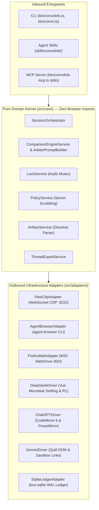

# ConvoLink (`convolink` / `convo`)

> **Autonomous AI Conversation Runtime Linking Web Models to Local Codebases**  
> *Link your terminal and AI coding agents directly to authenticated web sessions of ChatGPT, DeepSeek, and Google Gemini with automated artifact extraction, stream continuation, and non-blocking security gating.*

[](https://bun.sh)
[](https://www.typescriptlang.org)
[-success)](https://bun.sh)
[](#architecture)
[](#license)

---

## 💡 Why ConvoLink?

Modern web AI interfaces (**ChatGPT Plus/Pro**, **DeepSeek-V3/R1**, and **Google Gemini Advanced**) provide leading-edge reasoning, real-time web search grounding, interactive Canvas side drawers, and generous subscription compute. However, developers and autonomous coding agents are traditionally isolated from these web interfaces—forced to either manually copy-paste code snippets or pay redundant, metered token fees for API models that lack the UI's specialized scaffolding.

**ConvoLink** bridges this gap. It connects your CLI and autonomous agents directly to your existing, authenticated browser tabs using the non-invasive **Chrome DevTools Protocol (CDP)** and standard **W3C WebDriver BiDi**.

### Key Capabilities

- 💰 **Zero-Cost Subscription Compute:** Run high-volume code generations directly through your active web subscriptions without managing API keys or paying extra token fees.
- ⚖️ **Multi-Model Comparison Engine (`convo compare`):** Broadcast a prompt across ChatGPT, DeepSeek, and Gemini simultaneously with staggered 250ms dispatch and failure isolation, producing deterministic benchmark tables and namespaced code artifacts.
- 🧑‍⚖️ **Two-Stage Arbiter Consensus Engine (`--arbitrate`, `--arbiter`):** Collect candidate answers from multiple models in parallel, feed them into a designated reasoning Arbiter (e.g. DeepSeek R1), critique logic flaws and hallucinations, and output unified production code.
- 🦊 **Multi-Browser Transports (Chromium & Firefox):** Seamlessly switch between direct native `RawCdpAdapter` (<2ms latency), `AgentBrowserAdapter` (`agent-browser` 0.39.2 CLI), and `FirefoxBidiAdapter` (standard W3C WebDriver BiDi protocol).
- 🧠 **2026 Resilient Web Selectors:** Multi-selector fallback chains for modern ChatGPT (ProseMirror & CodeMirror), Google Gemini (Quill & Markdown), and DeepSeek (Chat & DeepThink R1).
- 🪄 **Tab & Fresh Chat Spawning:** Reset active conversations on demand (`--new`) or spawn new tabs in the background (`--open-tab`, `tab new <platform>`) without stealing window focus.
- ↩️ **State Movement & Mistake Rollback:** Automatic pre-mutation checkpoint journaling (`convo undo`, `convo back`, `convo history`) guarantees that if an agent resets a conversation or navigates away by mistake, it can immediately restore the prior thread URL without state loss.
- 📁 **Automated Artifact & Multi-File Extraction:** Automatically parses fenced code blocks containing `// filepath:`, `# filepath:`, or `<!-- file: -->` directives and writes clean source trees directly to your workspace.
- 🔄 **Autonomous Multi-Chunk Continuation:** Detects truncated responses ("Continue generating" buttons), automatically triggers continuation, and stitches multi-chunk streams seamlessly (up to 5 iterations).
- 🎨 **Canvas & Side-Drawer Inspection:** Scrapes active document state from ChatGPT Canvas and Gemini side drawers directly through the DOM.
- 🔒 **PID-Aware `tmpfs` Mutex Locking:** Prevents prompt collisions across concurrent processes using lock files in `$XDG_RUNTIME_DIR/convolink/` with automatic dead-PID stale lock recovery.
- 🛡️ **Non-Blocking Security Gate:** Automatically scrubs outbound credentials (`sk-...`, `ghp_...`, AWS, `.env`) and classifies inbound destructive commands (`rm -rf`, `sudo`) without halting `stdio` pipelines.
- 🎯 **Zero Window-Focus Theft:** Interacts silently via background CDP lifecycle commands (`Page.setWebLifecycleState: active`), keeping developer window focus completely uninterrupted.

---

## 🏗️ Architecture

ConvoLink is built strictly on **Hexagonal Architecture (Ports and Adapters)** with strict Inversion of Control (IoC).



### Architectural Guardrails (`AGENTS.md`)
1. **The Zero-Import Isolation Law of `src/core/`:** No domain service or entity within `src/core/` is permitted to import any browser automation framework, WebSocket client, or network transport. All external I/O is abstracted behind Port interfaces (`BrowserPort`, `PlatformPort`).
2. **Granularity & Line Limits:** Strict mechanical file size ceiling of **200 lines per file** and **80 lines per handler**, ensuring zero God-components, low cyclomatic complexity, and testable code.

---

## 🚀 Quickstart

### Prerequisites

- **[Bun](https://bun.sh)** (`>= 1.2.0`)
- **Google Chrome** or **Chromium**

### 1. Installation

```bash
git clone https://github.com/0xTanzim/convolink.git
cd convolink
bun install
```

### 2. Start Chrome with Remote Debugging

Launch Google Chrome with remote debugging enabled on port `9222`:

```bash
# On Linux (Fedora / Ubuntu / Debian):
./scripts/fedora-chrome-debug.sh

# Or launch manually on any OS:
google-chrome --remote-debugging-port=9222 --restore-last-session &
```

> **Tip:** Open [ChatGPT](https://chatgpt.com), [DeepSeek](https://chat.deepseek.com), or [Google Gemini](https://gemini.google.com) in any tab and log in as normal.

### 3. Verify Health (`convo doctor`)

Run the diagnostic suite to confirm CDP connectivity and detect open AI tabs:

```bash
bun run convo doctor
# Or with global/linked binary:
convo doctor
```

```text
🔍 Running ConvoLink Doctor...

[CDP Transport] Status: ONLINE (Latency: 1ms)
[Tabs] Found 3 total open tab(s), 3 supported AI tab(s).

• [DEEPSEEK] Hello greeting - DeepSeek
  TargetId: 713AD61E2ACB2C39A39AE3EE887A30E3 | ✅ READY | 🔓 UNLOCKED
  URL: https://chat.deepseek.com/a/chat/s/b36a98cc-7205-4cde-a1a0-cfc6c98f35c8
  Layout: deepseek-standard-v1

• [CHATGPT] Greeting response
  TargetId: A16BE3AD1A2B8238DE0B27ECA73F9580 | ✅ READY | 🔓 UNLOCKED
  URL: https://chatgpt.com/c/6ae56dbc-63fc-83ec-bc20-00b69ce6cc33
  Layout: chatgpt-2026-turnkey

• [GEMINI] Google Gemini
  TargetId: 837BDC4DF3585EA32B8AE2EE261C24BA | ✅ READY | 🔓 UNLOCKED
  URL: https://gemini.google.com/app/e2bdddb2fd90b84a
  Layout: gemini-modern
```

---

## 💻 CLI Reference

ConvoLink commands are accessible via `convo <command>` or `convolink <command>`.

### Commands

| Command | Description |
| :--- | :--- |
| `doctor [--launch]` | Runs connection checks, tests CDP latency, audits open AI tabs, and can auto-launch Chrome. |
| `list` | Lists all open browser tabs matching supported AI platforms. |
| `ask <prompt>` | Submits a prompt to an AI tab, awaits completion, and outputs response. |
| `compare <prompt>` | Broadcasts prompt across multiple models in parallel with optional Technical Arbiter. |
| `export <threadId>` | Exports full conversation history and extracted code blocks as Markdown or JSON. |
| `resume <threadId>` | Restores a conversation session by re-opening the saved thread URL in the browser. |
| `mcp` | Launches the Model Context Protocol (MCP) server over `stdio` for agent IDEs. |
| `tab new <platform>` | Spawns a fresh background tab for a platform (`chatgpt`, `deepseek`, `gemini`). |
| `tab close <targetId>` | Cleanly closes a specific browser tab target. |
| `back [targetId]` | Navigates the attached tab session back in browser history. |
| `undo [targetId]` | Restores the previous conversation URL from the checkpoint journal. |
| `history [targetId]` | Lists recent session checkpoints and thread URLs. |

### `ask` Command Options

| Flag | Short | Default | Description |
| :--- | :--- | :--- | :--- |
| `--new` | `-n` | `false` | Resets the active tab to a fresh conversation before submitting. |
| `--open-tab` | | `false` | Spawns a brand-new tab in the background before submitting. |
| `--transport <name>` | | `raw-cdp` | Transport engine: `raw-cdp`, `agent-browser`, or `firefox-bidi`. |
| `--platform <name>` | `-p` | First available | Target platform (`chatgpt`, `deepseek`, `gemini`). |
| `--targetId <hex>` | `-t` | First available | Target specific Chrome tab by its CDP `targetId`. |
| `--write-files` | `-w` | `false` | Automatically extract code blocks and write them to disk. |
| `--out-dir <path>` | `-o` | `./artifacts` | Target directory for extracted artifact files. |
| `--no-continue` | | `false` | Disable automatic multi-chunk stream continuation. |
| `--think` | | `undefined` | Toggle reasoning / deep-thinking mode (e.g., DeepThink R1). |
| `--timeout <ms>` | | `120000` | Maximum wait time for model completion (in ms). |

### `compare` Command Options

| Flag | Default | Description |
| :--- | :--- | :--- |
| `--platforms <p1,p2>` | `chatgpt,deepseek,gemini` | Comma-separated list of model platforms to query. |
| `--mode <mode>` | `parallel` | Execution schedule: `parallel` (staggered 250ms) or `sequential`. |
| `--arbitrate` | `false` | Trigger Stage 2 Technical Arbiter consensus synthesis. |
| `--arbiter <platform>` | `deepseek` | Designate specific model platform as the Arbiter judge. |
| `--out-dir <path>` | `undefined` | Output directory to save `REPORT.md` and namespaced artifacts. |
| `--timeout <ms>` | `120000` | Timeout per model execution (in ms). |
| `--transport <name>` | `raw-cdp` | Transport engine (`raw-cdp`, `agent-browser`, `firefox-bidi`). |

---

## 📁 Automated Artifact Extraction in Action

When asking web models to generate complex multi-file projects, prompt the model to tag code blocks with `// filepath: path/to/file`:

```bash
convo ask --platform chatgpt \
  "Create a simple TypeScript calculator with tests. Use // filepath: src/calc.ts and // filepath: tests/calc.test.ts" \
  -w --out-dir ./my-project
```

### Output:
```text
Python
Run
# filepath: src/calc.ts
export const add = (a: number, b: number): number => a + b;
export const sub = (a: number, b: number): number => a - b;

# filepath: tests/calc.test.ts
import { expect, test } from "bun:test";
import { add } from "../src/calc.js";

test("add", () => expect(add(2, 3)).toBe(5));

📁 Saved 2 artifact file(s):
  • ./my-project/src/calc.ts
  • ./my-project/tests/calc.test.ts
```

Directives are automatically stripped, parent directories are created recursively, and directory traversal attacks (`../../../`) are strictly sanitized.

---

## 🤖 Agent Installation via `npx skills add`

ConvoLink is packaged as a portable, publishable agent capability conforming to the [AgenticSkills.io](https://agenticskills.io) and Vercel Labs open agent skills standard (`SKILL.md`).

Install ConvoLink directly into any project or workspace with a single command:

```bash
# Install into your project's agent directory (.claude/skills, .agents/skills, etc.)
npx skills add 0xTanzim/convolink

# Or install globally across all agent sessions
npx skills add -g 0xTanzim/convolink
```

### Supported AI Coding Environments
- **Claude Code** (`.claude/skills/convolink/`)
- **Antigravity / Gemini CLI** (`.agents/skills/convolink/`)
- **Cursor** (`.cursor/skills/convolink/`)
- **GitHub Copilot CLI** (`gh skill install ...`)
- **Windsurf** (`.windsurf/skills/`)
- **OpenAI Codex & Custom LLM Orchestrators**

### How Agents Use ConvoLink
Once installed, your coding agent reads `skills/convolink/SKILL.md` dynamically and learns how to:
1. Run `convo doctor` to verify that Chrome is active on port 9222.
2. Route prompts to the appropriate web AI model (`chatgpt`, `deepseek`, `gemini`).
3. Instruct models to use `// filepath:` directives and persist generated code directly to disk with `-w`.
4. Recover gracefully from lock contention and model timeouts.

For deep-dive directive formatting, agents can consult the bundled reference guide:
- [skills/convolink/references/directives.md](skills/convolink/references/directives.md)

---

## 🔌 Model Context Protocol (MCP) Integration

ConvoLink exposes its capabilities through a native JSON-RPC 2.0 MCP server over `stdio`, allowing tools like Claude Desktop, Cursor, Antigravity, and OpenCode to tap into live browser AI tabs.

### Launch MCP Server
```bash
convo mcp
# Or execute standalone binary:
bun run bin/convolink-mcp.ts
```

### Claude Desktop Configuration
Add to `claude_desktop_config.json`:
```json
{
  "mcpServers": {
    "convolink": {
      "command": "bun",
      "args": ["run", "/absolute/path/to/convolink/bin/convolink-mcp.ts"]
    }
  }
}
```

See [skills/convolink/references/mcp.md](skills/convolink/references/mcp.md) for full tool schemas (`convo_ask`, `convo_compare`, `convo_list_tabs`, `convo_tab_new`, `convo_tab_close`, `convo_undo`).

---

## 🧪 Testing & Verification

ConvoLink adheres to strict **Test-Driven Development (TDD)**. All business logic is covered by isolated unit tests using in-memory test doubles (`FakeBrowserPort`, `FakeThreadStore`).

Run the full automated test suite:

```bash
# Run all tests (unit, integration, e2e)
bun test

# Run unit tests only
bun run test:unit

# Run strict TypeScript 7 type checking
bun run typecheck
```

```text
bun test v1.4.4 (38afee6c8)

 122 pass
 0 fail
 385 expect() calls
Ran 122 tests across 30 files. [1105.00ms]
$ tsc --noEmit (0 errors)
```

---

## 🛡️ Security & Privacy Guardrails

1. **Non-Blocking Secret Redaction:** All outbound prompts are scanned before hitting Chromium. Tokens matching OpenAI API keys (`sk-...`), GitHub personal access tokens (`ghp_...`), AWS credentials, and `.env` variable assignments are replaced with `[REDACTED_SECRET]`.
2. **Local Execution:** ConvoLink communicates solely with `127.0.0.1:9222` over local WebSocket loopback. No prompt data or browser state is ever transmitted to third-party telemetry servers.
3. **Safe Detach Semantics:** ConvoLink never calls `browser.close()`. It connects to your existing browser session and detaches cleanly upon query completion, preserving your tabs, cookies, and logins.

---

## 📄 License

MIT © 2026 Tanzim & ConvoLink Contributors.
