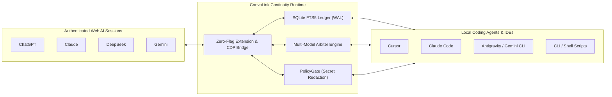

# ConvoLink (`convolink` / `convo`)

> **Your AI Architect and Coding Agent. Finally Connected.**  
> *Connect local autonomous coding agents (Cursor, Claude Code, Antigravity) directly to your live authenticated web AI sessions (ChatGPT, Claude, DeepSeek, Gemini) for bidirectional specifications, doubt resolution, and multi-model consensus.*

[](https://bun.sh)
[](https://www.typescriptlang.org)
[-success)](https://bun.sh)
[](https://github.com/0xTanzim/convolink/releases/tag/v1.0.0)
[](#-architecture)
[](LICENSE)

---

## ⚡ Why ConvoLink?

Developers spend hours in web AI conversations (**ChatGPT**, **Claude**, **DeepSeek**, **Gemini**) conducting technical research, selecting stacks, and establishing invariants. This conversation holds your project's **evolving mental model**.

When you switch to an IDE coding agent, that agent starts with **architectural amnesia**. Traditionally, you are trapped as a human copy-paste courier between the terminal and browser tabs.

ConvoLink eliminates the relay through **Three Core Pillars**:

1. **The Context Bridge:** Streams architectural specs and invariants directly into local agents while reporting milestone progress back upstream to the web session.
2. **The Intelligence Bridge:** Allows local agents running smaller or cost-effective models to delegate complex reasoning, difficult debugging, and architectural judgment to powerful frontier web models.
3. **The Capability Bridge:** Borrows upstream web capabilities—**extended thinking**, **live web search grounding**, and **multi-model cross-validation**—using existing authenticated web subscriptions with zero per-token API charges.



---

## 🚀 60-Second Quickstart

### 1. Install ConvoLink
```bash
git clone https://github.com/0xTanzim/convolink.git
cd convolink
bun install
bun link  # Exposes `convo` and `convolink` globally
```

### 2. Connect Your Real Browser (Zero "Ghost Browsers")

ConvoLink adheres to the **Zero Ghost Browser Law**: it connects directly to your existing authenticated browser without blank profiles or lost cookies.

#### Path A: ConvoLink Companion Extension (Recommended — Zero Flags)
Works with your everyday browser profile without restarting or setting command-line flags.
1. Download the extension ZIP from [GitHub Releases v1.0.0](https://github.com/0xTanzim/convolink/releases/tag/v1.0.0):
   - **Chrome / Brave / Edge:** `convolink-companion-chrome.zip`
   - **Firefox:** `convolink-companion-firefox.zip`
2. Unpack and load via `chrome://extensions` (Enable *Developer mode* $\rightarrow$ *Load unpacked*).
3. Pair the extension with ConvoLink:
   ```bash
   convo ext pair
   ```

#### Path B: Direct CDP Remote Debugging
In Chrome 144+, open `chrome://inspect/#remote-debugging` in your browser and enable remote debugging, or launch Chrome with `--remote-debugging-port=9222`.

### 3. Verify Connection (`convo doctor`)
Audit your connection and view all detected AI tabs:
```bash
convo doctor
```
```text
🔍 Running ConvoLink Doctor...
[CDP Transport] Status: ONLINE (Latency: 1ms)
[Tabs] Found 4 supported AI tab(s):
  • [CHATGPT] Architecture Discussion - ChatGPT (TargetId: A16BE3...) ✅ READY
  • [CLAUDE] Concurrency Refactoring - Claude (TargetId: 44F12A...) ✅ READY
  • [DEEPSEEK] Algorithmic Optimization - DeepSeek (TargetId: 713AD6...) ✅ READY
  • [GEMINI] Cloud Deployment Strategy - Gemini (TargetId: 837BDC...) ✅ READY
```

---

## 🛠️ Essential Workflows

### 1. Ingest Architectural Specs & Invariants
Query the active upstream conversation for design invariants or specs:
```bash
convo ask --platform claude \
  "We are ready to implement Milestone 2. Provide the transition table, invariant list, and error codes we decided on during research."
```

### 2. Resolve Agent Doubts & Report Milestone Progress
Report task completion and resolve edge-case ambiguity directly with the upstream architect:
```bash
convo ask --platform chatgpt \
  "Milestone 1 is complete. During implementation of the lock service, we noticed potential contention under high write volume. Should we invalidate stale leases immediately or let the 180s TTL expire?"
```

### 3. Multi-Model Consensus & Arbitration (`convo compare`)
Broadcast proposals across multiple frontier models in parallel, using an Arbiter to synthesize consensus:
```bash
convo compare \
  "Evaluate trade-offs between distributed SQLite (Litestream/LiteFS) vs PostgreSQL for a multi-tenant event ledger. Identify single points of failure." \
  --platforms chatgpt,claude,deepseek,gemini \
  --arbitrate \
  --arbiter deepseek \
  --out-dir ./comparison-results
```

### 4. Search Past Technical Decisions (`convo search`)
Search through all past discussions indexed locally in the SQLite FTS5 ledger:
```bash
convo search "JWT refresh token rotation invariants" --limit 5
```

### 5. Extract Implementation Files to Disk (`-w`)
Automatically extract production files tagged with `// filepath:` directives:
```bash
convo ask --platform claude \
  "Provide the ring buffer implementation with // filepath: src/ring-buffer.ts" \
  -w --out-dir .
```

---

## 🔌 IDE & Agent Integration (MCP)

ConvoLink includes a native JSON-RPC 2.0 Model Context Protocol server over `stdio`, exposing `convo_ask`, `convo_compare`, `convo_search`, and `convo_list_tabs` to modern AI agents.

### Configuration for Cursor & Claude Desktop
Add to your Claude Desktop config (`~/.config/Claude/claude_desktop_config.json`) or Cursor (`.cursor/mcp.json`):
```json
{
  "mcpServers": {
    "convolink": {
      "command": "bun",
      "args": ["run", "/absolute/path/to/convolink/bin/convolink-mcp.ts"]
    }
  }
}
```

---

## 💻 Command Reference

| Command | Description |
| :--- | :--- |
| `doctor` | Checks connection health, tests protocol latency, and audits open AI tabs. |
| `ask <prompt>` | Submits a prompt to an AI tab, streams completion, and outputs response. |
| `compare <prompt>` | Broadcasts prompt across multiple models with optional Arbiter synthesis. |
| `search <query>` | Full-text FTS5 search across conversation ledger turns and code snippets. |
| `export <threadId>` | Exports a conversation thread and code blocks to Markdown or JSON. |
| `profile list` | Lists discovered browser profiles and linked Google accounts. |
| `profile select <id>` | Selects and persists the active profile in `.convo/config.json`. |
| `ext pair` | Generates or displays the cryptographic pairing secret for the Companion Extension. |
| `clean` | Safely terminates orphaned debug processes and removes temporary directories. |
| `mcp` | Starts the Model Context Protocol stdio server for IDE agents. |

### Common Flags for `convo ask`
- `-p, --platform <name>`: Target platform (`chatgpt`, `claude`, `deepseek`, `gemini`).
- `-t, --targetId <id>`: Target specific tab by ID or shorthand (`#1`, `#2`).
- `-n, --new`: Reset active conversation to a fresh session before submitting.
- `-w, --write-files`: Automatically extract code artifacts and write to disk.
- `-o, --out-dir <dir>`: Destination directory for extracted files (default: `./artifacts`).
- `--think`: Enable deep reasoning mode (e.g., DeepSeek R1).
- `--transport <name>`: Transport engine: `raw-cdp` (default), `extension-bridge`, or `firefox-bidi`.

---

## 🏗️ Architecture & Operational Safety

ConvoLink is engineered in strict TypeScript under **Hexagonal Architecture (Ports and Adapters)**:
- **Zero-Import Domain Kernel:** `src/core/` contains 0 imports from any browser automation library (`playwright`, `puppeteer`, `ws`).
- **Zero Window-Focus Theft:** Operates silently in the background via CDP lifecycle emulation (`Page.setWebLifecycleState: active`). OS focus is never stolen.
- **PID-Aware `tmpfs` Mutex Locking:** Prevents prompt collisions across concurrent processes using lock files in `$XDG_RUNTIME_DIR/convolink/`. Dead process locks are automatically reclaimed.
- **Outbound Secret Scrubbing:** Automatically scrubs API keys (`sk-...`, `ghp_...`, AWS tokens, `.env` pairs) to `[REDACTED_SECRET]` before transmission.
- **Safe Browser Detach:** ConvoLink never calls `browser.close()`. It disconnects cleanly, keeping your everyday tabs and logins intact.

---

## 🧪 Testing & Verification

```bash
bun test        # Runs full 286-test suite across 56 test files
bun run typecheck # Strict TypeScript 7 typecheck (0 errors)
```

---

## 📖 Complete Documentation

Visit the official documentation site for complete architectural guides, ADRs, and deployment blueprints:  
👉 **[ConvoLink Documentation Site](https://0xtanzim.github.io/convolink/)**

---

## 📄 License

MIT © 2026 Tanzim & ConvoLink Contributors.
