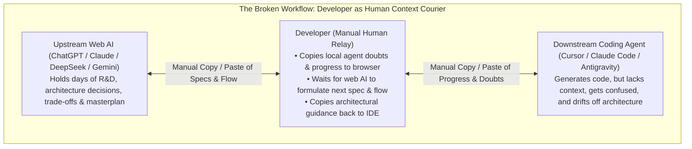
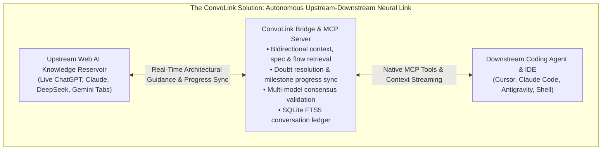
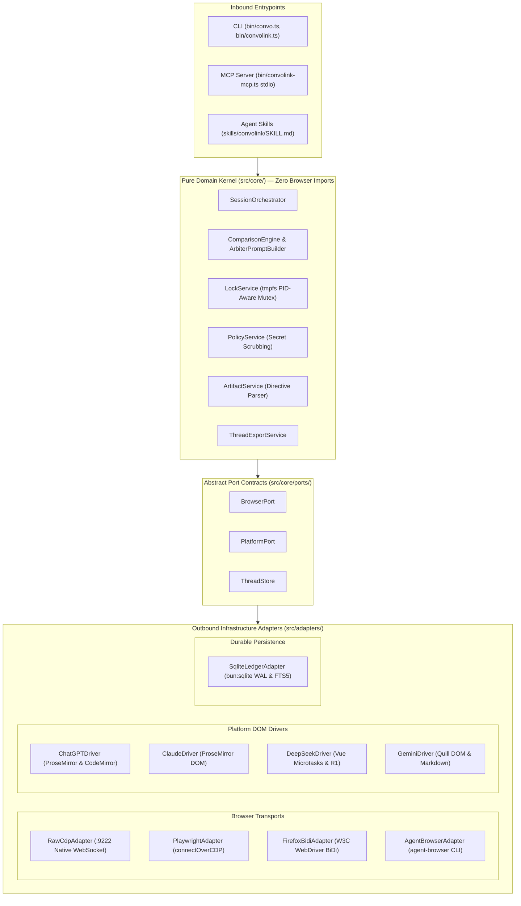

# ConvoLink (`convolink` / `convo`)

> **Your AI Architect and Coding Agent. Finally Connected.**  
> *Connect your local autonomous coding agents (Cursor, Claude Code, Antigravity) directly to the upstream web AI conversations that hold your project's architectural knowledge, technical specifications, and engineering intent. Stop being the manual messenger between your AIs.*

[](https://bun.sh)
[](https://www.typescriptlang.org)
[-success)](https://bun.sh)
[](#-architecture)
[](#-license)

---

## ⚡ The Problem: The Context & Intent Bottleneck

Modern autonomous coding agents are already highly proficient at generating code, running terminal commands, navigating repositories, and modifying files. **Raw code generation is no longer the primary bottleneck in software engineering.**

The real bottleneck is the separation between **where a project is understood** and **where a project is executed**.

### 1. The Upstream AI Conversation is the Project's Living Architect
Before writing substantial code, developers often spend hours or days in web-based AI conversations (**ChatGPT**, **Claude**, **DeepSeek**, **Gemini**) conducting technical research, selecting technology stacks, designing database schemas, identifying edge cases, and establishing architectural invariants.

Over time, this conversation accumulates something far more valuable than isolated answers: **the project's evolving mental model**. It knows not only *what* needs to be built, but *why* it needs to be built that way, which approaches were rejected, and what trade-offs were made.

### 2. The Local Coding Agent Starts with Architectural Amnesia
When the developer switches to an autonomous coding agent inside their IDE or terminal, that agent starts with zero connection to the upstream R&D. Despite having repository access, it lacks the broader context, reasoning, and architectural intent behind the project.

### 3. The Developer Becomes an Exhausted Human Relay
This creates a severe manual communication bottleneck. The developer is trapped acting as a human protocol between two isolated AI systems:
- The local agent finishes a task or reaches an ambiguous design boundary.
- The developer manually copies the agent's doubts, questions, or logs into the browser chat.
- The upstream AI (which holds the whole masterplan) analyzes the context and generates the architectural specifications and next steps.
- The developer copies those instructions back into the terminal so the agent knows what to do.
- When the local agent finishes a milestone, the developer manually reports the progress back to the upstream AI to get the next milestone instructions.

When this relay breaks—if the developer steps away or fails to relay a doubt—the local agent makes assumptions, drifts from the architecture, and writes conflicting code.



---

## 💡 The Solution: ConvoLink

ConvoLink eliminates the manual relay by establishing an **autonomous, bidirectional neural bridge** between authenticated upstream web AI sessions and local autonomous coding agents through **Chrome DevTools Protocol (CDP)** and the **Model Context Protocol (MCP)**.



### The Connected Engineering Loop

| Ecosystem Role | Primary Responsibility |
| :--- | :--- |
| **Web AI Architect** | Technical research, requirements modeling, system design, and architectural guidance. |
| **Local Coding Agent** | Repository-level implementation, terminal commands, test execution, and file edits. |
| **ConvoLink** | Programmatic communication and bidirectional context bridge between them. |

### How It Changes the Development Workflow

| Traditional Disconnected Coding Agent | ConvoLink-Connected Coding Agent |
| :--- | :--- |
| Operates in isolation, blind to upstream R&D | Directly communicates with the upstream architectural conversation |
| Requires the developer to manually relay questions & doubts | Autonomously queries the upstream architect for specifications |
| Requires manual progress reporting after every milestone | Continuously reports execution progress and findings upstream |
| High risk of architectural drift and conflicting assumptions | Maintains continuous architectural alignment throughout the build |
| Relies on a single model's isolated reasoning | Fans out cross-validation across multiple authenticated models |

---

## 🌟 Core Superpowers

### 1. 🧠 Bidirectional Context & Architectural Guidance
Local coding agents can directly query the upstream conversation for specifications (*"What is the event schema for Milestone 2?"*) and resolve doubts (*"Should we invalidate stale leases immediately or rely on TTL?"*). Conversely, agents report milestone completions and discovered constraints back upstream so guidance adapts as code evolves.

### 2. ⚖️ Multi-Model Architectural Cross-Validation (`convo compare`)
Leverage your existing authenticated web subscriptions (**ChatGPT, Claude, DeepSeek, Gemini**) to independently evaluate system architecture, concurrency models, and security trade-offs without incurring additional per-token API charges. Enable `--arbitrate` to have an Arbiter synthesize the consensus.

### 3. 🔍 Instant Full-Text Architectural Search (`convo search`)
All conversation turns, design trade-offs, and decisions are indexed into a local, high-performance **SQLite FTS5 ledger** with WAL mode. Your agent can instantly search across all past discussions:
```bash
convo search "JWT refresh token rotation invariants"
```

### 4. 📁 Automated File Tree Extraction (`-w`)
When the upstream architect outputs production implementation files tagged with `// filepath: src/auth.ts`, ConvoLink automatically parses the directives, creates parent directories recursively, sanitizes path traversal attacks, and writes the source files directly to your workspace.

### 5. 🔌 Native Model Context Protocol (MCP) Server (`convo mcp`)
Connect ConvoLink to **Cursor**, **Claude Desktop**, **Antigravity**, or any MCP-compliant agent in 30 seconds. Your agent gains native cognitive tools to list open AI tabs, query active discussions, compare multiple models, and search conversation history.

---

## 🚀 30-Second Quickstart

### Prerequisites
- **[Bun](https://bun.sh)** (`>= 1.2.0`)
- **Google Chrome** (or Chromium / Brave)

### 1. Clone & Install
```bash
git clone https://github.com/0xTanzim/convolink.git
cd convolink
bun install
bun link # Optional: makes `convo` and `convolink` globally accessible
```

### 2. Launch Chrome with Remote Debugging
Launch Chrome with remote debugging enabled on port `9222`:

```bash
# On Linux (Fedora / Ubuntu / Debian):
./scripts/fedora-chrome-debug.sh

# Or on macOS:
/Applications/Google\ Chrome.app/Contents/MacOS/Google\ Chrome --remote-debugging-port=9222 &

# Or on Windows (PowerShell):
Start-Process "chrome.exe" -ArgumentList "--remote-debugging-port=9222"
```

> **Note:** Open your favorite AI platforms ([ChatGPT](https://chatgpt.com), [Claude](https://claude.ai), [DeepSeek](https://chat.deepseek.com), [Gemini](https://gemini.google.com)) in tabs and log in.

### 3. Verify Health (`convo doctor`)
Check CDP transport connectivity and detect your open AI tabs:

```bash
convo doctor
```

```text
🔍 Running ConvoLink Doctor...

[CDP Transport] Status: ONLINE (Latency: 1ms)
[Tabs] Found 4 total open tab(s), 4 supported AI tab(s).

• [CHATGPT] Architecture Discussion - ChatGPT
  TargetId: A16BE3AD1A2B8238DE0B27ECA73F9580 | ✅ READY | 🔓 UNLOCKED
  URL: https://chatgpt.com/c/6ae56dbc-63fc-83ec-bc20-00b69ce6cc33

• [CLAUDE] Concurrency Refactoring - Claude
  TargetId: 44F12A9E58BC478E916BA1283B927CE1 | ✅ READY | 🔓 UNLOCKED
  URL: https://claude.ai/chat/5b7f14b2-e981-4322-a7d2-7c3905581bf4

• [DEEPSEEK] Algorithmic Optimization - DeepSeek
  TargetId: 713AD61E2ACB2C39A39AE3EE887A30E3 | ✅ READY | 🔓 UNLOCKED
  URL: https://chat.deepseek.com/a/chat/s/b36a98cc-7205-4cde-a1a0-cfc6c98f35c8

• [GEMINI] Cloud Deployment Strategy - Gemini
  TargetId: 837BDC4DF3585EA32B8AE2EE261C24BA | ✅ READY | 🔓 UNLOCKED
  URL: https://gemini.google.com/app/e2bdddb2fd90b84a
```

---

## 🛠️ Common Workflows & Examples

### 1. Ingest Upstream Architectural Specifications
When the local coding agent is ready to start a new phase, it queries the upstream project conversation for the agreed design specifications, data models, and flow invariants:
```bash
convo ask --platform claude \
  "We are ready to implement Milestone 2 (State Machine & Event Sourcing). Please provide the exact transition table, invariant list, and error codes we decided on during research."
```

### 2. Resolve Agent Doubts & Report Progress (Bidirectional Sync)
When the local agent finishes a task or encounters an architectural ambiguity, it syncs its state and requests direction directly from the upstream brain:
```bash
convo ask --platform chatgpt \
  "Milestone 1 is complete and all unit tests pass. During implementation of the lock service, we noticed potential contention under high write volume. Should we invalidate stale leases immediately or let the 180s TTL expire? What was our architectural consensus?"
```

### 3. Multi-Model Engineering Council & Validation (`convo compare`)
Before executing a high-risk or irreversible architectural change, broadcast the proposal across multiple frontier models (**Claude, ChatGPT, DeepSeek, Gemini**) in parallel. Use `--arbitrate` to have an Arbiter synthesize the consensus:
```bash
convo compare \
  "Evaluate trade-offs between distributed SQLite (Litestream/LiteFS) vs PostgreSQL for a multi-tenant event ledger under high write concurrency. Identify edge cases, single points of failure, and write amplification risks." \
  --platforms chatgpt,claude,deepseek,gemini \
  --arbitrate \
  --arbiter deepseek \
  --out-dir ./comparison-results
```

### 4. Search Past R&D Decisions in Local Ledger (`convo search`)
Recall why a specific technical trade-off was made days ago across any open browser chat:
```bash
convo search "SQLite WAL mode busy_timeout pragma" --limit 5
```

### 5. Write Generated Implementation Files Directly to Workspace (`-w`)
When the upstream model generates production code tagged with `// filepath:` directives, extract them directly into your file tree:
```bash
convo ask --platform claude \
  "Provide the implementation for the ring buffer according to our spec. Use // filepath: src/ring-buffer.ts and // filepath: tests/ring-buffer.test.ts" \
  -w --out-dir .
```

### 6. Reset Conversation or Spawn Background Tabs
Start a fresh conversation thread, or spawn a clean tab in the background without stealing OS focus:
```bash
# Reset active tab to a new conversation
convo ask --platform deepseek "Let's begin a new architecture spike" --new

# Or spawn a new background tab
convo tab new claude
```

---

## 🔌 IDE & Agent Integration

### Model Context Protocol (MCP) Setup

ConvoLink includes a native JSON-RPC 2.0 MCP server over `stdio`. It exposes tools (`convo_ask`, `convo_compare`, `convo_search`, `convo_list_tabs`, `convo_export`, `convo_tab_new`, `convo_undo`) directly to modern AI agents.

#### Claude Desktop
Add to `~/Library/Application Support/Claude/claude_desktop_config.json` (macOS) or `~/.config/Claude/claude_desktop_config.json` (Linux):
```json
{
  "mcpServers": {
    "convolink": {
      "command": "bun",
      "args": ["run", "/absolute/path/to/convolink/bin/convolink-mcp.ts"]
    }
  }
}
```

#### Cursor IDE
Add to `.cursor/mcp.json` in your project or global user settings:
```json
{
  "mcpServers": {
    "convolink": {
      "command": "bun",
      "args": ["run", "/absolute/path/to/convolink/bin/convolink-mcp.ts"]
    }
  }
}
```

### Agentic Skills Standard (`npx skills add`)
ConvoLink complies with the open [AgenticSkills.io](https://agenticskills.io) standard (`SKILL.md`). Install it into any agent workspace with one command:
```bash
# Install into project agent directory (.claude/skills, .agents/skills, etc.)
npx skills add 0xTanzim/convolink

# Or install globally across all coding agent sessions
npx skills add -g 0xTanzim/convolink
```

Supported environments include **Claude Code**, **Antigravity / Gemini CLI**, **Cursor**, **GitHub Copilot CLI**, **Windsurf**, and custom LLM orchestrators.

---

## 💻 CLI Command Reference

| Command | Description |
| :--- | :--- |
| `doctor [--launch]` | Verifies CDP connection health, tests protocol latency, and audits open AI tabs. |
| `list` | Lists all active browser tabs matching supported AI platforms. |
| `ask <prompt>` | Sends a prompt to a specific AI tab, streams completion, and outputs the response. |
| `compare <prompt>` | Broadcasts prompt across multiple models in parallel with optional Arbiter consensus. |
| `search <query>` | Performs SQLite FTS5 full-text search across past conversation turns and code snippets. |
| `export <threadId>` | Exports a conversation thread and extracted code blocks as Markdown or JSON. |
| `resume <threadId>` | Restores a session by navigating the browser to the saved conversation URL. |
| `mcp` | Runs the Model Context Protocol (MCP) server over `stdio` for agent IDEs. |
| `tab new <platform>` | Spawns a new background tab for `chatgpt`, `claude`, `deepseek`, or `gemini`. |
| `tab close <targetId>` | Closes a specific browser tab cleanly. |
| `back [targetId]` | Navigates the tab backward in browser history. |
| `undo [targetId]` | Restores the prior thread URL from the pre-mutation checkpoint journal. |
| `history [targetId]` | Displays recent session checkpoints and thread navigation history. |

### `convo ask` Flags
- `-p, --platform <name>`: Target platform (`chatgpt`, `claude`, `deepseek`, `gemini`). Default: first ready tab.
- `-t, --targetId <hex>`: Target a specific browser tab by CDP ID.
- `-n, --new`: Reset active conversation to a fresh session before submitting.
- `--open-tab`: Spawn a brand-new tab in the background before submitting.
- `-w, --write-files`: Automatically extract code blocks and write them to disk.
- `-o, --out-dir <path>`: Destination directory for extracted files (default: `./artifacts`).
- `--think`: Enable reasoning / deep-thinking mode (e.g. DeepSeek R1).
- `--no-continue`: Disable automated multi-chunk continuation.
- `--timeout <ms>`: Request timeout in milliseconds (default: `120000`).
- `--transport <name>`: Transport engine: `raw-cdp` (default), `playwright`, `agent-browser`, or `firefox-bidi`.

### `convo compare` Flags
- `--platforms <p1,p2>`: Comma-separated list of platforms (default: `chatgpt,claude,deepseek,gemini`).
- `--arbitrate`: Trigger Stage 2 Technical Arbiter consensus synthesis.
- `--arbiter <platform>`: Designate Arbiter judge (default: `deepseek`).
- `--mode <parallel|sequential>`: Execution schedule (default: `parallel` with staggered 250ms dispatch).
- `--out-dir <path>`: Directory to persist `REPORT.md` and extracted code artifacts.
- `--timeout <ms>`: Timeout per model execution (default: `120000`).

---

## 🏗️ Architecture

ConvoLink is engineered following **Hexagonal Architecture (Ports and Adapters)** with strict Inversion of Control (IoC).



### Architectural Guarantees (`AGENTS.md`)
1. **The Zero-Import Isolation Law of `src/core/`:** No file within `src/core/` is permitted to import any browser automation framework, WebSocket library, or network driver. Domain logic remains 100% decoupled and unit-testable.
2. **Strict File Size Limits:** Max **200 lines per file** and **80 lines per function** across core services to eliminate God-components and maintain high readability.
3. **100% Test-First Provenance:** Every domain service, adapter, and CLI command is backed by automated tests.

---

## 🛡️ Enterprise & Operational Safety

- 🎯 **Zero Window-Focus Theft:** Interacts silently via background CDP lifecycle commands (`Page.setWebLifecycleState: active`) and focus emulation. Your typing and OS window focus are never interrupted.
- 🔒 **PID-Aware `tmpfs` Mutex Locking:** Prevents prompt collisions across concurrent processes using lock files in `$XDG_RUNTIME_DIR/convolink/` (RAM-backed `tmpfs`). Stale locks from dead processes (`process.kill(pid, 0)`) or expired heartbeats are automatically reclaimed.
- 🛡️ **Non-Blocking Secret Scrubbing:** Every outbound prompt is automatically scanned. Sensitive tokens matching OpenAI keys (`sk-...`), GitHub PATs (`ghp_...`), AWS secrets, and `.env` variable assignments are redacted to `[REDACTED_SECRET]` before leaving your machine.
- 🚪 **Safe Detach Semantics:** ConvoLink **never** calls `browser.close()`. It attaches to existing browser sessions and cleanly disconnects its WebSocket client upon completion. Your browser, open tabs, cookies, and active sessions remain untouched.
- 🌐 **100% Local Execution:** Communicates solely via local loopback (`127.0.0.1:9222`). Zero prompt data or code is ever sent to third-party telemetry servers.

---

## 🧪 Testing & Verification

ConvoLink is verified with `bun:test` across unit, integration, and end-to-end suites using in-memory test doubles (`FakeBrowserPort`, `FakeThreadStore`):

```bash
# Run all automated tests
bun test

# Run unit tests only
bun run test:unit

# Run strict TypeScript 7 typecheck
bun run typecheck
```

```text
bun test v1.4.4
 137 pass
 0 fail
 430 expect() calls
Ran 137 tests across 32 files. [1455.00ms]

$ tsc --noEmit
(0 errors)
```

---

## 📄 License

MIT © 2026 Tanzim & ConvoLink Contributors.
