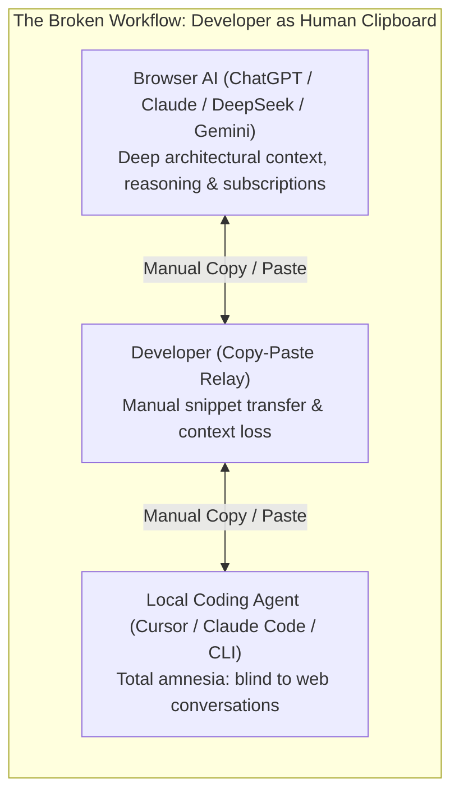
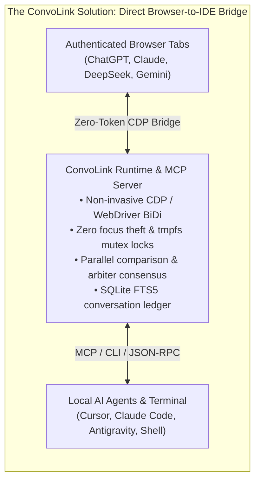
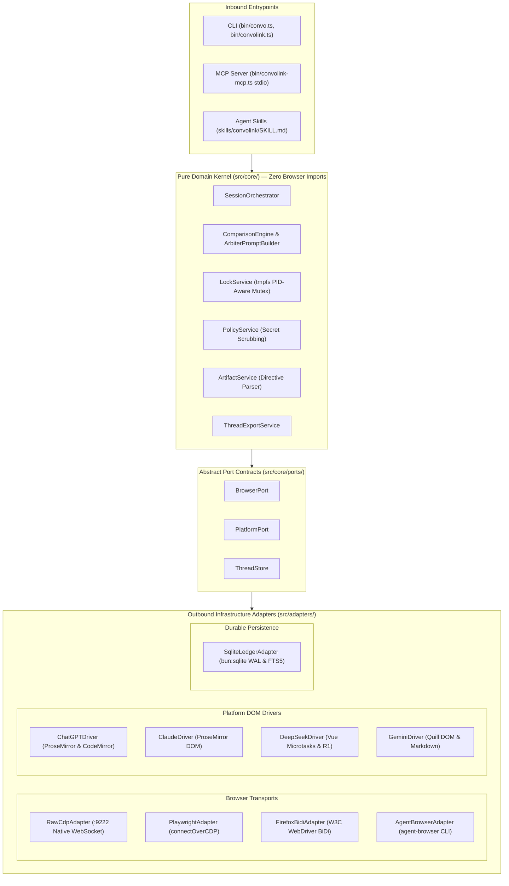

# ConvoLink (`convolink` / `convo`)

> **Autonomous AI Conversation Runtime Linking Web Models to Local Codebases**  
> *Connect your terminal and AI coding agents directly to authenticated web sessions of ChatGPT, Claude, DeepSeek, and Google Gemini. Query your live conversations, compare 4 models in parallel, search past chats with full-text search, and extract code directly into your project files.*

[](https://bun.sh)
[](https://www.typescriptlang.org)
[-success)](https://bun.sh)
[](#-architecture)
[](#-license)

---

## ⚡ The Problem: The Web-to-IDE Memory Wall

Every developer experiences this workflow friction daily:

1. **You brainstorm in web chats:** You spend an hour in **ChatGPT Plus/Pro**, **Claude Pro**, **DeepSeek R1**, or **Gemini Advanced** planning system architecture, debugging complex edge cases, and reasoning through deep algorithms.
2. **You switch to your IDE:** You open your editor or launch an autonomous coding agent (**Cursor**, **Claude Code**, **Antigravity**, **VS Code**).
3. **Total Agent Amnesia:** Your local agent has **zero memory** of the architectural decisions or solutions you just developed in the browser.
4. **The "Human Clipboard" Trap:** When your local agent gets stuck or introduces a bug, you are forced to copy-paste terminal compiler errors into your browser tabs, wait for an answer, and copy code blocks back into your project files.





**ConvoLink solves this permanently.** It turns your open, authenticated browser tabs into an active, queryable knowledge oracle for your terminal and local AI agents.

---

## 🌟 Core Superpowers

### 1. 🧠 Zero Amnesia & Zero Token Cost
Tap into the rich reasoning power of **ChatGPT Plus/Pro**, **Claude 3.7**, **DeepSeek R1**, and **Google Gemini Advanced** directly from your terminal or IDE agent. Use your existing subscriptions without managing API keys, paying metered token fees, or losing web-exclusive features like Deep Research, Canvas, and live search.

### 2. ⚖️ Multi-Model Comparison & Arbiter Consensus (`convo compare`)
Broadcast any coding challenge or architectural question to **ChatGPT, Claude, DeepSeek, and Gemini simultaneously**. Review a side-by-side benchmark table comparing execution speeds and code quality. Enable `--arbitrate` to have a designated reasoning Arbiter (e.g., DeepSeek R1) evaluate all candidate solutions, identify logic flaws, and synthesize the single best production implementation.

### 3. 🔍 Instant Full-Text Conversation Search (`convo search`)
All conversation turns and generated code blocks are automatically indexed into a local, high-performance **SQLite FTS5 ledger** with WAL mode. Instantly recall prior discussions, snippets, and decisions across all sessions:
```bash
convo search "JWT refresh token rotation"
```

### 4. 📁 Zero-Touch Multi-File Extraction (`-w`)
No more copying code block by block. When models output code tagged with `// filepath: src/auth.ts`, ConvoLink automatically parses the directives, creates parent directories recursively, sanitizes path traversal attacks, and writes the source files directly to your workspace.

### 5. 🔌 Turnkey Model Context Protocol (MCP) Server (`convo mcp`)
Connect ConvoLink to **Cursor**, **Claude Desktop**, **Antigravity**, or any MCP-compliant agent in 30 seconds. Your coding agent gains native tools to list open AI tabs, query active discussions, compare multiple models, and search conversation history.

---

## 🚀 30-Second Quickstart

### Prerequisites
- **[Bun](https://bun.sh)** (`>= 1.2.0`)
- **Google Chrome** (or Chromium / Brave)

### 1. Clone & Install
```bash
git clone https://github.com/0xTanzim/convolink.git
cd convolink
bun install
bun link # Optional: makes `convo` and `convolink` globally accessible
```

### 2. Launch Chrome with Remote Debugging
Launch Chrome with remote debugging enabled on port `9222`:

```bash
# On Linux (Fedora / Ubuntu / Debian):
./scripts/fedora-chrome-debug.sh

# Or on macOS:
/Applications/Google\ Chrome.app/Contents/MacOS/Google\ Chrome --remote-debugging-port=9222 &

# Or on Windows (PowerShell):
Start-Process "chrome.exe" -ArgumentList "--remote-debugging-port=9222"
```

> **Note:** Open your favorite AI platforms ([ChatGPT](https://chatgpt.com), [Claude](https://claude.ai), [DeepSeek](https://chat.deepseek.com), [Gemini](https://gemini.google.com)) in tabs and log in.

### 3. Verify Health (`convo doctor`)
Check CDP transport connectivity and detect your open AI tabs:

```bash
convo doctor
```

```text
🔍 Running ConvoLink Doctor...

[CDP Transport] Status: ONLINE (Latency: 1ms)
[Tabs] Found 4 total open tab(s), 4 supported AI tab(s).

• [CHATGPT] Architecture Discussion - ChatGPT
  TargetId: A16BE3AD1A2B8238DE0B27ECA73F9580 | ✅ READY | 🔓 UNLOCKED
  URL: https://chatgpt.com/c/6ae56dbc-63fc-83ec-bc20-00b69ce6cc33

• [CLAUDE] Concurrency Refactoring - Claude
  TargetId: 44F12A9E58BC478E916BA1283B927CE1 | ✅ READY | 🔓 UNLOCKED
  URL: https://claude.ai/chat/5b7f14b2-e981-4322-a7d2-7c3905581bf4

• [DEEPSEEK] Algorithmic Optimization - DeepSeek
  TargetId: 713AD61E2ACB2C39A39AE3EE887A30E3 | ✅ READY | 🔓 UNLOCKED
  URL: https://chat.deepseek.com/a/chat/s/b36a98cc-7205-4cde-a1a0-cfc6c98f35c8

• [GEMINI] Cloud Deployment Strategy - Gemini
  TargetId: 837BDC4DF3585EA32B8AE2EE261C24BA | ✅ READY | 🔓 UNLOCKED
  URL: https://gemini.google.com/app/e2bdddb2fd90b84a
```

---

## 🛠️ Common Workflows & Examples

### Ask a Live Model & Write Code Directly to Workspace
Query your open Claude tab and write the generated files directly into `./src`:
```bash
convo ask --platform claude \
  "Refactor our JWT validator to use subtle crypto. Use // filepath: src/auth/crypto.ts and // filepath: tests/auth/crypto.test.ts" \
  -w --out-dir .
```

### Multi-Model Comparison & Arbiter Consensus
Query ChatGPT, Claude, and DeepSeek in parallel, then have DeepSeek R1 synthesize the consensus answer:
```bash
convo compare \
  "Design a lock-free ring buffer in TypeScript with zero garbage collection allocations." \
  --platforms chatgpt,claude,deepseek \
  --arbitrate \
  --arbiter deepseek \
  --out-dir ./comparison-results
```

### Search Past Conversations in the Local Ledger
Find every turn across all past browser conversations discussing WebSockets:
```bash
convo search "WebSocket reconnection backoff" --limit 5
```

### Export a Thread as Clean Markdown
Export full turn-by-turn conversation logs for archival or documentation:
```bash
convo export 6ae56dbc-63fc-83ec-bc20-00b69ce6cc33 --format markdown > THREAD.md
```

### Reset Conversation or Open a Fresh Background Tab
Start a fresh chat in the active tab, or spawn a clean tab without stealing OS focus:
```bash
# Reset the active tab to a new conversation
convo ask --platform deepseek "Explain Raft consensus" --new

# Or spawn a new background tab
convo tab new claude
```

---

## 🔌 IDE & Agent Integration

### Model Context Protocol (MCP) Setup

ConvoLink includes a native JSON-RPC 2.0 MCP server over `stdio`. It exposes tools (`convo_ask`, `convo_compare`, `convo_search`, `convo_list_tabs`, `convo_export`, `convo_tab_new`, `convo_undo`) directly to modern AI agents.

#### Claude Desktop
Add to `~/Library/Application Support/Claude/claude_desktop_config.json` (macOS) or `~/.config/Claude/claude_desktop_config.json` (Linux):
```json
{
  "mcpServers": {
    "convolink": {
      "command": "bun",
      "args": ["run", "/absolute/path/to/convolink/bin/convolink-mcp.ts"]
    }
  }
}
```

#### Cursor IDE
Add to `.cursor/mcp.json` in your project or global user settings:
```json
{
  "mcpServers": {
    "convolink": {
      "command": "bun",
      "args": ["run", "/absolute/path/to/convolink/bin/convolink-mcp.ts"]
    }
  }
}
```

### Agentic Skills Standard (`npx skills add`)
ConvoLink complies with the open [AgenticSkills.io](https://agenticskills.io) standard (`SKILL.md`). Install it into any agent workspace with one command:
```bash
# Install into project agent directory (.claude/skills, .agents/skills, etc.)
npx skills add 0xTanzim/convolink

# Or install globally across all coding agent sessions
npx skills add -g 0xTanzim/convolink
```

Supported environments include **Claude Code**, **Antigravity / Gemini CLI**, **Cursor**, **GitHub Copilot CLI**, **Windsurf**, and custom LLM orchestrators.

---

## 💻 CLI Command Reference

| Command | Description |
| :--- | :--- |
| `doctor [--launch]` | Verifies CDP connection health, tests protocol latency, and audits open AI tabs. |
| `list` | Lists all active browser tabs matching supported AI platforms. |
| `ask <prompt>` | Sends a prompt to a specific AI tab, streams completion, and outputs the response. |
| `compare <prompt>` | Broadcasts prompt across multiple models in parallel with optional Arbiter consensus. |
| `search <query>` | Performs SQLite FTS5 full-text search across past conversation turns and code snippets. |
| `export <threadId>` | Exports a conversation thread and extracted code blocks as Markdown or JSON. |
| `resume <threadId>` | Restores a session by navigating the browser to the saved conversation URL. |
| `mcp` | Runs the Model Context Protocol (MCP) server over `stdio` for agent IDEs. |
| `tab new <platform>` | Spawns a new background tab for `chatgpt`, `claude`, `deepseek`, or `gemini`. |
| `tab close <targetId>` | Closes a specific browser tab cleanly. |
| `back [targetId]` | Navigates the tab backward in browser history. |
| `undo [targetId]` | Restores the prior thread URL from the pre-mutation checkpoint journal. |
| `history [targetId]` | Displays recent session checkpoints and thread navigation history. |

### `convo ask` Flags
- `-p, --platform <name>`: Target platform (`chatgpt`, `claude`, `deepseek`, `gemini`). Default: first ready tab.
- `-t, --targetId <hex>`: Target a specific browser tab by CDP ID.
- `-n, --new`: Reset active conversation to a fresh session before submitting.
- `--open-tab`: Spawn a brand-new tab in the background before submitting.
- `-w, --write-files`: Automatically extract code blocks and write them to disk.
- `-o, --out-dir <path>`: Destination directory for extracted files (default: `./artifacts`).
- `--think`: Enable reasoning / deep-thinking mode (e.g. DeepSeek R1).
- `--no-continue`: Disable automated multi-chunk continuation.
- `--timeout <ms>`: Request timeout in milliseconds (default: `120000`).
- `--transport <name>`: Transport engine: `raw-cdp` (default), `playwright`, `agent-browser`, or `firefox-bidi`.

### `convo compare` Flags
- `--platforms <p1,p2>`: Comma-separated list of platforms (default: `chatgpt,claude,deepseek,gemini`).
- `--arbitrate`: Trigger Stage 2 Technical Arbiter consensus synthesis.
- `--arbiter <platform>`: Designate Arbiter judge (default: `deepseek`).
- `--mode <parallel|sequential>`: Execution schedule (default: `parallel` with staggered 250ms dispatch).
- `--out-dir <path>`: Directory to persist `REPORT.md` and extracted code artifacts.
- `--timeout <ms>`: Timeout per model execution (default: `120000`).

---

## 🏗️ Architecture

ConvoLink is engineered following **Hexagonal Architecture (Ports and Adapters)** with strict Inversion of Control (IoC).



### Architectural Guarantees (`AGENTS.md`)
1. **The Zero-Import Isolation Law of `src/core/`:** No file within `src/core/` is permitted to import any browser automation framework, WebSocket library, or network driver. Domain logic remains 100% decoupled and unit-testable.
2. **Strict File Size Limits:** Max **200 lines per file** and **80 lines per function** across core services to eliminate God-components and maintain high readability.
3. **100% Test-First Provenance:** Every domain service, adapter, and CLI command is backed by automated tests.

---

## 🛡️ Enterprise & Operational Safety

- 🎯 **Zero Window-Focus Theft:** Interacts silently via background CDP lifecycle commands (`Page.setWebLifecycleState: active`) and focus emulation. Your typing and OS window focus are never interrupted.
- 🔒 **PID-Aware `tmpfs` Mutex Locking:** Prevents prompt collisions across concurrent processes using lock files in `$XDG_RUNTIME_DIR/convolink/` (RAM-backed `tmpfs`). Stale locks from dead processes (`process.kill(pid, 0)`) or expired heartbeats are automatically reclaimed.
- 🛡️ **Non-Blocking Secret Scrubbing:** Every outbound prompt is automatically scanned. Sensitive tokens matching OpenAI keys (`sk-...`), GitHub PATs (`ghp_...`), AWS secrets, and `.env` variable assignments are redacted to `[REDACTED_SECRET]` before leaving your machine.
- 🚪 **Safe Detach Semantics:** ConvoLink **never** calls `browser.close()`. It attaches to existing browser sessions and cleanly disconnects its WebSocket client upon completion. Your browser, open tabs, cookies, and active sessions remain untouched.
- 🌐 **100% Local Execution:** Communicates solely via local loopback (`127.0.0.1:9222`). Zero prompt data or code is ever sent to third-party telemetry servers.

---

## 🧪 Testing & Verification

ConvoLink is verified with `bun:test` across unit, integration, and end-to-end suites using in-memory test doubles (`FakeBrowserPort`, `FakeThreadStore`):

```bash
# Run all automated tests
bun test

# Run unit tests only
bun run test:unit

# Run strict TypeScript 7 typecheck
bun run typecheck
```

```text
bun test v1.4.4
 137 pass
 0 fail
 430 expect() calls
Ran 137 tests across 32 files. [1455.00ms]

$ tsc --noEmit
(0 errors)
```

---

## 📄 License

MIT © 2026 Tanzim & ConvoLink Contributors.
