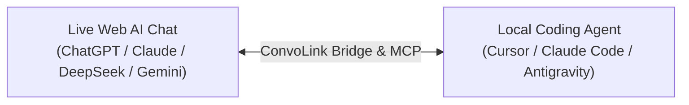

# ConvoLink (`convolink` / `convo`)

> **Your AI Architect and Coding Agent. Finally Connected.**  
> *Your web chat holds the architectural masterplan. Your IDE agent has the hands to write code. ConvoLink connects them directly—eliminating the exhausting human copy-paste relay.*

[](https://www.npmjs.com/package/convolink)
[](https://www.npmjs.com/package/convolink)
[](https://bun.sh)
[](https://www.typescriptlang.org)
[-success)](https://bun.sh)
[](https://github.com/0xTanzim/convolink/releases)
[](https://0xtanzim.github.io/convolink/)
[](LICENSE)

---

## ⚡ The Core Problem: The Human Context-Relay Trap

When building software with AI today, developers work in two disconnected worlds:

```text
┌──────────────────────────────────────────────┐       ┌──────────────────────────────────────────────┐
│       The Architectural Brain (Web AI)       │       │           The Coding Hands (IDE)             │
├──────────────────────────────────────────────┤       ├──────────────────────────────────────────────┤
│ ChatGPT Plus, Claude Pro, DeepSeek, Gemini   │       │ Cursor, Claude Code, Antigravity, Shell      │
│ • Holds days of accumulated research & ADRs  │       │ • Great at editing files & running tests     │
│ • State machines, schemas, security rules    │       │ • But starts with TOTAL AMNESIA              │
│ • Rejected trade-offs and domain invariants  │       │ • Blind to your web AI research & masterplan │
└──────────────────────────────────────────────┘       └──────────────────────────────────────────────┘
                       ▲                                                       ▲
                       │                                                       │
                       └────────────────── [ THE DEVELOPER ] ──────────────────┘
                                         (Manual Context Courier)
                          Copies agent doubts & logs to browser →
                          Waits for web AI to formulate specs & invariants →
                          Copies architectural direction back to IDE...
```

### Why Disconnected Agents Fail
1. **Architectural Amnesia:** When you open Cursor or Claude Code, the agent has zero connection to your upstream web research. When it hits an architectural boundary, you must manually copy its questions to the browser, wait for the web AI to specify the data model or flow, and copy the specifications back to your IDE.
2. **Architectural Drift:** If you step away or miss relaying a doubt, the local agent makes assumptions, drifts from your agreed masterplan, and writes conflicting code.
3. **The Intelligence Bottleneck:** Local agents running smaller or cost-effective models struggle with complex concurrency, distributed systems, or difficult debugging. But metered API tokens for frontier models are expensive.

**Why should your IDE agent be trapped in isolation when you already subscribe to world-class reasoning, live web search, and deep research in your browser?**

---

## 💡 The Solution: ConvoLink

ConvoLink bridges your IDE agents directly to your live browser tabs across **Three Core Product Pillars**:



### 1. 🌉 The Context Bridge
Streams architectural specifications, state invariants, data schemas, and design trade-offs directly into local agents on demand, while symmetrically reporting milestone progress and discovered constraints back upstream to the web AI conversation.

### 2. 🧠 The Intelligence Bridge
Allows local coding agents running smaller or cost-effective models to delegate complex algorithmic reasoning, tricky debugging, and architectural judgment to powerful frontier web models.

### 3. ⚡ The Capability Bridge
Allows local agents to borrow upstream web capabilities—**extended thinking (DeepSeek v4.1 Flash, GPT-6 Asta, Claude Opus 5.5)**, **live web search grounding**, **deep research**, and **multi-model cross-validation**—using your existing authenticated web subscriptions with zero per-token API charges.

---

### Upstream Capability Borrowing Matrix

| Upstream Web AI Capability | What Your Local Coding Agent Gains |
| :--- | :--- |
| **Living Architectural Context** | Direct access to 1-2 days of accumulated R&D, ADRs, rejected trade-offs, and masterplan specifications without manual copy-pasting. |
| **Extended Thinking / Deep Reasoning** | Thorough, multi-step analysis of difficult concurrency race conditions, algorithmic bottlenecks, and formal invariants (`--think`). |
| **Live Web Search Grounding** | Real-time web intelligence: latest library releases, breaking changes, deprecation notices, and official migration guides. |
| **Multi-Model Consensus & Arbitration** | Cross-validates high-risk architectural decisions across Claude, ChatGPT, DeepSeek, and Gemini in parallel with Stage 2 Arbiter synthesis (`convo compare --arbitrate`). |
| **Automated Code Artifact Extraction** | When the upstream architect outputs production files with `// filepath:`, ConvoLink writes them directly into your repo (`-w`). |

---

## 🚀 60-Second Quickstart

### 1. Install or Run Instantly

#### One-Line Universal Installers
```bash
# Linux (Ubuntu/Debian, Fedora, Arch, Alpine) & macOS:
curl -fsSL https://raw.githubusercontent.com/0xTanzim/convolink/main/scripts/install.sh | bash

# Windows Native (PowerShell):
irm https://raw.githubusercontent.com/0xTanzim/convolink/main/scripts/install.ps1 | iex
```

##### ℹ️ What does the 1-Line Installer actually do?
- **Executable Wrapper:** Places a single lightweight shell wrapper at `~/.local/bin/convo` (Linux/macOS) or `%LOCALAPPDATA%\convolink\bin\convo.cmd` (Windows).
- **Auto-Updating Execution:** Invokes `bunx -y convolink@latest "$@"` (or `npx -y convolink@latest "$@"`), automatically executing the latest published version without requiring manual upgrades.
- **Zero Root / Zero Daemons:** Never prompts for `sudo`/Administrator rights, never runs background services, and never tampers with browser profiles or user data.
- **Non-Destructive PATH:** Tests if `~/.local/bin` is in `$PATH`, and safely guides adding `export PATH="$HOME/.local/bin:$PATH"` to `~/.bashrc`, `~/.zshrc`, or `~/.config/fish/config.fish`.

#### Or Run with Package Managers
```bash
# Run instantly with zero setup:
bunx -y convolink@latest doctor

# Or install globally:
bun add -g convolink
# (or: pnpm add -g convolink)
```

### 2. Connect Your Real Browser (Zero "Ghost Browsers")

ConvoLink adheres to the **Zero Ghost Browser Law**: it never spawns unauthenticated blank browser profiles. It connects directly to your existing authenticated sessions:

> ### ⚠️ Which path do I need?
> **Chrome, Brave, Edge or Chromium, using your normal profile? → Path A (the extension).**
> It is the only supported way to drive that profile: Chrome 136+ blocks remote debugging
> on the default profile, and no flag re-enables it.
>
> **Dedicated automation profile, headless container, or CI? → Path B (CDP).**
> CDP needs its own `--user-data-dir`; it will not attach to your everyday profile.

#### Path A: Companion Extension (Recommended for Chrome users — zero flags, zero restarts)

Drives the browser you are already signed into, with **no startup flags** and **no browser
restarts**. Your ChatGPT Plus, Claude Pro and DeepSeek sessions stay exactly where they are.

1. Download the extension ZIP from [GitHub Releases v1.3.5](https://github.com/0xTanzim/convolink/releases/tag/v1.3.5):
   - **Chrome / Brave / Edge:** `convolink-companion-chrome-v1.3.5.zip`
   - **Firefox / Zen Browser:** `convolink-companion-firefox-v1.3.5.zip`
2. Open `chrome://extensions/` (Chrome/Brave/Edge) or `about:debugging#/runtime/this-firefox` (Firefox/Zen Browser), enable Developer mode, and load the extension:
   - **Chrome / Brave / Edge:** Click **Load unpacked** and select `extensions/convolink-companion/.output/chrome-mv3`.
   - **Firefox / Zen Browser:** Click **Load Temporary Add-on...** and select `extensions/convolink-companion/.output/firefox-mv3/manifest.json` (or the zip file).
3. Pair the extension with your local runtime:
   ```bash
   convo ext pair          # prints the token and the exact folder Chrome must load
   convo daemon start      # keeps the bridge alive on port 9224
   convo ext status        # client, profile, build id, tab count
   ```
4. Confirm the transport works before scripting anything:
   ```bash
   convo ask -p chatgpt --transport extension-bridge "Reply with the single word: ready"
   ```

The extension exposes a **fixed operation set** (probe, read, fill, click, key, navigate).
It cannot run arbitrary JavaScript — MV3's content-script CSP forbids `eval()`. That is a
security boundary, not a limitation to work around: unsupported probes fail loudly as
`extension-unsupported` instead of executing something unexpected.

<details>
<summary><b>What the extension refuses to do (by design)</b></summary>

| Refused | Reason |
|---|---|
| Close a tab you opened | Reports `not-owned` (exit 4). Automation must not destroy your work. |
| Evaluate arbitrary JavaScript | MV3 CSP; the extension maps known probes to typed operations instead. |
| Screenshot without permission | `captureVisibleTab` needs `<all_urls>` or a user gesture; otherwise `unsupported`. |
| Silently drive the wrong browser | Every command is bound to a specific target id. |

</details>

#### Path B: Direct Remote Debugging (dedicated profiles, headless, CI)

> **⚠️ CDP cannot attach to a default Chrome / Brave / Edge / Chromium profile on version 136 or newer.**
> The port accepts TCP, but `/json/version` returns **404** and ConvoLink reports
> `Blocked: this endpoint is the browser's default profile` in `convo doctor`.
> Use the extension for your normal profile, or start a dedicated profile below.
> The CDP port is `9222`; the extension bridge uses `9224` — different transports, different ports.

Connect directly via Chrome DevTools Protocol (CDP) against a profile you own:

<details>
<summary><b>🐧 Fedora & RHEL / CentOS Linux</b></summary>

```bash
# Launch Chrome with remote debugging on port 9222
google-chrome --remote-debugging-port=9222 &

# Or use ConvoLink auto-launch
convo doctor --launch
```
</details>

<details>
<summary><b>🐧 Ubuntu, Debian, Linux Mint & Pop!_OS</b></summary>

```bash
# Standard APT Google Chrome
google-chrome --remote-debugging-port=9222 &

# Chromium (APT or Snap)
chromium-browser --remote-debugging-port=9222 &
```
*Note for Snap/Flatpak users: ConvoLink automatically discovers sandboxed binaries at `/snap/bin/` and `/var/lib/flatpak/exports/bin/`.*
</details>

<details>
<summary><b>🏹 Arch Linux & Manjaro</b></summary>

```bash
# Google Chrome (AUR) or Chromium (official repo)
google-chrome-stable --remote-debugging-port=9222 &
# or
chromium --remote-debugging-port=9222 &
```
</details>

<details>
<summary><b>🏔️ Alpine Linux (musl libc / Docker)</b></summary>

```bash
# Install Chromium
apk add chromium

# Launch with container-safe flags
chromium-browser --remote-debugging-port=9222 --headless=new --disable-gpu --disable-dev-shm-usage --no-sandbox &
```
</details>

<details>
<summary><b>🦾 Linux ARM64 (Raspberry Pi, Asahi Linux, Ampere Cloud VMs)</b></summary>

Official Google Chrome `.deb`/`.rpm` is x86_64 only. On ARM64 Linux, ConvoLink automatically prioritizes native Chromium:
```bash
# Install native ARM64 Chromium
sudo apt install chromium-browser # (Debian/Ubuntu)
# or: sudo dnf install chromium     # (Fedora)

chromium-browser --remote-debugging-port=9222 &
```
</details>

<details>
<summary><b>🍎 macOS (Apple Silicon M1/M2/M3/M4 & Intel)</b></summary>

```bash
# Launch Google Chrome with remote debugging
"/Applications/Google Chrome.app/Contents/MacOS/Google Chrome" --remote-debugging-port=9222 &

# Or launch Brave
"/Applications/Brave Browser.app/Contents/MacOS/Brave Browser" --remote-debugging-port=9222 &

# Or launch Microsoft Edge
"/Applications/Microsoft Edge.app/Contents/MacOS/Microsoft Edge" --remote-debugging-port=9222 &
```
</details>

<details>
<summary><b>🪟 Windows Native (PowerShell / Command Prompt)</b></summary>

```powershell
# Launch Google Chrome with remote debugging on port 9222
Start-Process "chrome.exe" -ArgumentList "--remote-debugging-port=9222"

# Or use ConvoLink debug probe
powershell -File .\scripts\convo-debug.ps1
```
</details>

<details>
<summary><b>🌉 Windows Subsystem for Linux (WSL2) Cross-Boundary Bridging</b></summary>

ConvoLink running inside WSL2 connects directly to your Windows host Chrome session!

1. **On Windows Host:** Launch Chrome with remote debugging:
   ```powershell
   chrome.exe --remote-debugging-port=9222
   ```
2. **On Windows Host (One-Time Setup):** Allow port 9222 across the WSL2 vEthernet adapter in Administrator PowerShell:
   ```powershell
   # 1-Click setup via ConvoLink helper
   powershell -File .\scripts\convo-debug.ps1 -ConfigureWslBridge

   # Or manually:
   netsh interface portproxy add v4tov4 listenport=9222 listenaddress=0.0.0.0 connectport=9222 connectaddress=127.0.0.1
   New-NetFirewallRule -DisplayName "WSL Chrome CDP" -Direction Inbound -Protocol TCP -LocalPort 9222 -Action Allow
   ```
3. **Inside WSL2:** ConvoLink automatically probes `127.0.0.1` and falls back to your Windows default gateway (`ip route show default`):
   ```bash
   convo doctor
   ```
</details>

<details>
<summary><b>☁️ Cloud MicroVMs & Headless CI/CD Containers</b></summary>

ConvoLink automatically injects container-safe flags (`--headless=new`, `--disable-gpu`, `--disable-dev-shm-usage`, `--no-sandbox`) when no display server is detected:
```bash
convo doctor --launch
# Or manually:
google-chrome --remote-debugging-port=9222 --headless=new --disable-gpu --disable-dev-shm-usage --no-sandbox &
```
</details>

<br/>

- **Dedicated Persistent AI Profile:** If you prefer a standalone browser window that saves all your logins across reboots:
  ```bash
  google-chrome --remote-debugging-port=9222 --user-data-dir="$HOME/.config/convolink/profiles/ai-profile" &
  ```

#### Extension vs CDP at a glance

| | Companion Extension | Direct CDP |
| :--- | :--- | :--- |
| Your everyday logged-in profile | **Yes** | Blocked on Chrome 136+ |
| Browser flags / restart | **None** | `--remote-debugging-port` + `--user-data-dir` |
| Port | `9224` (WebSocket bridge) | `9222` (default) |
| Arbitrary JavaScript | No — fixed operation set | Yes |
| Screenshots | `<all_urls>` or a user gesture | Yes |
| Best for | Real work in your real browser | Automation profiles, headless, CI |

### 3. Verify Connection Health (`convo doctor`)
```bash
convo doctor
```
```text
🔍 Running ConvoLink Doctor...
[CDP Transport] Status: ONLINE (Latency: 1ms)
[Tabs] Found 4 supported AI tab(s):
  • [CHATGPT] Architecture Discussion - ChatGPT (TargetId: A16BE3...) ✅ READY
  • [CLAUDE] Concurrency Refactoring - Claude (TargetId: 44F12A...) ✅ READY
  • [DEEPSEEK] Algorithmic Optimization - DeepSeek (TargetId: 713AD6...) ✅ READY
  • [GEMINI] Cloud Deployment Strategy - Gemini (TargetId: 837BDC...) ✅ READY
```

---


## ⚠️ Known extension-transport limitations

Two platform-side behaviours are open; neither returns a wrong answer silently.

| Platform | Behaviour | Workaround |
|---|---|---|
| DeepSeek | The prompt is delivered but the transcript may not mount (`turns: 0`), ending as `transport-timeout` | Reload the tab; the conversation renders with the answer |
| Gemini | UI lives in a shadow root, so `DIAGNOSE` shows `sendFound: false` on a working tab, and completion is the slowest in the fleet (3.6 s to > 100 s) | Prefer ChatGPT/Claude/DeepSeek for latency-sensitive work; submission still succeeds via the Enter fallback |

Full analysis, evidence and options: [`docs/EXTENSION_TRANSPORT_ISSUES.md`](docs/EXTENSION_TRANSPORT_ISSUES.md).
Command surface and the unsupported boundary: [`docs/EXTENSION_CONTROL.md`](docs/EXTENSION_CONTROL.md).

## 🧭 First Run and Browser Support

Run `convo setup` once per project. It lists the browsers and profiles it can see,
lets you pick with arrow keys, mouse, or by typing, verifies the choice against the
real session, and writes `.convo/config.json`. Later commands reuse it; no flags
and no guessing.

```bash
convo setup                # interactive: browser -> profile -> verify -> save
convo setup --show         # what is configured, and where each value came from
convo setup --browser=zen --profile=/home/you/.zen/abc.default  # non-interactive (agents)
convo setup --reset        # forget the selection
```

| Browser | Debug on the real default profile? | What ConvoLink does |
|---|---|---|
| Chrome | No — blocked even after the approval dialog | Real profile: **use the Companion Extension**. CDP: requires a dedicated `--user-data-dir`; the default profile is refused before a socket is opened |
| Brave | No | Same as Chrome: extension for the real profile, CDP only on a dedicated one |
| Edge | No | Same as Chrome: extension for the real profile, CDP only on a dedicated one |
| Chromium | No | Same as Chrome: extension for the real profile, CDP only on a dedicated one |
| Firefox | Yes, but one BiDi session and one process per profile | Reuses the running session, or starts the same profile with `convo connect --firefox`; never spawns a second instance |
| Zen | Yes, same rules as Firefox | Same as Firefox |

Firefox and Zen allow the real profile over BiDi, so your logins come along.
Chromium-family browsers hard-block remote debugging on the default profile, so there are
only two honest options: **the Companion Extension for your real profile**, or **CDP
against a separate `--user-data-dir`**. Nothing else attaches to your everyday Chrome.

No path enables the extension automatically, and no path kills a browser you did not ask
it to restart.

## 🛠️ The 4 Core Workflows

### 1. Ingest Architectural Specs & Invariants
Query the upstream conversation for specifications and state invariants:
```bash
convo ask --platform claude \
  "We are ready to implement Milestone 2. Provide the transition table, invariant list, and error codes we decided on during research."
```

### 2. Resolve Agent Doubts & Report Milestone Progress
Sync local agent findings and resolve technical forks directly with the upstream architect:
```bash
convo ask --platform chatgpt \
  "Milestone 1 is complete. During implementation of the lock service, we noticed potential contention under high write volume. Should we invalidate stale leases immediately or let the 180s TTL expire?"
```

### 3. Multi-Model Consensus & Arbitration (`convo compare`)
Broadcast proposals across multiple models in parallel with Stage 2 Technical Arbiter synthesis:
```bash
convo compare \
  "Evaluate trade-offs between distributed SQLite (Litestream/LiteFS) vs PostgreSQL for a multi-tenant event ledger. Identify single points of failure." \
  --platforms chatgpt,claude,deepseek,gemini \
  --arbitrate \
  --arbiter deepseek \
  --out-dir ./comparison-results
```

### 4. Search Past Architectural Decisions (`convo search`)
Search through all past turns and code blocks captured in the local **SQLite FTS5 ledger**:
```bash
convo search "JWT refresh token rotation invariants" --limit 5
```

---

## 🔌 Universal AI Coding Harnesses Integration

ConvoLink includes an ephemeral, lightweight Model Context Protocol (MCP) server over `stdio` designed specifically for autonomous AI coding agents. It connects directly to all modern 2026 AI harnesses with zero background daemons.

### 1. Harness Configuration Matrix

| AI Coding Harness | Primary Configuration File | Registration / CLI Command |
| :--- | :--- | :--- |
| **Google Antigravity** | `~/.gemini/config/mcp_config.json`<br/>*(or `.agents/mcp_config.json`)* | Side Panel > `...` > **MCP Servers** |
| **OpenAI Codex** | `~/.codex/config.toml` | `codex mcp add convolink -- bunx -y convolink@latest mcp` |
| **Anthropic Claude Code** | `.claude/mcp.json` | `claude mcp add convolink -- bunx -y convolink@latest mcp` |
| **Cursor IDE** | `.cursor/mcp.json`<br/>*(or `~/.cursor/mcp.json`)* | Settings > Features > **MCP** |
| **Devin Desktop / Windsurf** | `~/.config/devin/mcp_config.json`<br/>*(or `.devin/mcp_config.json`)* | Cascade Menu > **Open MCP config file** |
| **Cline / Roo Code** | Extension Global Storage | Extension Header > **MCP Servers** tab |
| **CommandCode / OpenCode** | `.mcp/config.json` | Project Root Configuration |
| **Aider & Shell Agents** | Native CLI Subshell | `convo ask` / `convo search` piped into prompts |

*For complete step-by-step setup guides, schemas, and live docs, visit:*  
👉 **[AI Coding Harnesses Guide (Web)](https://0xtanzim.github.io/convolink/integrations/ai-harnesses/)** • **[Raw Markdown for AI Crawlers](https://raw.githubusercontent.com/0xTanzim/convolink/main/docs/AI_HARNESSES.md)**

```json
{
  "mcpServers": {
    "convolink": {
      "command": "bunx",
      "args": ["-y", "convolink@latest", "mcp"]
    }
  }
}
```
*(You can also pass `--idle-timeout=15m` to customize ephemeral shutdown.)*

---

## 🤖 For AI Agents: One Command, Zero Guessing

A fresh agent usually burns ten minutes rediscovering the transport, the pairing token and
the config schema. Two commands remove that entirely.

### 1. Ask what is ready, get one next step

```bash
convo onboard --json
# If `convo` is not on PATH yet (fresh machine), the same command is:
bunx convolink@latest onboard --json
```

```json
{
  "ok": false,
  "data": {
    "steps": [
      { "id": "daemon", "status": "done" },
      { "id": "extension", "status": "todo", "action": { "kind": "user", "instruction": "Open chrome://extensions … Token: 43a5…" } },
      { "id": "profile", "status": "todo" }
    ],
    "nextAction": { "kind": "user", "instruction": "…", "why": "Only a human can load the unpacked extension." },
    "requiresUserSelection": { "question": "Which browser profile should ConvoLink drive?", "options": ["Personal <you@example.com> (chrome)"] }
  }
}
```

`nextAction.kind` is `command` (the agent runs it), `user` (print the instruction and stop) or
`tool` (call that MCP tool). Repeat until `ok: true`. This is also exposed as the
`convo_onboard` MCP tool.

**Never hand-edit `.convo/config.json`.** The profile is a human decision; `onboard` returns
the choice, and `convo profile select` writes it.

Exit codes are the contract: `0` ok, `2` configuration, `3` transport down, `4` **a human
must act in the browser**, `5` reached but not ready, `6` internal.

### 2. Install the Agent Skill so your AI Assistant knows ConvoLink

Install the standard `SKILL.md` directly into your coding agent's skill environment:

```bash
# Universal Agent Skills standard (installs into active agent's skill directory):
npx skills add 0xTanzim/convolink
# or via bunx:
bunx skills add 0xTanzim/convolink

# Or install natively via ConvoLink CLI:
convo skill install --harness opencode    # or claude, cursor, codex, antigravity
convo skill list
```

| Harness / Agent | Target Skill Path | Format |
|---|---|---|
| **Antigravity** | `.agents/skills/convolink/SKILL.md` | Standard `SKILL.md` + references |
| **Claude Code** | `.claude/skills/convolink/SKILL.md` | Standard `SKILL.md` + references |
| **OpenCode** | `.opencode/skills/convolink/SKILL.md` | Standard `SKILL.md` + references |
| **Codex** | `.codex/skills/convolink/SKILL.md` | Standard `SKILL.md` + references |
| **Cursor** | `.cursor/rules/convolink.mdc` | MDC Rule format |
| **Windsurf** | `.windsurfrules` | Context Rules format |

- **Direct Raw Skill URL:** [`https://raw.githubusercontent.com/0xTanzim/convolink/main/skills/convolink/SKILL.md`](https://raw.githubusercontent.com/0xTanzim/convolink/main/skills/convolink/SKILL.md)
- **Full Skill Package & References:** [GitHub `skills/convolink/`](https://github.com/0xTanzim/convolink/tree/main/skills/convolink)
  - [Browser Guide (Firefox, Zen, Chrome, Brave, Edge)](https://github.com/0xTanzim/convolink/blob/main/skills/convolink/references/browsers.md)
  - [Complete CLI Manual](https://github.com/0xTanzim/convolink/blob/main/skills/convolink/references/cli.md)
  - [MCP Tools & Error Codes Schema](https://github.com/0xTanzim/convolink/blob/main/skills/convolink/references/mcp.md)
  - [Artifact Directives Guide](https://github.com/0xTanzim/convolink/blob/main/skills/convolink/references/directives.md)

### 3. Clients that support MCP elicitation get a real question

If the harness advertises `elicitation`, `convo_setup` with **no arguments** asks the user to
pick a profile in a native modal, waits up to five minutes, writes `.convo/config.json` and
returns `answeredBy: "elicitation"`. Clients without the capability (Claude Code, Codex
today) receive the same choice as a `requiresUserSelection` text block — nothing hangs.

---

## 🧰 Complete Tool Suites: 19 CLI Tools & 11 MCP Tools

ConvoLink provides both a complete **19-command CLI suite** for terminal workflows and an **11-tool cognitive MCP suite** optimized for autonomous agents:

### 1. The 19 Command-Line (CLI) Tools
*Detailed Reference: [CLI Reference (Web)](https://0xtanzim.github.io/convolink/commands/overview/) • [Raw Markdown](https://raw.githubusercontent.com/0xTanzim/convolink/main/docs/CLI_REFERENCE.md)*

| # | Command | Primary Usage | Functional Purpose |
| :- | :--- | :--- | :--- |
| **1** | `doctor` | `convo doctor [--launch]` | Inspect CDP latency, open AI tabs, selector health, and host OS diagnostics. |
| **2** | `list` | `convo list` | Discover and enumerate all active browser tabs on supported AI platforms. |
| **3** | `ask` | `convo ask "<prompt>" [flags]` | Submit prompt to an AI tab, stream reply, and automatically extract code artifacts. |
| **4** | `compare` | `convo compare "<prompt>" [flags]` | Broadcast task across multiple models in parallel with Stage 2 Arbiter consensus. |
| **5** | `tab new` | `convo tab new <platform\|url>` | Spawn a clean background tab for an AI platform (e.g. `deepseek`) or URL. |
| **6** | `tab close` | `convo tab close <targetId>` | Non-destructively terminate an idle tab without affecting the browser. |
| **7** | `back` | `convo back [targetId]` | Navigate active browser tab backward in browser session history. |
| **8** | `undo` | `convo undo [targetId]` | Recover from an accidental chat reset by rolling back to previous checkpoint URL. |
| **9** | `history` | `convo history [targetId]` | Inspect timestamped session checkpoints and thread navigation history. |
| **10** | `resume` | `convo resume <threadId>` | Rehydrate past conversation thread from SQLite ledger into live browser tab. |
| **11** | `export` | `convo export <threadId> [--format]` | Dump durable conversation ledger into Markdown or structured JSON. |
| **12** | `search` | `convo search <query> [--limit]` | Full-text FTS5 search across all past turns, prompts, and extracted code. |
| **13** | `profile list` | `convo profile list` | Discover local Google Chrome, Brave, and Edge profiles with Google account emails. |
| **14** | `profile select` | `convo profile select <id\|email>` | Persist selected browser profile in workspace `.convo/config.json`. |
| **15** | `ext pair` | `convo ext pair [--rotate]` | Generate and display cryptographic token for zero-flag Companion Extension. |
| **16** | `clean` | `convo clean` | Self-heal by terminating orphan ghost Chrome processes and stale mutex locks. |
| **17** | `onboard` | `convo onboard [--json]` | Report readiness (daemon, pairing, profile, transport) and the single next step, with agent-branchable exit codes. |
| **18** | `skill` | `convo skill install --harness <name>` | Write the ConvoLink agent skill into the harness's skill directory. |
| **19** | `daemon` | `convo daemon [status\|start\|stop]` | Manage the background bridge daemon that owns port 9224. |
| **+** | `mcp` | `convo mcp [--idle-timeout]` | Launch Model Context Protocol (MCP) JSON-RPC 2.0 stdio server for agents. |

---

### 2. The 11 Composite MCP Cognitive Tools (for Autonomous Agents)
*Detailed Reference: [MCP Reference (Web)](https://0xtanzim.github.io/convolink/integrations/mcp/) • [Raw Markdown](https://raw.githubusercontent.com/0xTanzim/convolink/main/docs/MCP_REFERENCE.md)*

| Tool | Autonomous Agent Role | Key Parameters |
|:---|:---|:---|
| `convo_onboard` | Readiness report plus the single next step (`command` / `user` / `tool`). Call this first, and again after acting on it. | *(none)* |
| `convo_status` | Resolved browser, profile, transport and endpoint for the project, with the source of each value. | *(none)* |
| `convo_setup` | Persist browser + profile. Called with no arguments it returns the profile choice, or asks the user directly when the client supports elicitation. | `browser?`, `profile?`, `transport?`, `verifyTab?` |
| `convo_ask` | Dispatch prompts to active web AI tab, stream responses, and auto-extract code artifacts (`// filepath:`). | `prompt`, `platform?`, `targetId?`, `writeFiles?`, `outDir?`, `newChat?`, `openTab?`, `think?`, `search?` |
| `convo_compare` | Multi-model consensus: broadcast across models in parallel with Stage 2 Technical Arbiter synthesis. | `prompt`, `platforms?`, `arbitrate?`, `arbiter?` |
| `convo_doctor` | Inspect connection health and open AI tabs. Pass `fix: true` to self-heal stale mutex locks and ghost processes. | `fix?` |
| `convo_list_tabs` | Discover active AI tabs (ChatGPT, Claude, DeepSeek, Gemini) without window-focus theft. | *(none)* |
| `convo_tab` | Tab lifecycle management: spawn background tab (`new`), close tab (`close`), navigate back (`back`), or undo reset (`undo`). | `action: "new" \| "close" \| "back" \| "undo"`, `target?`, `targetId?` |
| `convo_search` | Full-text search (SQLite FTS5) across historical turns, architectural decisions, and extracted code artifacts. | `query`, `limit?` |
| `convo_thread` | Thread management: export conversation history to Markdown/JSON (`export`), resume thread (`resume`), or view checkpoints (`history`). | `action: "export" \| "resume" \| "history"`, `threadId?`, `targetId?`, `format?` |
| `convo_profile` | Multi-browser profile management: discover Chrome/Edge/Brave profiles (`list`) or bind workspace to profile (`select`). | `action: "list" \| "select"`, `target?` |

---

## 🤖 Direct Ingestion Links for AI Web Crawlers

If you are an AI agent, indexing bot, or automated crawler reading this repository, direct Markdown documentation is available at:
- **AI Coding Harnesses Guide (Raw):** `https://raw.githubusercontent.com/0xTanzim/convolink/main/docs/AI_HARNESSES.md`
- **16-Command CLI Reference (Raw):** `https://raw.githubusercontent.com/0xTanzim/convolink/main/docs/CLI_REFERENCE.md`
- **11-Tool MCP Specification (Raw):** `https://raw.githubusercontent.com/0xTanzim/convolink/main/docs/MCP_REFERENCE.md`
- **Architecture Masterplan (Raw):** `https://raw.githubusercontent.com/0xTanzim/convolink/main/docs/ARCHITECTURE.md`
- **Architecture Decision Records (Raw):** `https://raw.githubusercontent.com/0xTanzim/convolink/main/docs/ADR.md`

---

## 🏗️ Architecture & Operational Safety

- 🎯 **Zero Window-Focus Theft:** Operates silently in the background via CDP lifecycle commands (`Page.setWebLifecycleState: active`). Your typing focus is never interrupted.
- 🔒 **PID-Aware `tmpfs` Mutex Locking:** Prevents prompt collisions across concurrent processes using lock files in `$XDG_RUNTIME_DIR/convolink/`. Dead process locks are automatically reclaimed.
- 🛡️ **Outbound Secret Scrubbing:** Automatically scrubs API keys (`sk-...`, `ghp_...`, AWS secrets, `.env` pairs) to `[REDACTED_SECRET]` before transmission.
- 🚪 **Safe Browser Detach:** ConvoLink **never** calls `browser.close()`. It disconnects cleanly, keeping your everyday tabs and logins intact.
- 🏛️ **Hexagonal Pure Domain Kernel:** `src/core/` contains **0 browser or network imports**, ensuring 100% testability with sub-millisecond in-memory doubles.

---

## 🧪 Testing & Verification

```bash
bun test          # Runs full 309-test suite across 59 test files (100% pass)
bun run typecheck # Strict TypeScript 7 typecheck (0 errors)
bun run build     # Compiles zero-dependency standalone dist bundles
```

---

## 📖 Complete Documentation & Architectural ADRs

Visit our official documentation site for complete architectural guides, ADR-001 through ADR-017, and Linux setup:  
👉 **[https://0xtanzim.github.io/convolink/](https://0xtanzim.github.io/convolink/)**

### 🤖 Agent-Ready Documentation
For LLMs, autonomous coding agents, and IDE context injection:
- **Index (`/llms.txt`):** [https://0xtanzim.github.io/convolink/llms.txt](https://0xtanzim.github.io/convolink/llms.txt) (Curated markdown index and prompt context)
- **Full Bundle (`/llms-full.txt`):** [https://0xtanzim.github.io/convolink/llms-full.txt](https://0xtanzim.github.io/convolink/llms-full.txt) (Single-file concatenated complete documentation)

---

## 📄 Maintainer & License

- **Maintainer:** Tanzim Hossain ([@0xTanzim](https://github.com/0xTanzim) • `tanzimhossain2@gmail.com`)
- **npm Registry:** [`convolink` on npm](https://www.npmjs.com/package/convolink)
- **Repository:** [https://github.com/0xTanzim/convolink](https://github.com/0xTanzim/convolink)
- **Issues & Support:** [https://github.com/0xTanzim/convolink/issues](https://github.com/0xTanzim/convolink/issues)
- **License:** MIT © 2026 Tanzim Hossain & ConvoLink Contributors. See [LICENSE](LICENSE) for details.
