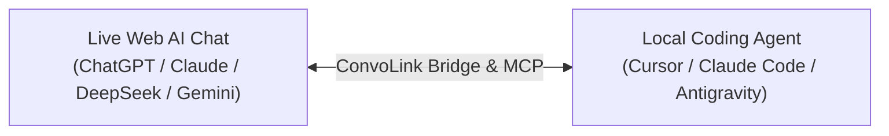

# ConvoLink (`convolink` / `convo`)

> **Your AI Architect and Coding Agent. Finally Connected.**  
> *Your web chat holds the architectural masterplan. Your IDE agent has the hands to write code. ConvoLink connects them directly—eliminating the exhausting human copy-paste relay.*

[](https://www.npmjs.com/package/convolink)
[](https://www.npmjs.com/package/convolink)
[](https://bun.sh)
[](https://www.typescriptlang.org)
[-success)](https://bun.sh)
[](https://github.com/0xTanzim/convolink/releases)
[](https://0xtanzim.github.io/convolink/)
[](LICENSE)

---

## ⚡ The Core Problem: The Human Context-Relay Trap

When building software with AI today, developers work in two disconnected worlds:

```text
┌──────────────────────────────────────────────┐       ┌──────────────────────────────────────────────┐
│       The Architectural Brain (Web AI)       │       │           The Coding Hands (IDE)             │
├──────────────────────────────────────────────┤       ├──────────────────────────────────────────────┤
│ ChatGPT Plus, Claude Pro, DeepSeek, Gemini   │       │ Cursor, Claude Code, Antigravity, Shell      │
│ • Holds days of accumulated research & ADRs  │       │ • Great at editing files & running tests     │
│ • State machines, schemas, security rules    │       │ • But starts with TOTAL AMNESIA              │
│ • Rejected trade-offs and domain invariants  │       │ • Blind to your web AI research & masterplan │
└──────────────────────────────────────────────┘       └──────────────────────────────────────────────┘
                       ▲                                                       ▲
                       │                                                       │
                       └────────────────── [ THE DEVELOPER ] ──────────────────┘
                                         (Manual Context Courier)
                          Copies agent doubts & logs to browser →
                          Waits for web AI to formulate specs & invariants →
                          Copies architectural direction back to IDE...
```

### Why Disconnected Agents Fail
1. **Architectural Amnesia:** When you open Cursor or Claude Code, the agent has zero connection to your upstream web research. When it hits an architectural boundary, you must manually copy its questions to the browser, wait for the web AI to specify the data model or flow, and copy the specifications back to your IDE.
2. **Architectural Drift:** If you step away or miss relaying a doubt, the local agent makes assumptions, drifts from your agreed masterplan, and writes conflicting code.
3. **The Intelligence Bottleneck:** Local agents running smaller or cost-effective models struggle with complex concurrency, distributed systems, or difficult debugging. But metered API tokens for frontier models are expensive.

**Why should your IDE agent be trapped in isolation when you already subscribe to world-class reasoning, live web search, and deep research in your browser?**

---

## 💡 The Solution: ConvoLink

ConvoLink bridges your IDE agents directly to your live browser tabs across **Three Core Product Pillars**:



### 1. 🌉 The Context Bridge
Streams architectural specifications, state invariants, data schemas, and design trade-offs directly into local agents on demand, while symmetrically reporting milestone progress and discovered constraints back upstream to the web AI conversation.

### 2. 🧠 The Intelligence Bridge
Allows local coding agents running smaller or cost-effective models to delegate complex algorithmic reasoning, tricky debugging, and architectural judgment to powerful frontier web models.

### 3. ⚡ The Capability Bridge
Allows local agents to borrow upstream web capabilities—**extended thinking (DeepSeek R1, OpenAI o-series)**, **live web search grounding**, **deep research**, and **multi-model cross-validation**—using your existing authenticated web subscriptions with zero per-token API charges.

---

### Upstream Capability Borrowing Matrix

| Upstream Web AI Capability | What Your Local Coding Agent Gains |
| :--- | :--- |
| **Living Architectural Context** | Direct access to 1-2 days of accumulated R&D, ADRs, rejected trade-offs, and masterplan specifications without manual copy-pasting. |
| **Extended Thinking / Deep Reasoning** | Thorough, multi-step analysis of difficult concurrency race conditions, algorithmic bottlenecks, and formal invariants (`--think`). |
| **Live Web Search Grounding** | Real-time web intelligence: latest library releases, breaking changes, deprecation notices, and official migration guides. |
| **Multi-Model Consensus & Arbitration** | Cross-validates high-risk architectural decisions across Claude, ChatGPT, DeepSeek, and Gemini in parallel with Stage 2 Arbiter synthesis (`convo compare --arbitrate`). |
| **Automated Code Artifact Extraction** | When the upstream architect outputs production files with `// filepath:`, ConvoLink writes them directly into your repo (`-w`). |

---

## 🚀 60-Second Quickstart

### 1. Install or Run Instantly

#### One-Line Universal Installers
```bash
# Linux (Ubuntu/Debian, Fedora, Arch, Alpine) & macOS:
curl -fsSL https://raw.githubusercontent.com/AgentConversation/convolink/main/scripts/install.sh | bash

# Windows Native (PowerShell):
irm https://raw.githubusercontent.com/AgentConversation/convolink/main/scripts/install.ps1 | iex
```

#### Or Run with Package Managers
```bash
# Run instantly with zero setup:
bunx -y convolink@latest doctor

# Or install globally:
bun add -g convolink
# (or: pnpm add -g convolink)
```

### 2. Connect Your Real Browser (Zero "Ghost Browsers")

ConvoLink adheres to the **Zero Ghost Browser Law**: it never spawns unauthenticated blank browser profiles. It connects directly to your existing authenticated sessions:

#### Path A: Companion Extension (Recommended — 100% Zero Flags)
Connects directly to your everyday browser session with **zero Chrome startup flags** and **zero browser restarts**.
1. Download the extension ZIP from [GitHub Releases v1.0.0](https://github.com/0xTanzim/convolink/releases/tag/v1.0.0):
   - **Chrome / Brave / Edge:** `convolink-companion-chrome.zip`
   - **Firefox:** `convolink-companion-firefox.zip`
2. Open `chrome://extensions/` (or `about:debugging` in Firefox), enable **Developer mode**, and click **Load unpacked**.
3. Pair the extension with your local runtime:
   ```bash
   convo ext pair
   ```

#### Path B: Direct Remote Debugging (Cross-Platform)

Connect directly via Chrome DevTools Protocol (CDP) or native launchers:

<details>
<summary><b>🐧 Fedora & RHEL / CentOS Linux</b></summary>

```bash
# Launch Chrome with remote debugging on port 9222
google-chrome --remote-debugging-port=9222 &

# Or use ConvoLink auto-launch
convo doctor --launch
```
</details>

<details>
<summary><b>🐧 Ubuntu, Debian, Linux Mint & Pop!_OS</b></summary>

```bash
# Standard APT Google Chrome
google-chrome --remote-debugging-port=9222 &

# Chromium (APT or Snap)
chromium-browser --remote-debugging-port=9222 &
```
*Note for Snap/Flatpak users: ConvoLink automatically discovers sandboxed binaries at `/snap/bin/` and `/var/lib/flatpak/exports/bin/`.*
</details>

<details>
<summary><b>🏹 Arch Linux & Manjaro</b></summary>

```bash
# Google Chrome (AUR) or Chromium (official repo)
google-chrome-stable --remote-debugging-port=9222 &
# or
chromium --remote-debugging-port=9222 &
```
</details>

<details>
<summary><b>🏔️ Alpine Linux (musl libc / Docker)</b></summary>

```bash
# Install Chromium
apk add chromium

# Launch with container-safe flags
chromium-browser --remote-debugging-port=9222 --headless=new --disable-gpu --disable-dev-shm-usage --no-sandbox &
```
</details>

<details>
<summary><b>🦾 Linux ARM64 (Raspberry Pi, Asahi Linux, Ampere Cloud VMs)</b></summary>

Official Google Chrome `.deb`/`.rpm` is x86_64 only. On ARM64 Linux, ConvoLink automatically prioritizes native Chromium:
```bash
# Install native ARM64 Chromium
sudo apt install chromium-browser # (Debian/Ubuntu)
# or: sudo dnf install chromium     # (Fedora)

chromium-browser --remote-debugging-port=9222 &
```
</details>

<details>
<summary><b>🍎 macOS (Apple Silicon M1/M2/M3/M4 & Intel)</b></summary>

```bash
# Launch Google Chrome with remote debugging
"/Applications/Google Chrome.app/Contents/MacOS/Google Chrome" --remote-debugging-port=9222 &

# Or launch Brave
"/Applications/Brave Browser.app/Contents/MacOS/Brave Browser" --remote-debugging-port=9222 &

# Or launch Microsoft Edge
"/Applications/Microsoft Edge.app/Contents/MacOS/Microsoft Edge" --remote-debugging-port=9222 &
```
</details>

<details>
<summary><b>🪟 Windows Native (PowerShell / Command Prompt)</b></summary>

```powershell
# Launch Google Chrome with remote debugging on port 9222
Start-Process "chrome.exe" -ArgumentList "--remote-debugging-port=9222"

# Or use ConvoLink debug probe
powershell -File .\scripts\convo-debug.ps1
```
</details>

<details>
<summary><b>🌉 Windows Subsystem for Linux (WSL2) Cross-Boundary Bridging</b></summary>

ConvoLink running inside WSL2 connects directly to your Windows host Chrome session!

1. **On Windows Host:** Launch Chrome with remote debugging:
   ```powershell
   chrome.exe --remote-debugging-port=9222
   ```
2. **On Windows Host (One-Time Setup):** Allow port 9222 across the WSL2 vEthernet adapter in Administrator PowerShell:
   ```powershell
   # 1-Click setup via ConvoLink helper
   powershell -File .\scripts\convo-debug.ps1 -ConfigureWslBridge

   # Or manually:
   netsh interface portproxy add v4tov4 listenport=9222 listenaddress=0.0.0.0 connectport=9222 connectaddress=127.0.0.1
   New-NetFirewallRule -DisplayName "WSL Chrome CDP" -Direction Inbound -Protocol TCP -LocalPort 9222 -Action Allow
   ```
3. **Inside WSL2:** ConvoLink automatically probes `127.0.0.1` and falls back to your Windows default gateway (`ip route show default`):
   ```bash
   convo doctor
   ```
</details>

<details>
<summary><b>☁️ Cloud MicroVMs & Headless CI/CD Containers</b></summary>

ConvoLink automatically injects container-safe flags (`--headless=new`, `--disable-gpu`, `--disable-dev-shm-usage`, `--no-sandbox`) when no display server is detected:
```bash
convo doctor --launch
# Or manually:
google-chrome --remote-debugging-port=9222 --headless=new --disable-gpu --disable-dev-shm-usage --no-sandbox &
```
</details>

<br/>

- **Dedicated Persistent AI Profile:** If you prefer a standalone browser window that saves all your logins across reboots:
  ```bash
  google-chrome --remote-debugging-port=9222 --user-data-dir="$HOME/.config/convolink/profiles/ai-profile" &
  ```

### 3. Verify Connection Health (`convo doctor`)
```bash
convo doctor
```
```text
🔍 Running ConvoLink Doctor...
[CDP Transport] Status: ONLINE (Latency: 1ms)
[Tabs] Found 4 supported AI tab(s):
  • [CHATGPT] Architecture Discussion - ChatGPT (TargetId: A16BE3...) ✅ READY
  • [CLAUDE] Concurrency Refactoring - Claude (TargetId: 44F12A...) ✅ READY
  • [DEEPSEEK] Algorithmic Optimization - DeepSeek (TargetId: 713AD6...) ✅ READY
  • [GEMINI] Cloud Deployment Strategy - Gemini (TargetId: 837BDC...) ✅ READY
```

---

## 🛠️ The 4 Core Workflows

### 1. Ingest Architectural Specs & Invariants
Query the upstream conversation for specifications and state invariants:
```bash
convo ask --platform claude \
  "We are ready to implement Milestone 2. Provide the transition table, invariant list, and error codes we decided on during research."
```

### 2. Resolve Agent Doubts & Report Milestone Progress
Sync local agent findings and resolve technical forks directly with the upstream architect:
```bash
convo ask --platform chatgpt \
  "Milestone 1 is complete. During implementation of the lock service, we noticed potential contention under high write volume. Should we invalidate stale leases immediately or let the 180s TTL expire?"
```

### 3. Multi-Model Consensus & Arbitration (`convo compare`)
Broadcast proposals across multiple models in parallel with Stage 2 Technical Arbiter synthesis:
```bash
convo compare \
  "Evaluate trade-offs between distributed SQLite (Litestream/LiteFS) vs PostgreSQL for a multi-tenant event ledger. Identify single points of failure." \
  --platforms chatgpt,claude,deepseek,gemini \
  --arbitrate \
  --arbiter deepseek \
  --out-dir ./comparison-results
```

### 4. Search Past Architectural Decisions (`convo search`)
Search through all past turns and code blocks captured in the local **SQLite FTS5 ledger**:
```bash
convo search "JWT refresh token rotation invariants" --limit 5
```

---

## 🔌 IDE & Agent Integration (MCP in 30 Seconds)

ConvoLink includes an ephemeral, lightweight Model Context Protocol (MCP) server over `stdio` designed specifically for autonomous AI coding agents (Cursor, Windsurf, Claude Code, Antigravity).

### 1. One-Line Agent Setup
For **Claude Code**:
```bash
claude mcp add convolink -- bunx -y convolink@latest mcp
```

For **Cursor** (`.cursor/mcp.json`) or **Claude Desktop**:
```json
{
  "mcpServers": {
    "convolink": {
      "command": "bunx",
      "args": ["-y", "convolink@latest", "mcp"]
    }
  }
}
```

*(You can also pass `--idle-timeout=10m` to customize ephemeral shutdown.)*

### 2. Autonomous 8-Tool Cognitive Suite
ConvoLink exposes an ergonomic, domain-partitioned tool suite optimized for high agent accuracy without context bloat:

| Tool | Autonomous Agent Role | Key Parameters |
|:---|:---|:---|
| `convo_ask` | Dispatch prompts to active web AI tab, stream responses, and auto-extract code artifacts (`// filepath:`). | `prompt`, `platform?`, `targetId?`, `think?`, `search?`, `extractArtifacts?` |
| `convo_compare` | Multi-model consensus: broadcast across models in parallel with Stage 2 Arbiter synthesis. | `prompt`, `platforms?`, `arbitrate?`, `arbiter?` |
| `convo_doctor` | Inspect connection health and open AI tabs. Auto-heals stale mutex locks when `fix: true`. | `fix?` |
| `convo_list_tabs` | Discover active AI tabs (ChatGPT, Claude, DeepSeek, Gemini) without window-focus theft. | *(none)* |
| `convo_tab` | Tab lifecycle management: open new chat, close tab, navigate back, or undo previous prompt. | `action: "new" \| "close" \| "back" \| "undo"`, `platform?`, `targetId?` |
| `convo_search` | Full-text search (SQLite FTS5) across past turns, decisions, and extracted code artifacts. | `query`, `limit?` |
| `convo_thread` | Thread management: export conversation history to Markdown/JSON, resume, or view checkpoints. | `action: "export" \| "resume" \| "history"`, `threadId?`, `targetId?`, `format?` |
| `convo_profile` | Multi-browser profile management: list discovered Chrome profiles or select active profile. | `action: "list" \| "select"`, `profileName?` |

---

## 🏗️ Architecture & Operational Safety

- 🎯 **Zero Window-Focus Theft:** Operates silently in the background via CDP lifecycle commands (`Page.setWebLifecycleState: active`). Your typing focus is never interrupted.
- 🔒 **PID-Aware `tmpfs` Mutex Locking:** Prevents prompt collisions across concurrent processes using lock files in `$XDG_RUNTIME_DIR/convolink/`. Dead process locks are automatically reclaimed.
- 🛡️ **Outbound Secret Scrubbing:** Automatically scrubs API keys (`sk-...`, `ghp_...`, AWS secrets, `.env` pairs) to `[REDACTED_SECRET]` before transmission.
- 🚪 **Safe Browser Detach:** ConvoLink **never** calls `browser.close()`. It disconnects cleanly, keeping your everyday tabs and logins intact.
- 🏛️ **Hexagonal Pure Domain Kernel:** `src/core/` contains **0 browser or network imports**, ensuring 100% testability with sub-millisecond in-memory doubles.

---

## 🧪 Testing & Verification

```bash
bun test          # Runs full 309-test suite across 59 test files (100% pass)
bun run typecheck # Strict TypeScript 7 typecheck (0 errors)
bun run build     # Compiles zero-dependency standalone dist bundles
```

---

## 📖 Complete Documentation & Architectural ADRs

Visit our official documentation site for complete architectural guides, ADR-001 through ADR-017, and Linux setup:  
👉 **[https://0xtanzim.github.io/convolink/](https://0xtanzim.github.io/convolink/)**

---

## 📄 Maintainer & License

- **Maintainer:** Tanzim Hossain ([@0xTanzim](https://github.com/0xTanzim) • `tanzimhossain2@gmail.com`)
- **npm Registry:** [`convolink` on npm](https://www.npmjs.com/package/convolink)
- **Repository:** [https://github.com/0xTanzim/convolink](https://github.com/0xTanzim/convolink)
- **Issues & Support:** [https://github.com/0xTanzim/convolink/issues](https://github.com/0xTanzim/convolink/issues)
- **License:** MIT © 2026 Tanzim Hossain & ConvoLink Contributors. See [LICENSE](LICENSE) for details.
