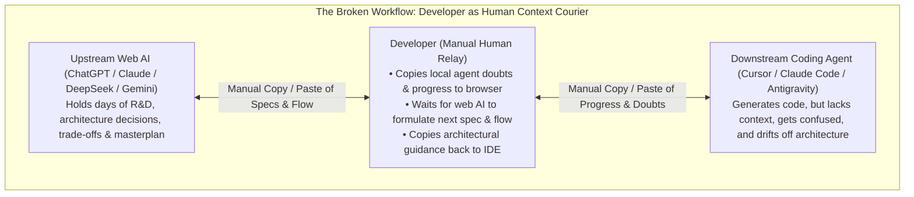
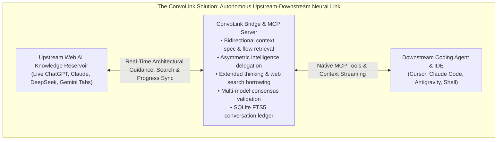

# ConvoLink (`convolink` / `convo`)

> **Your AI Architect and Coding Agent. Finally Connected.**  
> *Your project has a brain in your web chat. Your coding agent has hands in your IDE. ConvoLink connects them. Programmatically link local autonomous coding agents (Cursor, Claude Code, Antigravity) directly to your live upstream web AI sessions (ChatGPT, Claude, DeepSeek, Gemini) for bidirectional specifications, doubt resolution, and multi-model consensus.*

[](https://bun.sh)
[](https://www.typescriptlang.org)
[-success)](https://bun.sh)
[](https://github.com/0xTanzim/convolink/releases/tag/v1.0.0)
[](https://0xtanzim.github.io/convolink/)
[](#-architecture--operational-safety)
[](LICENSE)

---

## ⚡ The Dual Problem: Disconnected Context & Asymmetric Intelligence

Modern autonomous coding agents are proficient at generating code, executing terminal commands, and modifying files. **Raw code generation is no longer the primary bottleneck in software engineering.**

Software development requires understanding intent, researching technologies, evaluating trade-offs, validating decisions, and refining architecture. Today, developers face two fundamental structural bottlenecks:

### 1. The Context Bottleneck: The Human Context-Relay Trap
Before writing code, developers often spend hours or days in web AI conversations (**ChatGPT**, **Claude**, **DeepSeek**, **Gemini**) conducting technical research, selecting stacks, designing database schemas, identifying edge cases, and establishing architectural invariants.

Over time, this conversation accumulates something far more valuable than isolated answers: **the project's evolving mental model**. It knows not only *what* needs to be built, but *why* it needs to be built that way, which approaches were rejected, and what trade-offs were made.

When the developer switches to an autonomous coding agent inside their IDE, that agent starts with **architectural amnesia**—zero connection to the upstream R&D. The developer is trapped acting as a human relay:
- The local agent finishes a task or reaches an ambiguous design boundary.
- The developer manually copies the agent's doubts, questions, or logs into the browser chat.
- The upstream AI (which holds the whole masterplan) analyzes the context and generates the architectural specifications and next steps.
- The developer copies those instructions back into the terminal so the agent knows what to do.
- When the local agent finishes a milestone, the developer manually reports the progress back to the upstream AI to get the next milestone instructions.

When this relay breaks—if the developer steps away or fails to relay a doubt—the local agent makes assumptions, drifts from the architecture, and writes conflicting code.

### 2. The Intelligence & Cost Bottleneck: Local Agents Have Limited Capacity
Developers frequently run smaller, cheaper, or locally hosted models in their IDEs for routine development work (editing files, generating boilerplate, running tests). 

However, when the agent encounters an unfamiliar library, a complex distributed race condition, or a critical architectural fork, smaller models reach their reasoning limits. Traditionally, developers must either:
- Pay expensive, metered per-token API charges for high-tier models.
- Manually switch to a browser tab, re-explain the entire problem, and copy the answer back.

**Why should a local coding agent be restricted to the reasoning capacity of a local model when the developer already has access to frontier reasoning, live web search, and deep research through active web subscriptions?**



---

## 💡 The Solution: ConvoLink

ConvoLink eliminates the manual relay and empowers local agents through **Three Core Product Pillars**:

1. **The Context Bridge:** Continuously stream project specifications, architectural decisions, and intent from upstream conversations directly into local agents, while reporting milestone progress back upstream.
2. **The Intelligence Bridge:** Allow local agents running smaller or cost-effective models to delegate complex reasoning, difficult debugging, and architectural judgment to powerful frontier web models.
3. **The Capability Bridge:** Allow local agents to borrow upstream web capabilities—including **extended thinking**, **live web search grounding**, **deep research**, and **multi-model cross-validation**—using existing authenticated web subscriptions without additional API-token charges.



### Upstream Capability Borrowing Matrix

| Upstream Web AI Capability | What the Local Coding Agent Gains |
| :--- | :--- |
| **Extended Thinking / Deep Reasoning** | Thorough, multi-step analysis of difficult concurrency, algorithmic, and architectural edge cases (e.g. DeepSeek R1, OpenAI o1/o3). |
| **Live Web Search Grounding** | Access to current technical documentation, newest library releases, breaking changes, and migration guides. |
| **Deep Research** | Multi-source investigation, comparative benchmark evaluations, and security posture analysis. |
| **Living Project Context** | Direct access to 1-2 days of accumulated R&D, ADRs, rejected trade-offs, and masterplan specifications. |
| **Multi-Model Consensus** | Independent cross-validation across ChatGPT, Claude, DeepSeek, and Gemini without per-token API fees. |

### The Connected Engineering Loop

| Ecosystem Role | Primary Responsibility |
| :--- | :--- |
| **Web AI Architect & Oracle** | Technical research, requirements modeling, deep reasoning, web search grounding, and system architecture. |
| **Local Coding Agent (The Hands)** | Repository-level implementation, terminal commands, test execution, and fast file edits (often using cost-effective models). |
| **ConvoLink** | Programmatic communication, intelligence delegation, and bidirectional context bridge between them. |

---

## 🚀 60-Second Quickstart

### 1. Install ConvoLink
```bash
git clone https://github.com/0xTanzim/convolink.git
cd convolink
bun install
bun link  # Exposes `convo` and `convolink` globally
```

### 2. Connect Your Real Browser (Zero "Ghost Browsers")

ConvoLink adheres to the **Zero Ghost Browser Law**: it never spawns unauthenticated, blank browser profiles. You have two primary connection paths:

#### Path A: ConvoLink Companion Extension (Recommended — 100% Zero Flags)
Connects directly to your everyday browser session with **zero Chrome startup flags** and **zero browser restarts**.
1. Download the extension ZIP from [GitHub Releases v1.0.0](https://github.com/0xTanzim/convolink/releases/tag/v1.0.0):
   - **Chrome / Brave / Edge:** `convolink-companion-chrome.zip`
   - **Firefox:** `convolink-companion-firefox.zip`
2. Open `chrome://extensions/` (or `about:debugging` in Firefox), toggle **Developer mode**, and click **Load unpacked**.
3. Pair the extension with your local runtime:
   ```bash
   convo ext pair
   ```

#### Path B: Direct CDP Remote Debugging (Upgraded & Complete)
Connect directly to Chromium via Chrome DevTools Protocol (CDP):

- **Option 1: Chrome 144+ User-Consented Debugging (Zero Restart)**  
  In your everyday Chrome browser, navigate to `chrome://inspect/#remote-debugging` and enable remote debugging. Chrome writes its dynamic port to `DevToolsActivePort`, which ConvoLink auto-detects.
- **Option 2: Linux Native Helper Script (Fedora / Ubuntu / Debian)**  
  Run the native helper to verify or launch your active debugging session safely:
  ```bash
  ./scripts/fedora-chrome-debug.sh
  ```
- **Option 3: Dedicated Persistent AI Profile**  
  If you prefer a standalone browser window that preserves all your ChatGPT, Claude, DeepSeek, and Google account logins across system reboots:
  ```bash
  google-chrome --remote-debugging-port=9222 --user-data-dir="$HOME/.config/convolink/profiles/ai-profile" &
  ```

### 3. Multi-Profile Discovery (`convo profile`)
ConvoLink automatically scans your browser's `Local State` to identify installed profiles:
```bash
# List discovered profiles and accounts
convo profile list

# Select and link profile for this workspace (saved to .convo/config.json)
convo profile select 1
# Or by email:
convo profile select developer@example.com
```

### 4. Verify Connection Health (`convo doctor`)
```bash
convo doctor
```
```text
🔍 Running ConvoLink Doctor...
[CDP Transport] Status: ONLINE (Latency: 1ms)
[Tabs] Found 4 supported AI tab(s):
  • [CHATGPT] Architecture Discussion - ChatGPT (TargetId: A16BE3...) ✅ READY
  • [CLAUDE] Concurrency Refactoring - Claude (TargetId: 44F12A...) ✅ READY
  • [DEEPSEEK] Algorithmic Optimization - DeepSeek (TargetId: 713AD6...) ✅ READY
  • [GEMINI] Cloud Deployment Strategy - Gemini (TargetId: 837BDC...) ✅ READY
```

---

## 🛠️ Essential Workflows

### 1. Ingest Architectural Specifications
Query the active upstream conversation for specifications and state invariants:
```bash
convo ask --platform claude \
  "We are ready to implement Milestone 2. Provide the transition table, invariant list, and error codes we decided on during research."
```

### 2. Resolve Agent Doubts & Report Milestone Progress
Sync local agent findings and resolve technical forks with the upstream architect:
```bash
convo ask --platform chatgpt \
  "Milestone 1 is complete. During implementation of the lock service, we noticed potential contention under high write volume. Should we invalidate stale leases immediately or let the 180s TTL expire?"
```

### 3. Multi-Model Consensus & Arbitration (`convo compare`)
Broadcast proposals across multiple models in parallel with Stage 2 Technical Arbiter consensus:
```bash
convo compare \
  "Evaluate trade-offs between distributed SQLite (Litestream/LiteFS) vs PostgreSQL for a multi-tenant event ledger. Identify single points of failure." \
  --platforms chatgpt,claude,deepseek,gemini \
  --arbitrate \
  --arbiter deepseek \
  --out-dir ./comparison-results
```

### 4. Search Past Architectural Decisions (`convo search`)
Search through all past turns and code blocks captured in the local SQLite FTS5 ledger:
```bash
convo search "JWT refresh token rotation invariants" --limit 5
```

### 5. Automated File Tree Extraction (`-w`)
Automatically extract production files tagged with `// filepath:` directives directly to disk:
```bash
convo ask --platform claude \
  "Provide the ring buffer implementation with // filepath: src/ring-buffer.ts and // filepath: tests/ring-buffer.test.ts" \
  -w --out-dir .
```

---

## 🔌 IDE & Agent Integration (MCP)

ConvoLink includes a native JSON-RPC 2.0 Model Context Protocol server over `stdio` (`bin/convolink-mcp.ts`).

### Cursor IDE Configuration
Add to `.cursor/mcp.json` in your project or global settings:
```json
{
  "mcpServers": {
    "convolink": {
      "command": "bun",
      "args": ["run", "/absolute/path/to/convolink/bin/convolink-mcp.ts"]
    }
  }
}
```

### Claude Desktop Configuration
Add to `~/.config/Claude/claude_desktop_config.json` (Linux) or `~/Library/Application Support/Claude/claude_desktop_config.json` (macOS):
```json
{
  "mcpServers": {
    "convolink": {
      "command": "bun",
      "args": ["run", "/absolute/path/to/convolink/bin/convolink-mcp.ts"]
    }
  }
}
```

---

## 💻 CLI Command Reference

| Command | Usage | Description |
| :--- | :--- | :--- |
| `doctor` | `convo doctor [--launch]` | Audits CDP latency and verifies open AI tabs. |
| `list` | `convo list` | Lists all active browser tabs matching supported platforms. |
| `ask` | `convo ask <prompt> [flags]` | Sends prompt to tab, streams completion, extracts files. |
| `compare` | `convo compare <prompt> [flags]` | Broadcasts prompt across models with arbitration. |
| `search` | `convo search <query>` | SQLite FTS5 full-text search across past discussions. |
| `export` | `convo export <threadId>` | Exports a thread and code blocks to Markdown or JSON. |
| `profile` | `convo profile <list\|select>` | Discovers and switches active browser profiles. |
| `ext` | `convo ext pair [--rotate]` | Manages extension pairing secrets. |
| `clean` | `convo clean` | Terminates orphaned debug processes safely. |
| `mcp` | `convo mcp` | Runs Model Context Protocol stdio server for IDE agents. |

### Common Flags for `convo ask`
- `-p, --platform <name>`: Target platform (`chatgpt`, `claude`, `deepseek`, `gemini`).
- `-t, --targetId <id>`: Target specific tab by ID or shorthand (`#1`, `#2`).
- `-n, --new`: Reset active conversation to a fresh session before submitting.
- `-w, --write-files`: Automatically extract code artifacts and write to disk.
- `-o, --out-dir <dir>`: Destination directory for extracted files (default: `./artifacts`).
- `--think`: Enable deep reasoning mode (e.g. DeepSeek R1).
- `--transport <name>`: Transport engine: `raw-cdp` (default), `extension-bridge`, or `firefox-bidi`.

---

## 🏗️ Architecture & Operational Safety

ConvoLink is engineered following **Hexagonal Architecture (Ports and Adapters)** with strict Inversion of Control:
- **Zero-Import Domain Kernel:** `src/core/` contains 0 imports from any browser automation framework (`playwright`, `puppeteer`, `ws`).
- **Zero Window-Focus Theft:** Operates silently in the background via CDP lifecycle commands (`Page.setWebLifecycleState: active`). Your OS typing focus is never interrupted.
- **PID-Aware `tmpfs` Mutex Locking:** Prevents prompt collisions across concurrent processes using lock files in `$XDG_RUNTIME_DIR/convolink/`. Dead process locks are automatically reclaimed.
- **Outbound Secret Scrubbing:** Automatically redacts API keys (`sk-...`, `ghp_...`, AWS secrets, `.env` pairs) to `[REDACTED_SECRET]` before transmission.
- **Safe Browser Detach:** ConvoLink never calls `browser.close()`. It disconnects cleanly, keeping your everyday tabs and logins intact.

---

## 🧪 Testing & Verification

```bash
bun test        # Runs full 286-test suite across 56 test files (100% pass)
bun run typecheck # Strict TypeScript 7 typecheck (0 errors)
```

---

## 📖 Complete Documentation & ADRs

Visit the official documentation site for complete architectural guides, ADRs, and deployment blueprints:  
👉 **[https://0xtanzim.github.io/convolink/](https://0xtanzim.github.io/convolink/)**

---

## 📄 License

MIT © 2026 Tanzim & ConvoLink Contributors.
