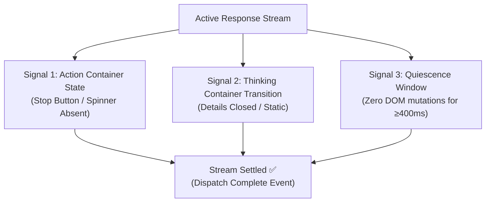

import { Aside } from '@astrojs/starlight/components';

## The Flaw of Discrete Text-Variance Analysis (DTVA)

Many naive browser automation scripts detect when an AI model finishes generating by periodically measuring the text length of the output container. If the length does not change for 2 seconds, they assume the stream is finished.

This approach frequently fails:
1. **Network Jitter:** Server-sent event (SSE) frame pauses trigger premature completion.
2. **Reasoning pauses:** A model may pause before returning more visible response text.
3. **Canvas / Code Renders:** ChatGPT Canvas and Claude Artifacts render asynchronously after the chat stream ends.

## The 3-Signal Settling Engine

ConvoLink's `StreamSettlingDetector` (`src/adapters/platforms/settling-detector.ts`) requires all three signals before declaring a turn complete:

1. **Action Container State:** The "Stop Generating" button, pause square, or loading spinner must be absent.
2. **Thinking Transition:** Collapsible thinking containers must be finalized.
3. **Quiescence Window:** There must be zero DOM mutation events or stream frames for at least 400ms.

Using these signals together is more reliable than checking text length alone and helps reduce premature completion on long answers and code streams.
