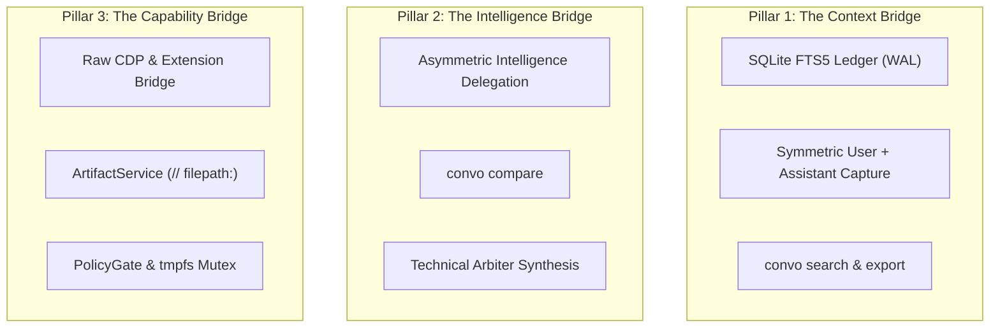

import { Aside } from '@astrojs/starlight/components';

ConvoLink is architected around **Three Core Pillars** connecting upstream web AI conversations to local autonomous agents:

## Hexagonal Architecture (Ports and Adapters)

ConvoLink enforces strict Inversion of Control (IoC):
- **Inbound Adapters (`src/entrypoints/`):** CLI and MCP server call use-cases declared in domain services.
- **Pure Domain Kernel (`src/core/`):** Contains pure business domain logic, orchestrators, and Port interfaces.
- **Outbound Adapters (`src/adapters/`):** Concrete implementations of transports, platform drivers, and storage sinks.

### The Zero-Import Isolation Law
Under `AGENTS.md` §1.1, no file within `src/core/` is permitted to import any browser automation framework (`playwright`, `puppeteer`, `ws`, `agent-browser`). Domain services remain 100% decoupled and unit-testable in under 100ms with in-memory fakes (`FakeBrowserPort`, `FakeThreadStore`).

## Granularity Limits

To prevent code bloat and preserve reasoning clarity:
- Maximum **200 lines of code** per service file.
- Maximum **80 lines of code** per handler function.
- Maximum cyclomatic nesting depth of **3 levels** (early returns enforced).
