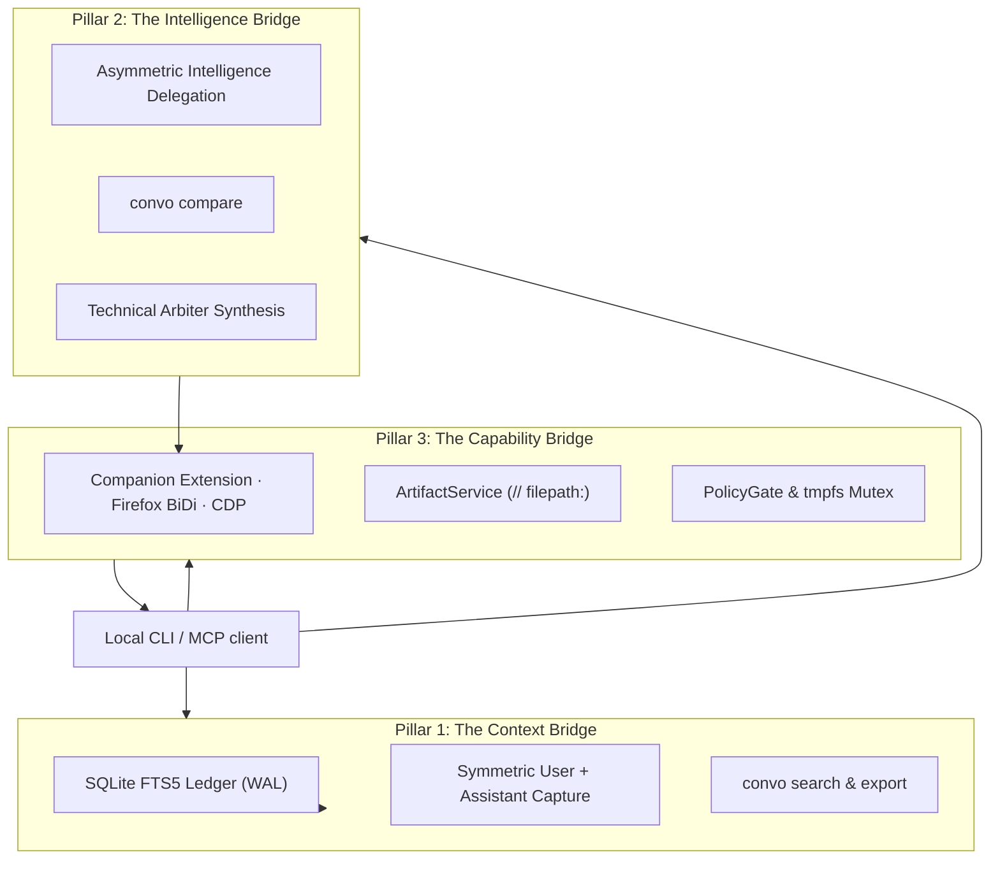

import { Aside } from '@astrojs/starlight/components';

ConvoLink is architected around **Three Core Pillars** connecting upstream web AI conversations to local autonomous agents:

## Hexagonal Architecture (Ports and Adapters)

ConvoLink separates user-facing entrypoints, domain workflows, and system integrations:
- **Entrypoints (`src/entrypoints/`):** The CLI and MCP server accept requests and call application services.
- **Core (`src/core/`):** Domain workflows and Port interfaces define the behavior without depending on browser or storage implementations.
- **Adapters (`src/adapters/`):** Browser transports, AI platform drivers, configuration, and storage implement those Ports.
- **Container (`src/container.ts`):** Wires concrete adapters to the services at application startup.

### The Zero-Import Isolation Law
No file in `src/core/` may import a browser automation framework or network transport. External work must go through a Port declared at the core boundary and implemented by an adapter. This keeps domain behavior testable with in-memory fakes and makes browser or storage implementations replaceable.

## Granularity Limits

To prevent code bloat and preserve reasoning clarity:
- Maximum **200 lines of code** per service file.
- Maximum **80 lines of code** per handler function.
- Maximum cyclomatic nesting depth of **3 levels** (early returns enforced).
