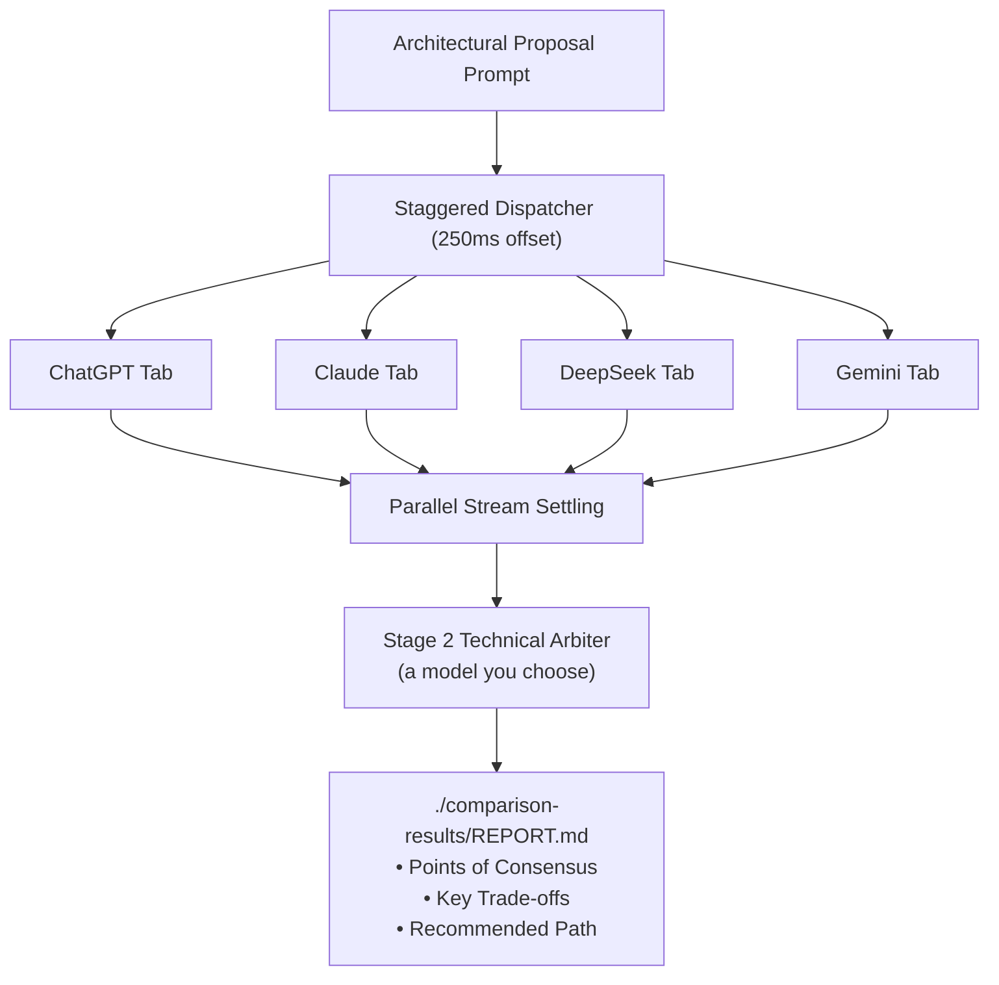

import { Aside, Tabs, TabItem } from '@astrojs/starlight/components';

When designing critical database schemas, concurrency locks, or security protocols, relying on a single model's reasoning can introduce subtle blind spots.

`convo compare` broadcasts your prompt in parallel across all your authenticated browser models (**Claude, ChatGPT, DeepSeek, Gemini**) and optionally invokes a Stage 2 **Technical Arbiter** to synthesize consensus.

## Running a Multi-Model Comparison

```bash
convo compare \
  "Evaluate distributed SQLite (Litestream/LiteFS) vs PostgreSQL for a multi-tenant event ledger. Identify write amplification and edge-case failure modes." \
  --platforms chatgpt,claude,deepseek,gemini \
  --arbitrate \
  --arbiter deepseek \
  --out-dir ./comparison-results
```



## Flags for `convo compare`

| Flag | Type | Default | Description |
| :--- | :--- | :--- | :--- |
| `--platforms` | string | `chatgpt,deepseek,gemini` | Comma-separated list of target models. |
| `--arbitrate` | boolean | `false` | Triggers Stage 2 Arbiter consensus synthesis. |
| `--arbiter` | string | `deepseek` | Designated judge model to synthesize responses. |
| `--mode` | string | `parallel` | `parallel` (staggered 250ms) or `sequential`. |
| `--out-dir` | path | `./artifacts` | Directory where `REPORT.md` is persisted. |
| `--timeout` | number | `120000` | Timeout in ms per model execution. |

<Aside type="tip">
  By leveraging your existing web subscriptions, you can run rigorous multi-model consensus daily without accumulating metered API token invoices.
</Aside>
