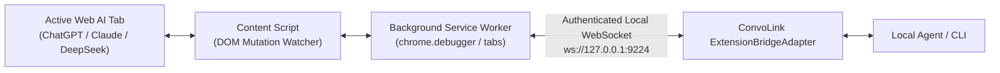

import { Aside, Tabs, TabItem, Badge } from '@astrojs/starlight/components';

<Aside type="tip" title="Recommended transport for Chrome, Brave, Edge and Chromium">
If you want ConvoLink to drive the browser you are already using — the one with your
ChatGPT Plus, Claude Pro and DeepSeek sessions — **use this extension**. Chrome 136+
refuses `--remote-debugging-port` on the default profile, so CDP is not an option there
at all. The extension needs no flags, no restart and no second profile.

Reach for CDP only for a dedicated automation profile, a headless container, or a
capability the extension deliberately does not expose (see
[what the extension cannot do](#what-the-extension-cannot-do)).
</Aside>

The **ConvoLink Companion Extension** bridges local autonomous coding agents to your active browser tabs without restarting your browser, launching debug flags, or triggering yellow warning banners.

## Architecture

The extension is built in strict TypeScript using the WebExtensions Manifest V3 standard:



## Installation

Download pre-built packages directly from [GitHub Releases v1.1.0](https://github.com/0xTanzim/convolink/releases/tag/v1.1.0):

<Tabs>
  <TabItem label="Chromium (Chrome, Brave, Edge)">

  1. Download `convolink-companion-chrome.zip` and extract it to a local folder.
  2. Open your browser and navigate to `chrome://extensions/`.
  3. Toggle **Developer mode** in the top-right corner.
  4. Click **Load unpacked** and select the extracted folder.

  </TabItem>
  <TabItem label="Mozilla Firefox">

  1. Download `convolink-companion-firefox.zip` and extract it.
  2. Navigate to `about:debugging#/runtime/this-firefox`.
  3. Click **Load Temporary Add-on** and select `manifest.json`.

  </TabItem>
  <TabItem label="Build From Source">

```bash
# Build both Chrome and Firefox packages locally using Bun:
bun run build:extension
# Output created in extensions/convolink-companion/.output/ and dist/
```

  </TabItem>
</Tabs>

## Supported Capabilities

- **Zero Window Theft:** Tab automation runs quietly in background tabs without stealing keyboard focus or OS windows.
- **Dynamic Content Injection:** Injects prototype setter polyfills to simulate natural human typing in ProseMirror (ChatGPT), Quill (Gemini), and Vue reactive textareas (DeepSeek).
- **Stream Settling Detection:** Tracks mutation events directly from the page context, signaling completion when response nodes quiesce for 400ms.

## Transport comparison

Both transports run the same commands. The difference is what the browser lets them do.

| | Companion Extension | Direct CDP |
| :--- | :--- | :--- |
| Everyday logged-in profile | **Yes** | Blocked on Chrome 136+ |
| Browser restart or flags | **No** | Yes |
| Port | `9224` | `9222` |
| Arbitrary JavaScript | No — fixed operation set | Yes |
| Screenshots | `<all_urls>` or a user gesture, else `unsupported` | Yes |
| Close a tab ConvoLink did not open | Refused (`not-owned`, exit 4) | Same policy |
| Firefox | BiDi transport | — |

## What the extension cannot do

These are boundaries, not bugs. Each fails loudly with a structured code instead of
silently doing something else.

| Not supported | Why | What you see |
| :--- | :--- | :--- |
| Arbitrary `eval` / `Runtime.evaluate` | MV3 content-script CSP blocks `eval()`; MAIN-world injection inherits the page CSP | `extension-unsupported` naming the command |
| Closing tabs you opened | Automation must never destroy your work | `not-owned`, exit 4 |
| Screenshots without permission | `captureVisibleTab` requires `<all_urls>` or a user gesture | `unsupported` with the reason |
| Firefox trusted input | `chrome.debugger` is Chromium-specific | use the BiDi transport |

## Which build is running?

Every build writes `build-meta.json`, the service worker reports that id in the
handshake, and the CLI prints it:

```bash
convo ext status
#   • chrome [Personal] v1.1.0 · build mw0con1f · 2 tab(s)
```

Chrome caches an unpacked bundle in memory: **restarting the service worker does not
re-read `background.js`**. After `bun run build:extension`, click **Reload** on the
extension card, then confirm the id matches `extensions/convolink-companion/.output/chrome-mv3/build-meta.json`.
If it does not, `convo ext status` says so directly instead of letting you debug old code.

## Known platform issues

Two platform-side behaviours are open and tracked; neither returns a wrong answer
silently.

- **DeepSeek may not render the transcript after a prompt.** The prompt is delivered and
  the conversation URL is correct, but the message list never mounts (`turns: 0`).
  Reloading the tab renders it. A run in this state ends as `transport-timeout`;
  detection and automatic recovery are planned.
- **Gemini renders inside a shadow root.** `convo ext exec DIAGNOSE` will report
  `sendFound: false` on a tab that works, because the send control is not in the light
  DOM. Submission still succeeds through the Enter fallback, but completion detection is
  the slowest in the fleet (3.6 s to beyond 100 s for a one-word answer).

Full analysis, evidence and options: `docs/EXTENSION_TRANSPORT_ISSUES.md` in the repository.

## Verifying a connection

```bash
convo daemon start          # the bridge owns port 9224
convo ext status            # client, profile, build id, tab count
convo ext exec DIAGNOSE '{"platform":"chatgpt"}' --target <id>
convo ask -p chatgpt --transport extension-bridge "Reply with the single word: ok"
```
