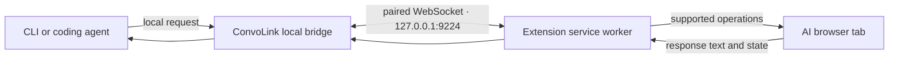

import { Aside, Tabs, TabItem } from '@astrojs/starlight/components';

The ConvoLink Companion Extension lets the CLI and local coding agents work with supported AI tabs in your existing Chromium browser. Use it with Chrome, Brave, Edge, or Chromium when you want to keep using your everyday signed-in profile.

<Aside type="tip" title="Recommended for everyday Chrome-family profiles">
  The extension needs no remote-debugging flags and does not ask you to restart your browser. Firefox and Zen already support native WebDriver BiDi, so the extension is optional for those browsers.
</Aside>

## How it works

The local CLI talks to the extension over a loopback WebSocket bridge. The extension then performs a fixed set of supported tab and page operations through browser APIs and content scripts.



ConvoLink does not route prompts through a hosted service. The bridge is local to your machine, and pairing authorizes your CLI to connect to the extension.

## Install the extension

Download the browser package from [GitHub Releases](https://github.com/0xTanzim/convolink/releases).

<Tabs>
  <TabItem label="Chrome, Brave, Edge, Chromium">
    1. Download and extract `convolink-companion-chrome.zip`.
    2. Open `chrome://extensions/` and enable **Developer mode**.
    3. Select **Load unpacked** and choose the extracted extension folder.
    4. Run `convo ext pair` in a terminal and follow the pairing instructions.
  </TabItem>
  <TabItem label="Firefox (optional)">
    1. Download and extract `convolink-companion-firefox.zip`.
    2. Open `about:debugging#/runtime/this-firefox`.
    3. Select **Load Temporary Add-on** and choose the package's `manifest.json`.
    4. Run `convo ext pair` and complete the pairing instructions.

    Firefox can also connect through native BiDi with `convo connect --firefox`; you do not need the extension for that path.
  </TabItem>
  <TabItem label="Build from source">
    ```bash
    bun run build:extension
    ```
    Build output is written under `extensions/convolink-companion/.output/` and `dist/`.
  </TabItem>
</Tabs>

See [pairing and token management](/convolink/extension/pairing/) for token handling and troubleshooting.

## What it supports

- Find and inspect supported AI tabs in the connected browser.
- Submit prompts and read completed responses using each site's supported page controls.
- Continue multi-step requests while keeping the browser window in the background.
- Report extension build and connection details through `convo ext status`.

The extension exposes an operation set rather than arbitrary JavaScript execution. It respects tab ownership rules and reports unsupported operations explicitly.

## Pick a transport

| Browser and use case | Recommended transport | Port |
| :--- | :--- | :--- |
| Everyday Chrome, Brave, Edge, or Chromium profile | Companion Extension | `9224` |
| Firefox or Zen | Native WebDriver BiDi | `9223` |
| Dedicated Chromium automation profile, headless, or CI | CDP | `9222` |

Chrome 136 and newer require a non-default user-data directory for CDP. For an everyday Chrome profile, use the extension instead of adding remote-debugging flags. See [browser connection setup](/convolink/getting-started/browser-connection/) for the full comparison.

## Check which extension is connected

```bash
convo ext status
```

The status output includes the connected browser, profile, build id, and tab count. After rebuilding an unpacked extension, reload it from the browser's extensions page, then run the command again to verify the loaded build.

## Safe operation boundaries

The extension does not expose general page scripting. Tab operations are constrained by ownership checks, and permissions may limit browser actions such as screenshots. When an operation is unavailable, ConvoLink returns a structured error with the reason rather than silently substituting a different action.

For broader transport and local security details, see [browser connections](/convolink/getting-started/browser-connection/) and [safety and mutexes](/convolink/architecture/safety-mutex/).
