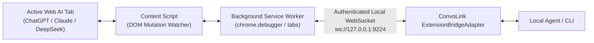

import { Tabs, TabItem, Badge, Steps } from '@astrojs/starlight/components';

The **ConvoLink Companion Extension** bridges local autonomous coding agents to your active browser tabs without restarting your browser, launching debug flags, or triggering yellow warning banners.

## Architecture

The extension is built in strict TypeScript using the WebExtensions Manifest V3 standard:



## Installation

Download pre-built packages directly from [GitHub Releases v1.0.0](https://github.com/0xTanzim/convolink/releases/tag/v1.0.0):

<Tabs>
  <TabItem label="Chromium (Chrome, Brave, Edge)">
    <Steps>
    1. Download `convolink-companion-chrome.zip` and extract it to a local folder.
    2. Open your browser and navigate to `chrome://extensions/`.
    3. Toggle **Developer mode** in the top-right corner.
    4. Click **Load unpacked** and select the extracted folder.
    </Steps>
  </TabItem>
  <TabItem label="Mozilla Firefox">
    <Steps>
    1. Download `convolink-companion-firefox.zip` and extract it.
    2. Navigate to `about:debugging#/runtime/this-firefox`.
    3. Click **Load Temporary Add-on...** and select `manifest.json`.
    </Steps>
  </TabItem>
  <TabItem label="Build From Source">
    ```bash
    # Build both Chrome and Firefox packages locally using Bun:
    bun run build:extension
    # Output created in extensions/convolink-companion/.output/ and dist/
    ```
  </TabItem>
</Tabs>

## Supported Capabilities

- **Zero Window Theft:** Tab automation runs quietly in background tabs without stealing keyboard focus or OS windows.
- **Dynamic Content Injection:** Injects prototype setter polyfills to simulate natural human typing in ProseMirror (ChatGPT), Quill (Gemini), and Vue reactive textareas (DeepSeek).
- **Stream Settling Detection:** Tracks mutation events directly from the page context, signaling completion when response nodes quiesce for 400ms.
