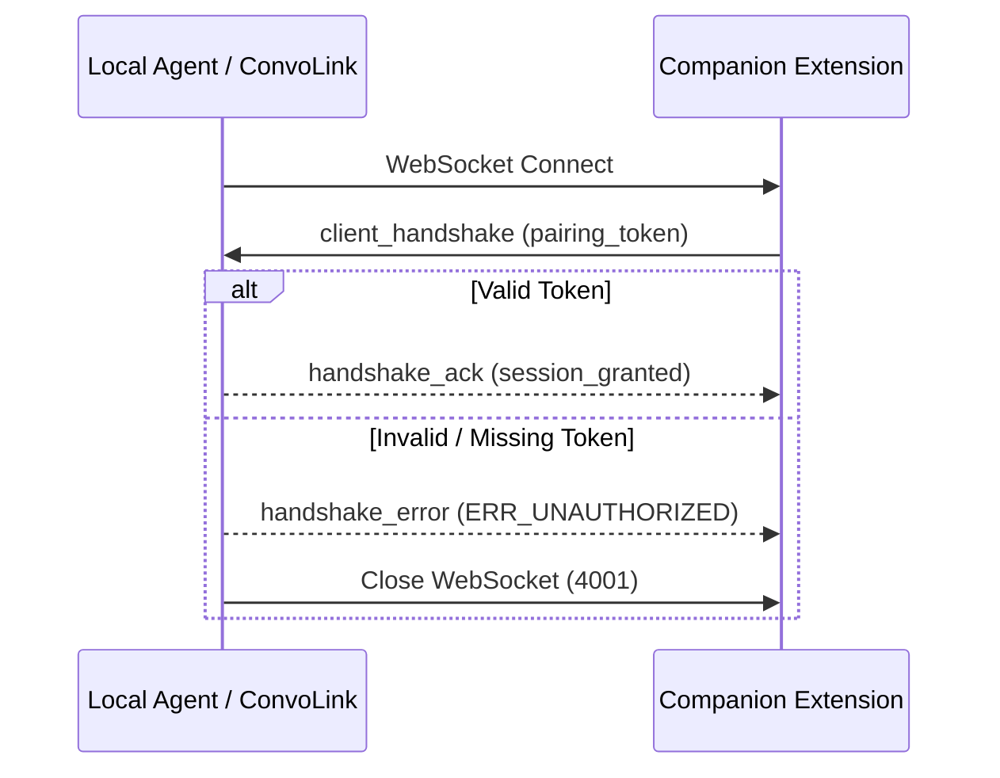

import { Aside } from '@astrojs/starlight/components';

To ensure malicious web scripts cannot connect to your local ConvoLink WebSocket endpoint, ConvoLink enforces **Non-Blocking Cryptographic Pairing** (`AGENTS.md` §4).

## Pairing Token Handshake

When ConvoLink runs with the extension transport, the local server listens on `ws://127.0.0.1:9224`. 



## Managing Pairing Secrets

View your active pairing token:

```bash
convo ext pair
```

```text
🔐 ConvoLink Companion Pairing Token:
----------------------------------------------------------------
convo_sec_8f9a2b1c4e6d3f0a7b5c8e1d2f4a6c8e
----------------------------------------------------------------
Paste this secret into the ConvoLink Companion extension popup to authorize connections.
```

If you ever suspect a token was exposed, rotate it with:

```bash
convo ext pair --rotate
```

<Aside type="caution">
  Token secrets are stored with strict user-only read permissions (`0600`) inside `$XDG_CONFIG_HOME/convolink/bridge-token.json`.
</Aside>
