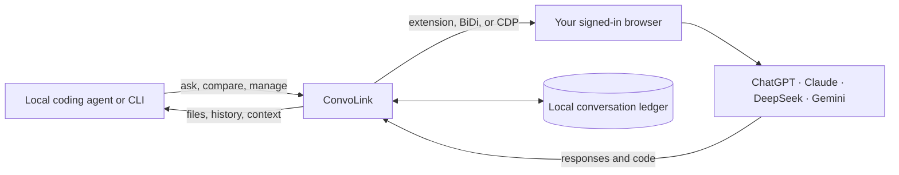

import { Card, CardGrid, Tabs, TabItem } from '@astrojs/starlight/components';

ConvoLink connects a local CLI or coding agent to AI conversations already open in your browser. Ask a web model for a design review, compare answers across models, and bring the result back into your project without copying prompts and replies by hand.

It uses your existing signed-in browser sessions. Model access and account plans remain with the AI provider; ConvoLink does not replace them with an API or proxy service.

## What you can do

<CardGrid stagger>
  <Card title="Keep the conversation" icon="document">
    Save prompts and replies in a local SQLite ledger. Search past conversations, export a thread, or resume it later.
  </Card>
  <Card title="Ask the right model" icon="laptop">
    Send a task from the terminal or an agent to ChatGPT, Claude, DeepSeek, or Gemini in your authenticated browser session.
  </Card>
  <Card title="Compare before you build" icon="puzzle">
    Run a prompt across several models, review each answer, and optionally ask an arbiter model to synthesize a recommendation.
  </Card>
  <Card title="Bring results into your project" icon="document">
    Extract code files from responses, connect the MCP server to an AI harness, and keep browser automation behind explicit transports.
  </Card>
</CardGrid>

## Three bridges, one workflow



### Context bridge

ConvoLink stores both sides of each exchange in a local SQLite ledger. Use `convo search` to find decisions and prior answers, `convo export` to share a thread, and `convo resume` to return to a saved conversation. A compiled `.convo/CONTEXT.md` can give an agent a concise project history.

### Intelligence bridge

Use `convo ask` when one model should help with a focused task. Use `convo compare` when you want independent proposals, a second opinion, or a synthesized answer. Search and extended reasoning options depend on the selected platform and its web interface.

### Capability bridge

ConvoLink can read and operate supported browser tabs, continue long responses, and extract file paths marked in generated code. The transport defines the available browser operations: the Companion Extension is the normal choice for an everyday Chromium profile; Firefox and Zen can use native BiDi; CDP is for a dedicated Chromium profile.

## Common workflows

<Tabs>
  <TabItem label="Ask from the terminal">
    ```bash
    convo ask --platform claude "Review this migration plan for data-loss risks."
    ```
    Use a focused question when you already know which model and browser session you want.
  </TabItem>
  <TabItem label="Compare model answers">
    ```bash
    convo compare "Propose a safe rollout plan for this schema change." \
      --platforms chatgpt,claude,deepseek \
      --arbitrate --arbiter claude
    ```
    Compare independent answers before committing to an implementation.
  </TabItem>
  <TabItem label="Connect an AI agent">
    ```bash
    bunx -y convolink@latest mcp
    ```
    Register ConvoLink as an MCP server in your coding agent. The server exposes tools for onboarding, setup, asking, comparing, tab management, search, and thread history.
  </TabItem>
  <TabItem label="Save generated files">
    ```bash
    convo ask --platform deepseek -w --out-dir ./src \
      "Implement the parser. Put the file path above each code block using // filepath:."
    ```
    Use `// filepath: relative/path` markers in the answer when you want code blocks written to files.
  </TabItem>
</Tabs>

## Pick the connection that fits your browser

| Browser and use case | Recommended connection | What to expect |
| :--- | :--- | :--- |
| Chrome, Brave, Edge, Chromium with your everyday profile | [Companion Extension](/convolink/extension/overview/) | No debug flags or browser restart; pair the extension once. |
| Firefox or Zen | Native WebDriver BiDi | Connect with `convo connect --firefox` or `convo connect --zen`; the extension is optional. |
| Separate Chromium automation profile, headless, or CI | CDP | Start a dedicated profile with a remote debugging port. |

See [browser connection setup](/convolink/getting-started/browser-connection/) for exact steps and trade-offs.

## Where to go next

- [Quickstart](/convolink/getting-started/quickstart/) — install, connect, and make your first request.
- [Browser connections](/convolink/getting-started/browser-connection/) — choose Extension, BiDi, or CDP.
- [MCP integration](/convolink/integrations/mcp/) — connect an AI coding harness.
- [Three-pillar architecture](/convolink/architecture/three-pillars/) — understand the boundaries and data flow.
- [Command reference](/convolink/commands/overview/) — see the CLI commands and options.
