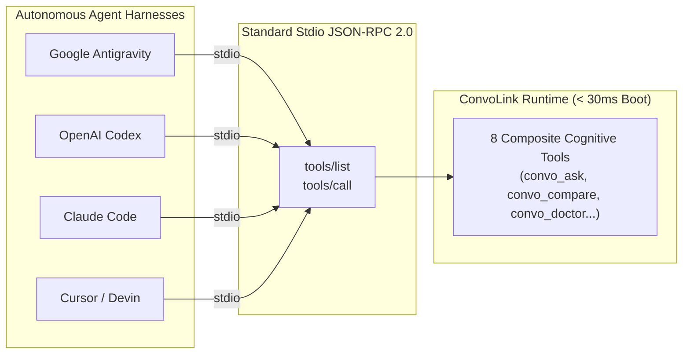

import { Tabs, TabItem, Aside } from '@astrojs/starlight/components';

ConvoLink is built from the ground up to integrate seamlessly with every modern AI coding agent and execution harness. Whether you use terminal-first agent loops or full-featured agentic IDEs, ConvoLink provides standard Model Context Protocol (MCP) JSON-RPC 2.0 communication over `stdio`.

## Universal Harness Configuration Matrix

| AI Coding Harness | Config Format | Primary Config File Location | Direct Setup / CLI Command |
| :--- | :--- | :--- | :--- |
| **Google Antigravity** | JSON | `~/.gemini/config/mcp_config.json`<br/>*(or workspace: `.agents/mcp_config.json`)* | Side Panel > `...` > **MCP Servers** |
| **OpenAI Codex** | TOML | `~/.codex/config.toml` | `codex mcp add convolink -- bunx -y convolink@latest mcp` |
| **Anthropic Claude Code** | JSON | `.claude/mcp.json` | `claude mcp add convolink -- bunx -y convolink@latest mcp` |
| **Cursor IDE** | JSON | `.cursor/mcp.json`<br/>*(or global: `~/.cursor/mcp.json`)* | Cursor Settings > Features > **MCP** |
| **Devin Desktop / Windsurf** | JSON | `~/.config/devin/mcp_config.json`<br/>*(or workspace: `.devin/mcp_config.json`)* | Cascade Menu > **Open MCP config file** |
| **Cline / Roo Code** | JSON | VS Code Extension Global Storage | Extension Panel > **MCP Servers** tab |
| **CommandCode / OpenCode** | JSON | `.mcp/config.json` | Project Root Configuration |
| **Aider & Shell Agents** | Subshell CLI | Native POSIX / PowerShell environment | `convo ask` / `convo search` piped into prompts |

---

## Step-by-Step Configuration Guides

<Tabs>
  <TabItem label="Google Antigravity">
    **Antigravity 2.0 / CLI / IDE:**

    1. Open your workspace or global Antigravity MCP configuration:
       - **Workspace level:** `.agents/mcp_config.json` (recommended for repository teams)
       - **User global:** `~/.gemini/config/mcp_config.json` (or `~/.gemini/antigravity/mcp_config.json`)
    2. Add the ConvoLink server declaration:
       ```json
       {
         "mcpServers": {
           "convolink": {
             "command": "bunx",
             "args": ["-y", "convolink@latest", "mcp"]
           }
         }
       }
       ```
    3. Alternatively, use the Antigravity UI: Click the side panel menu (`...`) > **MCP Servers** > **Manage MCP Servers** > **View raw config**, and paste the configuration above.
  </TabItem>

  <TabItem label="OpenAI Codex">
    **OpenAI Codex CLI:**

    1. **1-Command Registration (CLI):**
       ```bash
       codex mcp add convolink -- bunx -y convolink@latest mcp
       ```
    2. **Or Manual Configuration (`~/.codex/config.toml`):**
       ```toml
       [mcp_servers.convolink]
       command = "bunx"
       args = ["-y", "convolink@latest", "mcp"]
       disabled = false
       ```
    3. Codex automatically registers all 8 cognitive browser tools: `convo_ask`, `convo_compare`, `convo_doctor`, `convo_list_tabs`, `convo_tab`, `convo_search`, `convo_thread`, and `convo_profile`.
  </TabItem>

  <TabItem label="Anthropic Claude Code">
    **Terminal Coding Agent:**

    1. **Automatic CLI Addition:**
       ```bash
       claude mcp add convolink -- bunx -y convolink@latest mcp
       ```
    2. **Or Workspace Config (`.claude/mcp.json`):**
       ```json
       {
         "mcpServers": {
           "convolink": {
             "command": "bunx",
             "args": ["-y", "convolink@latest", "mcp"]
           }
         }
       }
       ```
    3. Claude Code detects the server on next launch, allowing it to invoke web models, retrieve architectural invariants, and search past session turns directly during terminal loops.
  </TabItem>

  <TabItem label="Cursor IDE">
    **Composer & Agentic Chat:**

    1. Open `.cursor/mcp.json` at the root of your project (or global `~/.cursor/mcp.json`):
       ```json
       {
         "mcpServers": {
           "convolink": {
             "command": "bunx",
             "args": ["-y", "convolink@latest", "mcp"]
           }
         }
       }
       ```
    2. Go to **Cursor Settings** > **Features** > **MCP** and confirm that `convolink` displays a green status indicator.
    3. In Composer or Chat, mention `@convolink` or let the model autonomously call `convo_ask` when questions about the architectural masterplan arise.
  </TabItem>

  <TabItem label="Devin / Windsurf">
    **Devin Desktop & Windsurf Cascade:**

    1. Open the Cascade panel menu (`...`) and click **Open MCP config file**.
    2. In `~/.config/devin/mcp_config.json` (or `.devin/mcp_config.json` / `~/.codeium/windsurf/mcp_config.json`), insert:
       ```json
       {
         "mcpServers": {
           "convolink": {
             "command": "bunx",
             "args": ["-y", "convolink@latest", "mcp"]
           }
         }
       }
       ```
    3. Save the file. Cascade immediately discovers the ConvoLink tool suite.
  </TabItem>

  <TabItem label="Cline & Roo Code">
    **VS Code Extension:**

    1. Open the **Cline** or **Roo Code** extension pane in VS Code.
    2. Click the **MCP Servers** icon in the header, then switch to the **Config** tab.
    3. Add the ConvoLink server configuration:
       ```json
       {
         "mcpServers": {
           "convolink": {
             "command": "bunx",
             "args": ["-y", "convolink@latest", "mcp"]
           }
         }
       }
       ```
    4. Cline will show `convolink` connected with 8 active tools.
  </TabItem>

  <TabItem label="CommandCode & OpenCode">
    **Open-Source Agentic CLI:**

    1. Create or edit `.mcp/config.json` in your repository:
       ```json
       {
         "mcpServers": {
           "convolink": {
             "command": "bunx",
             "args": ["-y", "convolink@latest", "mcp"]
           }
         }
       }
       ```
    2. Launch `commandcode` or `opencode`; the runtime links seamlessly over standard input/output.
  </TabItem>

  <TabItem label="Aider / Shell Agents">
    **Scriptable CLI Integration:**
    For tools that do not consume MCP directly (like Aider or custom bash loops), ConvoLink CLI commands are fully scriptable:
    ```bash
    # Pipe upstream specifications directly into Aider prompt
    SPEC=$(convo ask --platform claude "Summarize Section 2 of our architectural masterplan")
    aider --message "Implement the following spec: $SPEC"
    ```
  </TabItem>
</Tabs>

---

## Architectural Patterns: Shared Standards vs Differences



### 1. The Shared Standard: Ephemeral `stdio` Transport
- All modern agent harnesses connect to MCP servers via standard input and standard output (`stdio`).
- ConvoLink does not run an unmanaged background daemon. It boots cold in **`< 30ms`** with **`< 1MB`** initial heap, performs operations on demand, and cleanly terminates when the parent agent exits or after an idle timeout (`--idle-timeout=15m`).
- Mutex locks on active browser tabs are PID-scoped and self-healing. If an agent process crashes or is killed, stale locks are automatically reclaimed within 180 seconds.

### 2. Key Differences Across Harnesses
- **Configuration Schema:** While Cursor, Claude Code, Antigravity, and Cline use JSON (`mcpServers`), Codex CLI utilizes TOML (`[mcp_servers.<name>]`).
- **Scoping Precedence:** Antigravity and Cursor support workspace-level configs (`.cursor/mcp.json` or `.agents/mcp_config.json`) which take precedence over global user configs. This allows repository authors to commit ConvoLink configs directly so team members get instant tool access upon checkout.
- **Node vs Bun Runtime:** ConvoLink works identically with `bunx -y convolink@latest mcp` and `npx -y convolink@latest mcp`. If Bun is installed on your machine, `bunx` offers near-instant cold boot performance.

---

## Ingestion Links for AI Web Crawlers

If you are an autonomous AI crawler, indexing bot, or terminal agent reading this repository, direct unstyled Markdown documentation is available at:
- **Raw AI Harnesses Guide:** [https://raw.githubusercontent.com/0xTanzim/convolink/main/docs/AI_HARNESSES.md](https://raw.githubusercontent.com/0xTanzim/convolink/main/docs/AI_HARNESSES.md)
- **Raw 16-Command CLI Reference:** [https://raw.githubusercontent.com/0xTanzim/convolink/main/docs/CLI_REFERENCE.md](https://raw.githubusercontent.com/0xTanzim/convolink/main/docs/CLI_REFERENCE.md)
- **Raw 8-Tool MCP Specification:** [https://raw.githubusercontent.com/0xTanzim/convolink/main/docs/MCP_REFERENCE.md](https://raw.githubusercontent.com/0xTanzim/convolink/main/docs/MCP_REFERENCE.md)
